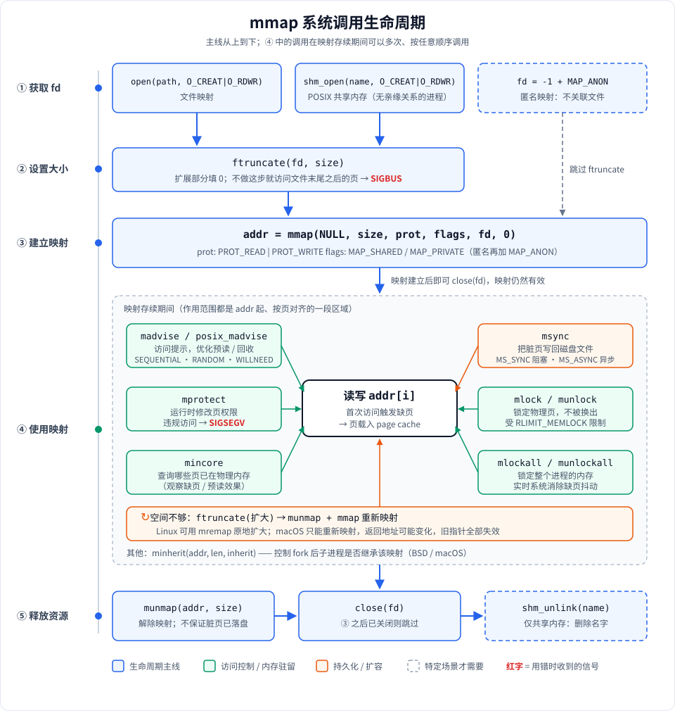
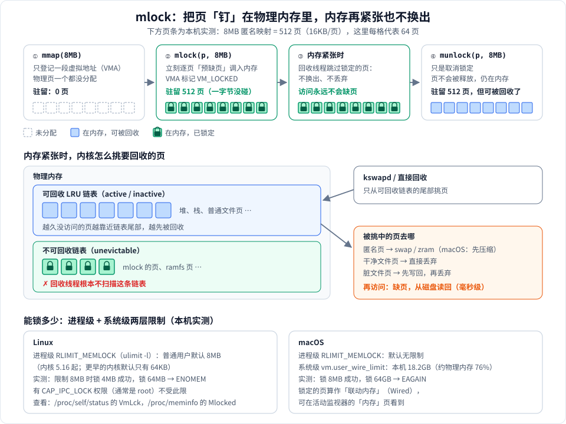
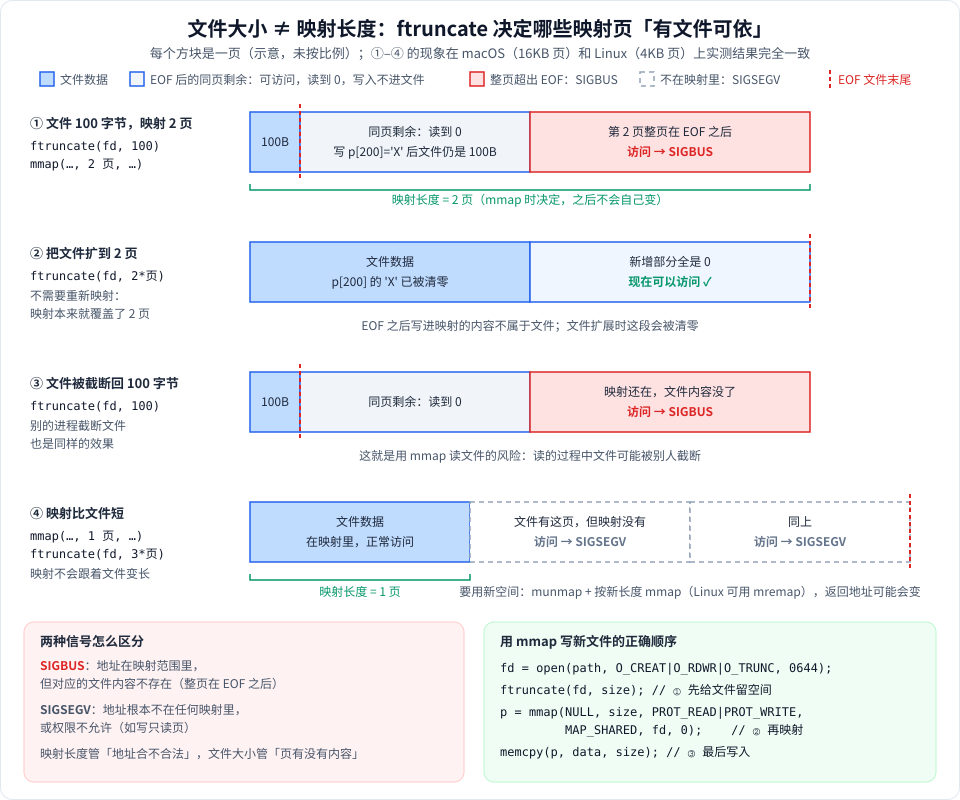

# 用到的系统调用：msync / mprotect / madvise / mlock / ftruncate

`mmap` 只负责**建立映射**。映射建好之后，什么时候落盘、能不能写、怎么预读、会不会被换出、文件够不够大，分别由这 5 个系统调用控制：

| 系统调用     | 一句话作用                 | 解决什么问题                        | 项目里的封装                      |
|--------------|----------------------------|-------------------------------------|-----------------------------------|
| `msync`      | 把映射里的修改**写回文件** | 断电或崩溃后数据不丢                | `MmapRegion::sync()`              |
| `mprotect`   | 运行时**修改页权限**       | 防止误写、JIT、栈保护页             | `MmapRegion::protect()`           |
| `madvise`    | 告诉内核**我打算怎么访问** | 预读更准、及时释放内存              | `MmapRegion::advise()`            |
| `mlock`      | 把页**锁在物理内存里**     | 不被换出到 swap、延迟稳定           | `MmapRegion::lock()` / `unlock()` |
| `ftruncate`  | **设置文件大小**           | 映射前给文件"留出空间"，避免 SIGBUS | `FileDescriptor::truncate()`      |

以上都定义在 [mmap_wrapper.hpp](../src/mmap_wrapper.hpp)，对应的演示代码集中在 [stage2_syscalls.cpp](../src/stage2/stage2_syscalls.cpp)。

除 `ftruncate` 外，这些调用作用的地址都必须**按页对齐**（`addr` 是页大小的整数倍）。返回值都是：成功返回 `0`，失败返回 `-1` 并设置 `errno`。

## 全景图：这些调用怎么串起来



- **①→②→③ 建立**：先拿到 fd（`open` 普通文件 / `shm_open` 共享内存 / 匿名映射不需要 fd），再用 `ftruncate` 给文件留出空间，最后 `mmap` 得到 `addr`。
- **④ 使用**：映射存续期间，围绕"读写 `addr[i]`"可以随时调用 `madvise`、`mprotect`、`msync`、`mlock` 等；空间不够时走扩容回路。
- **⑤ 释放**：`munmap` → `close` →（共享内存才需要）`shm_unlink`。

图中的函数都声明在 `<sys/mman.h>`（`ftruncate` / `close` 在 `<unistd.h>`）。`mincore`、`minherit`、`mlockall` 本项目没有用到，画出来是为了补全头文件里的这一族调用。

---

## 1. msync —— 把修改写回文件

```c
int msync(void *addr, size_t length, int flags);
```

### 为什么需要它

用 `MAP_SHARED` 映射文件后，`ptr[0] = 'X'` 修改的其实是 **page cache 里的页**，内核会把这个页标记为"脏页"，然后**在之后某个时间**再写回磁盘（Linux 默认大约 30 秒内）。如果这期间机器断电，修改就丢了。

`msync` 的作用就是"现在立刻把脏页写回去"。

```
你的进程 ──写──▶ page cache（脏页）──msync / 内核回写──▶ 磁盘文件
```

### 参数 flags

| 标志 | 含义 |
|---|---|
| `MS_SYNC` | **阻塞**，直到数据真正写到磁盘才返回。可靠但慢 |
| `MS_ASYNC` | 只是安排回写，**立即返回**。快，但返回时不保证已经落盘 |
| `MS_INVALIDATE` | 让同一文件的其他映射失效，重新读取最新内容（很少用） |

### 常见误区

- **munmap 不等于落盘**：解除映射后脏页仍留在 page cache，由内核择机回写。数据不会丢（除非断电），但也不保证已经写到磁盘。
- **其他进程不需要 msync 也能看到修改**：同一文件的多个 `MAP_SHARED` 映射共享同一组 page cache 页，修改对它们是立即可见的。msync 解决的是**持久化**问题，不是**可见性**问题。
- **对 `MAP_PRIVATE` 和匿名映射调用 msync 没有意义**：它们没有可以写回的文件。

### 实际应用

- **LMDB**：提交事务时调用 msync 保证持久化（或者使用 `fdatasync`）。
- **MMKV、xlog**（微信的 KV 存储和日志库）：平时只写映射，靠内核回写；在关键时刻（比如 App 切到后台）才主动 msync，在性能和可靠性之间折中。
- **本项目**：[stage1 `demo_write_shared`](../src/stage1/stage1_basic.cpp)、[stage2 `demo_msync`](../src/stage2/stage2_syscalls.cpp)、[stage9 `SimpleKVStore::put`](../src/stage9/stage9_projects.cpp) 每次写完都会 `MS_SYNC`。

---

## 2. mprotect —— 运行时修改页权限

```c
int mprotect(void *addr, size_t len, int prot);
```

### 为什么需要它

`mmap` 的 `prot` 参数只决定**初始**权限。mprotect 可以在运行过程中随时改变它：

| prot | 读 | 写 | 执行 |
|---|---|---|---|
| `PROT_NONE` | ✗ | ✗ | ✗ |
| `PROT_READ` | ✓ | ✗ | ✗ |
| `PROT_READ \| PROT_WRITE` | ✓ | ✓ | ✗ |
| `PROT_READ \| PROT_EXEC` | ✓ | ✗ | ✓ |

违反权限的访问会被 MMU 拦截，内核向进程发送 **SIGSEGV**（macOS 上有时是 SIGBUS）。

### 注意点

- 新权限不能超过文件的打开方式：用 `O_RDONLY` 打开的文件，`MAP_SHARED` 映射后无法通过 mprotect 加上 `PROT_WRITE`，会返回 `EACCES`。
- 只修改一部分页的权限时，内核会把原来的一个 VMA（内核里描述一段映射区域的结构）**拆分**成几段，在 `/proc/self/maps` 里能看到（见 [stage7](../src/stage7/stage7_kernel.cpp)）。

### 实际应用

- **JIT 编译器（V8、JVM、LuaJIT）**：先用 `RW` 权限写入生成的机器码，再改成 `RX` 执行。同一时刻一块内存不能既可写又可执行，这就是安全上的 **W^X** 原则。
- **栈保护页（guard page）**：线程栈底部放一页 `PROT_NONE`，栈一旦溢出就会立刻崩溃，而不是悄悄覆盖相邻内存。
- **内存调试工具**：Electric Fence 这类工具把每次分配的末尾紧挨一个 `PROT_NONE` 页，越界写入时当场触发崩溃。
- **保护只读数据**：初始化完成后把配置表改成 `PROT_READ`，防止后续代码误改。
- **本项目**：[stage2 `demo_mprotect`](../src/stage2/stage2_syscalls.cpp) 把页改为只读后再写入，用 `sigsetjmp`/`siglongjmp` 捕获信号，演示写入被拦截的过程。

---

## 3. madvise —— 告诉内核访问模式

```c
int madvise(void *addr, size_t length, int advice);
```

### 为什么需要它

内核不知道你打算怎么用这块内存，只能靠猜测来预读和回收。madvise 是给内核的**提示**，属于优化手段，不影响程序是否正确（`MADV_DONTNEED` 除外，见下文）。

### 常用 advice

| advice            | 含义                   | 内核的反应 |
|-------------------|------------------------|---|
| `MADV_NORMAL`     | 默认                   | 适度预读 |
| `MADV_SEQUENTIAL` | 我会**从头到尾顺序读** | 加大预读量，读过的页可以尽早回收 |
| `MADV_RANDOM`     | 我会**随机跳着读**     | 关闭预读，避免读进用不到的数据 |
| `MADV_WILLNEED`   | 这段**马上要用**       | 提前把页读入 page cache |
| `MADV_DONTNEED`   | 这段**暂时不用了**     | 释放物理页（见下方说明） |

### `MADV_DONTNEED` 在不同平台上的差异

- **Linux**：立即丢弃这些页。下次访问时，匿名映射读到的是**全 0**，文件映射会**从文件重新读入**。如果是 `MAP_PRIVATE` 映射，之前做过的修改也会丢失。这一行为会影响程序结果。
- **macOS**：只是提示，内核不一定会马上丢弃，内容可能还在。

### 实际应用

- **grep、ripgrep、文件拷贝**：对大文件用 `MADV_SEQUENTIAL`，读得更快，也不会挤占 page cache。
- **数据库索引（B+ 树）**：用 `MADV_RANDOM`，避免预读浪费 I/O。
- **jemalloc、tcmalloc**：把空闲的大块内存用 `MADV_DONTNEED` 或 `MADV_FREE` 还给系统，降低 RSS，但保留虚拟地址以便复用。
- **本项目**：[stage2 `demo_madvise`](../src/stage2/stage2_syscalls.cpp) 用策略模式切换不同的 advice。[stage9 `MiniGrep`](../src/stage9/stage9_projects.cpp) 搜索前调用 `advise(MADV_SEQUENTIAL)`。

---

## 4. mlock / munlock —— 锁在物理内存中

```c
int mlock(const void *addr, size_t len);
int munlock(const void *addr, size_t len);
```



### 先看不锁会怎样：页随时可能被"请出"内存

你的程序觉得自己的数据"在内存里"，其实内核随时可能把它挪走。内存紧张时，回收线程（Linux 叫 kswapd）会从**可回收链表**的尾部（最久没被访问的页）挑页，按页的类型处理：

| 页的类型 | 被回收时 | 再次访问时 |
|---|---|---|
| 匿名页（堆、栈、`MAP_ANONYMOUS`） | 写到 swap / zram；macOS 先压缩 | 缺页，从 swap 读回或解压 |
| 干净的文件页 | 直接丢弃（磁盘上有原件） | 缺页，从文件读回 |
| 脏的文件页 | 先写回文件，再丢弃 | 缺页，从文件读回 |

对绝大多数程序来说这完全没问题，这正是虚拟内存的好处。但有两类程序受不了：

1. **怕慢的**：一次从磁盘读回的缺页要几毫秒。音频处理每 5ms 就要交一帧数据，高频交易按微秒计时，一次缺页就足以出错。
2. **怕泄露的**：私钥、密码一旦被换出到 swap 分区，就以明文留在磁盘上，关机后仍能被读出来。

### mlock 做了什么

`mlock(addr, len)` 对这段地址做两件事：

1. **立刻把所有页调入内存**。不管你之前有没有访问过，内核逐页"预缺页"，把物理页分配好、文件内容读进来。返回后，这段内存的每一页都已经在物理内存里。
2. **把这些页标记为锁定**。内核给这段映射（VMA）打上 `VM_LOCKED` 标记，并把页从可回收链表移到**不可回收链表（unevictable）**。回收线程根本不扫描这条链表，所以这些页不会被换出、也不会被丢弃。

结果是：**之后访问这段内存，永远不会因为缺页而等磁盘**。

`munlock(addr, len)` 只做相反的第 2 件事：去掉锁定标记，页回到可回收链表。**页本身不会被释放**，仍然留在内存里，只是从此又可以被回收了。

### 本机实测

用 `mincore` 统计一段 8MB 匿名映射有多少页在物理内存里（macOS，16KB 页，共 512 页）：

```
RLIMIT_MEMLOCK: 无限制
页大小 16384，共 512 页
1. mmap 之后         驻留    0 页
2. mlock 返回 0
   mlock 之后        驻留  512 页（一个字节都没访问）
3. munlock 返回 0
   munlock 之后      驻留  512 页（解锁不等于释放）
4. mlock 64GB 返回 -1 (Resource temporarily unavailable)
```

在 Ubuntu 24.04 容器里，用普通用户、`ulimit -l` 为 8MB 运行同样的逻辑（4KB 页），还能从 `/proc/self/status` 的 `VmLck` 看到锁定量：

```
RLIMIT_MEMLOCK: 8388608 字节
1. mmap 之后 驻留 0 页  VmLck:       0 kB
2. mlock 4MB 返回 0  驻留 1024 页  VmLck:    4096 kB
3. munlock 后 驻留 1024 页  VmLck:       0 kB
4. mlock 64MB 返回 -1 (Cannot allocate memory)
```

两边结论一致：**mlock 立刻让页全部驻留；munlock 后页还在，只是不再计入锁定量；超出限制会失败**。

<details>
<summary>实验代码（macOS 版）</summary>

```cpp
// c++ -std=c++17 -o mlock_demo mlock_demo.cpp
#include <cerrno>
#include <cstdio>
#include <cstring>
#include <sys/mman.h>
#include <sys/resource.h>
#include <unistd.h>
#include <vector>

static size_t resident(void *p, size_t size, long page) {
    std::vector<char> vec(size / page);
    mincore(p, size, vec.data());
    size_t n = 0;
    for (char v : vec) n += (v & MINCORE_INCORE) ? 1 : 0;   // Linux 上写 (v & 1)
    return n;
}

int main() {
    long page = sysconf(_SC_PAGESIZE);
    struct rlimit rl {};
    getrlimit(RLIMIT_MEMLOCK, &rl);
    if (rl.rlim_cur == RLIM_INFINITY) printf("RLIMIT_MEMLOCK: 无限制\n");
    else printf("RLIMIT_MEMLOCK: %llu 字节\n", (unsigned long long)rl.rlim_cur);

    const size_t size = 8UL << 20;   // 8MB
    void *p = mmap(nullptr, size, PROT_READ | PROT_WRITE, MAP_PRIVATE | MAP_ANON, -1, 0);
    printf("页大小 %ld，共 %zu 页\n", page, size / page);
    printf("1. mmap 之后         驻留 %4zu 页\n", resident(p, size, page));

    int r = mlock(p, size);
    printf("2. mlock 返回 %d %s\n", r, r == 0 ? "" : strerror(errno));
    printf("   mlock 之后        驻留 %4zu 页（一个字节都没访问）\n", resident(p, size, page));

    r = munlock(p, size);
    printf("3. munlock 返回 %d\n", r);
    printf("   munlock 之后      驻留 %4zu 页（解锁不等于释放）\n", resident(p, size, page));

    const size_t huge = 64UL << 30;  // 64GB，故意超过限制
    void *q = mmap(nullptr, huge, PROT_READ | PROT_WRITE, MAP_PRIVATE | MAP_ANON, -1, 0);
    r = mlock(q, huge);
    printf("4. mlock 64GB 返回 %d (%s)\n", r, r == 0 ? "ok" : strerror(errno));
    munmap(q, huge);
    munmap(p, size);
}
```

</details>

### 能锁多少：两层限制

锁住的内存谁也回收不了，锁太多会让整个系统没内存可用，所以操作系统有两层限制：

| | Linux | macOS |
|---|---|---|
| 进程级 | `RLIMIT_MEMLOCK`（`ulimit -l`）。普通用户默认 **8MB**（内核 5.16 起；更早只有 64KB） | `RLIMIT_MEMLOCK` 默认**无限制** |
| 系统级 | 物理内存本身 | `vm.user_wire_limit`：本机 18.2GB，约为物理内存的 76% |
| 超出时 | `ENOMEM` | `EAGAIN`（Resource temporarily unavailable） |
| 绕过限制 | 有 `CAP_IPC_LOCK` 能力（通常是 root）。注意 Docker 容器默认会去掉这个能力，容器里的 root 同样受限 | — |
| 怎么看锁了多少 | 进程：`/proc/<pid>/status` 的 `VmLck`；全局：`/proc/meminfo` 的 `Mlocked` | 活动监视器"内存"页的「联动内存」（Wired） |

需要锁大量内存的服务（比如数据库）通常在 systemd 配置里写 `LimitMEMLOCK=infinity`，或在 `/etc/security/limits.conf` 里给用户调高 `memlock`。

### 容易误解的几点

| 误解 | 实际 |
|---|---|
| munlock 会释放内存 | 不会。只是取消锁定，页仍在内存，以后可以被回收 |
| mlock 两次要 munlock 两次 | 不用。锁定不计数，同一段地址 mlock 多少次，一次 munlock 就全部解锁 |
| 锁定后物理地址就固定了 | 不保证。Linux 做内存规整（compaction）时仍可能把锁定页迁移到别的物理页框，只保证"一直在内存里"。需要固定物理地址（如 DMA）要用驱动层的机制 |
| 锁定的文件页就不会写回了 | 会写回。锁定只是不被**丢弃**，脏页照样会被 msync / 回写线程写回磁盘 |
| fork 出的子进程也锁着 | 不会。子进程不继承内存锁 |
| 要记得 munlock 才能退出 | 不用。`munmap` 或进程退出时，锁自动解除 |

### mlockall：锁住整个进程

```c
mlockall(MCL_CURRENT | MCL_FUTURE);
```

- `MCL_CURRENT`：锁住进程当前**已有**的所有映射（代码、堆、栈、共享库……）。
- `MCL_FUTURE`：以后**新建**的映射（新的 malloc、mmap、栈增长）也自动锁定。

实时程序通常在启动阶段调用一次，然后预先访问一遍需要的内存，此后运行期间就不会再出现缺页。代价是整个进程的内存都不能被回收，必须确保进程本身占用不大。

### 实际应用

- **密码学库（OpenSSL、libsodium 的 `sodium_mlock`）、GPG**：存放私钥的内存要 mlock，防止被写进 swap。
- **实时系统、高频交易、音频处理**：用 `mlockall` 消除缺页带来的延迟抖动。
- **数据库**：部分数据库可以配置锁住 buffer pool。
- **本项目**：[stage2 `demo_mlock`](../src/stage2/stage2_syscalls.cpp#L237)，[stage7 观察者 demo](../src/stage7/stage7_kernel.cpp) 也会把 lock 事件打印出来。

---

## 5. ftruncate —— 设置文件大小

```c
int ftruncate(int fd, off_t length);
```



### 先分清两个"长度"

用 mmap 映射文件时，有两个各自独立的长度，初学时最容易混在一起：

| | 由谁决定 | 管什么 | 越界后果 |
|---|---|---|---|
| **映射长度** | `mmap` 的 `length` 参数，**映射建立后就固定了** | 哪些虚拟地址是合法的 | 访问映射范围之外 → **SIGSEGV** |
| **文件大小** | `ftruncate`、`write` 追加、别的进程截断…… **随时可能变** | 映射里的哪些页"有文件内容可依" | 整页落在文件末尾（EOF）之后 → **SIGBUS** |

`ftruncate(fd, length)` 改的就是第二个：把文件设成 `length` 字节，变长时新增部分全部填 0，变短时多出的部分被删掉。它**不会碰任何已有的映射**，但会改变映射里每一页的"命运"。

### 本机实测：一个 2 页的映射，文件大小变来变去

下面的程序先把文件设为 100 字节，映射 2 页，然后反复改文件大小，用 `sigsetjmp` 捕获信号记录每次访问的结果（用法见 [2-sigjmp_buf的用法.md](2-sigjmp_buf的用法.md)）。macOS 和 Ubuntu 24.04 的输出完全一致（只有页大小不同）：

```
页大小 16384；文件 100 字节，映射 2 页
A. 读 p[50]（文件内）        : ok
B. 读 p[200]（同页、文件外） : ok, 值=0
   写 p[200]='X' 后文件大小  : 100（没变）
C. 读 p[page]（第 2 页）     : SIGBUS
D. ftruncate 扩到 2 页后读 p[page]（不重新映射）: ok, 值=0
   此时 p[200] = 0（扩展时文件尾被清零，之前写的 X 没了）
E. ftruncate 缩回 100 字节后读 p[page]: SIGBUS
```

逐条对照上图：

- **A、B（图 ①）**：文件只有 100 字节，但内核以**页**为单位映射，所以第 0 页整页都能访问。100 字节之后的部分读到 0；往里写也不报错，但**写的内容不属于文件**，文件大小还是 100。
- **C（图 ①）**：第 1 页整页都在文件末尾之后，没有任何文件内容与它对应，访问触发 **SIGBUS**。
- **D（图 ②）**：`ftruncate` 把文件扩到 2 页后，**不用重新映射**，第 1 页立刻就能访问，因为映射本来就覆盖了 2 页，缺的只是文件内容。新增部分全是 0。之前写在 EOF 之后的 `'X'` 也被清零了，再次说明它从来不属于文件。
- **E（图 ③）**：把文件截回 100 字节，第 1 页又变回 SIGBUS。映射还在，文件内容没了。如果截断文件的是**别的进程**，你的进程照样会在访问时崩溃，这是用 mmap 读文件的一大风险。

<details>
<summary>实验代码</summary>

```cpp
// c++ -std=c++17 -o trunc trunc.cpp
#include <csetjmp>
#include <csignal>
#include <cstdio>
#include <fcntl.h>
#include <sys/mman.h>
#include <sys/stat.h>
#include <unistd.h>

static sigjmp_buf g_jmp;
static void on_sig(int) { siglongjmp(g_jmp, 1); }

// 尝试读 p[off]，返回是否成功
static bool try_read(volatile char *p, size_t off, char *out) {
    if (sigsetjmp(g_jmp, 1) == 0) { *out = p[off]; return true; }
    return false;
}
static off_t fsize(int fd) { struct stat st{}; fstat(fd, &st); return st.st_size; }

int main() {
    struct sigaction sa{}; sa.sa_handler = on_sig; sigemptyset(&sa.sa_mask);
    sigaction(SIGBUS, &sa, nullptr); sigaction(SIGSEGV, &sa, nullptr);
    long page = sysconf(_SC_PAGESIZE);
    const char *path = "/tmp/trunc_demo.bin";
    int fd = open(path, O_CREAT | O_RDWR | O_TRUNC, 0644);
    ftruncate(fd, 100);
    volatile char *p = (volatile char *)mmap(nullptr, 2 * page, PROT_READ | PROT_WRITE, MAP_SHARED, fd, 0);
    char c;
    printf("页大小 %ld；文件 %lld 字节，映射 2 页\n", page, (long long)fsize(fd));
    printf("A. 读 p[50]（文件内）        : %s\n", try_read(p, 50, &c) ? "ok" : "SIGBUS");
    bool ok = try_read(p, 200, &c);
    printf("B. 读 p[200]（同页、文件外） : %s, 值=%d\n", ok ? "ok" : "SIGBUS", ok ? c : -1);
    p[200] = 'X';
    printf("   写 p[200]='X' 后文件大小  : %lld（没变）\n", (long long)fsize(fd));
    printf("C. 读 p[page]（第 2 页）     : %s\n", try_read(p, page, &c) ? "ok" : "SIGBUS");
    ftruncate(fd, 2 * page);
    printf("D. ftruncate 扩到 2 页后读 p[page]（不重新映射）: %s, 值=%d\n", try_read(p, page, &c) ? "ok" : "SIGBUS", c);
    ok = try_read(p, 200, &c);
    printf("   此时 p[200] = %d（扩展时文件尾被清零，之前写的 X 没了）\n", c);
    ftruncate(fd, 100);
    printf("E. ftruncate 缩回 100 字节后读 p[page]: %s\n", try_read(p, page, &c) ? "ok" : "SIGBUS");
    munmap((void *)p, 2 * page); close(fd); unlink(path);
}
```

</details>

### 用 mmap 写新文件，顺序必须是

刚 `open(O_CREAT | O_TRUNC)` 出来的文件大小是 0，这时映射多大都没用，每一页都在 EOF 之后，一写就 SIGBUS。所以**通过 mmap 写一个新文件**时，顺序必须是：

```c
int fd = open(path, O_CREAT | O_RDWR | O_TRUNC, 0644);
ftruncate(fd, size);                     // ① 先把文件扩展到目标大小（扩展部分填 0）
void *p = mmap(NULL, size, PROT_READ | PROT_WRITE, MAP_SHARED, fd, 0);  // ② 再映射
memcpy(p, data, size);                   // ③ 然后才能写入
```

### 行为

- `length` 大于当前大小：文件被扩展，新增部分全是 0（通常不会真正占用磁盘空间，即"稀疏文件"）。
- `length` 小于当前大小：文件被截断。**其他进程如果还映射着被截掉的那部分，再访问就会 SIGBUS**。这也是用 mmap 读文件的一个风险：读的过程中文件被别人截断了。

### 文件变大之后，映射不会跟着变长

实测 D 说明：只要新空间**本来就在映射范围内**，扩大文件后直接就能用。但如果映射长度只等于旧的文件大小（这是最常见的写法：`mmap(NULL, 文件大小, ...)`），新空间就在映射之外，访问会触发 **SIGSEGV**（图 ④）。这时必须重新映射：

> 实测：映射 1 页、把文件扩到 3 页后访问第 2 页，macOS 和 Linux 都收到信号 11（SIGSEGV）。前提是映射后面的地址没有被别的映射占用；如果恰好紧挨着另一段映射，访问不会报错，而是**悄悄读写到别人的数据**，比崩溃更危险。所以永远不要访问超出映射长度的地址。

- Linux：可以用 `mremap` 原地扩大。
- macOS：没有 mremap，只能先 `munmap` 再重新 `mmap`，**返回的地址可能会变**，所以之前保存的指针都会失效。

### 实际应用

- **MMKV、LMDB、日志文件**：空间不够时 `ftruncate` 扩容（通常按倍数增长），再重新映射。
- **POSIX 共享内存**：`shm_open` 创建出来的对象大小是 0，必须先 ftruncate 才能 mmap。macOS 上一个共享内存对象**只能 ftruncate 一次**。
- **本项目**：[`FileDescriptor::truncate`](../src/mmap_wrapper.hpp)、[stage2 `demo_ftruncate_sigbus`](../src/stage2/stage2_syscalls.cpp)（故意越界演示 SIGBUS）、[stage4 `SharedMemory`](../src/stage4/stage4_shared_mem.cpp)、[stage9 `SimpleKVStore::put`](../src/stage9/stage9_projects.cpp)（扩容后重新映射）。

---

## 串起来：一个可持久化映射文件的完整生命周期

以 [stage9 的 `SimpleKVStore`](../src/stage9/stage9_projects.cpp) 为例，5 个调用各在什么时候出场：

```
open(O_CREAT|O_RDWR)
   │
ftruncate(初始大小)        ← 先让文件有空间
   │
mmap(MAP_SHARED, RW)
   │
madvise(MADV_RANDOM)       ← 可选：KV 查找是随机访问
   │
┌─▶ 写入记录
│     │ 空间不够？
│     ├─ 是 → ftruncate(扩大) → munmap + mmap（重新映射）
│     ▼
│   msync(MS_SYNC)         ← 每次提交后持久化
└──── 继续写
   │
mprotect(PROT_READ)        ← 可选：只读打开时防止误写
   │
munmap → close
```

`mlock` 一般不出现在这类存储里，只在对延迟极其敏感或数据敏感（如密钥）的场景才使用。

---

## 速查：出错时看什么

| 现象 | 可能原因 |
|---|---|
| 访问映射时 **SIGBUS** | 访问超出了文件末尾，忘记 ftruncate，或者文件被别人截断了 |
| 写入时 **SIGSEGV** | 页权限不允许写（mmap 时的 prot 或者 mprotect 改过） |
| 断电后数据丢失 | 只写了映射，没有 msync |
| `mprotect` 返回 `EACCES` | 文件是只读打开的，却想加上写权限 |
| `mlock` 返回 `ENOMEM` / `EPERM` | 超过了 `RLIMIT_MEMLOCK` 限制 |
| 系统调用返回 `EINVAL` | 地址没有按页对齐，或者长度为 0 |
| `MADV_DONTNEED` 之后数据变成 0 | Linux 上这是正常行为，页内容已被丢弃 |
