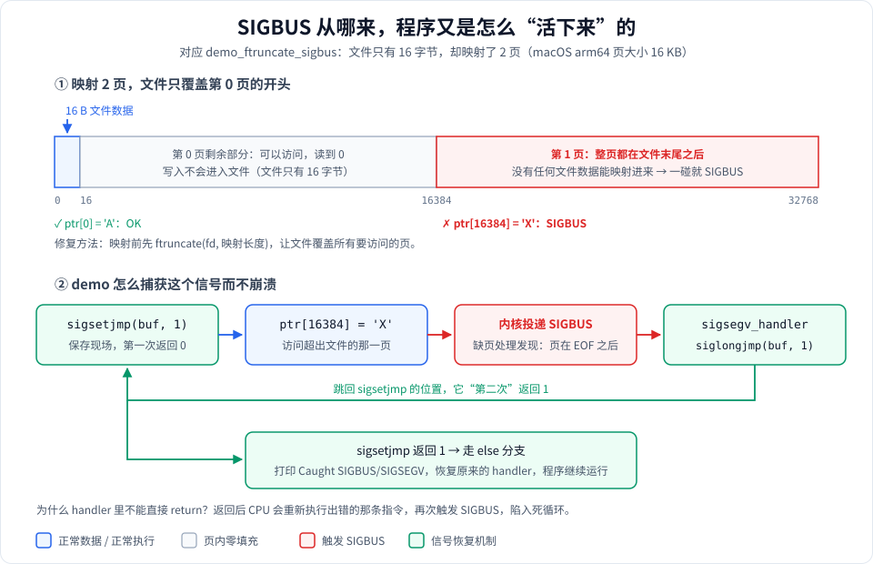
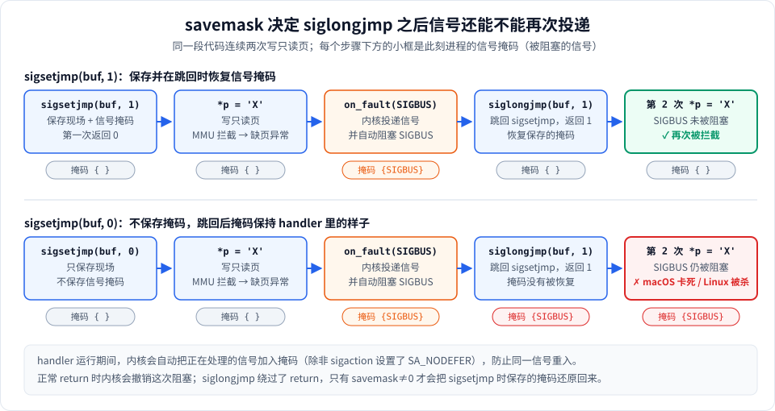

# sigjmp_buf 的用法：从 SIGSEGV / SIGBUS 中"活下来"

学 mmap 时，有两类错误是以**信号**的形式出现的，而不是函数返回 -1：

- 写只读页（`mprotect` 改成只读后再写）→ **SIGSEGV**（macOS 上常常是 SIGBUS）
- 访问超出文件末尾的映射页（忘了 `ftruncate`、文件被截断）→ **SIGBUS**

这两个信号的默认处理方式是**直接杀死进程**。stage2 的 demo 想要"演示出错、但程序继续往下跑"，靠的就是 `sigjmp_buf` + `sigsetjmp` + `siglongjmp` 这一套。

---

## 1. 三个东西各是什么

```c
#include <setjmp.h>   // C++ 里写 <csetjmp>

sigjmp_buf env;                          // 一个"存档"，保存 CPU 现场（栈指针、程序计数器、寄存器…）
int  sigsetjmp(sigjmp_buf env, int savemask);   // 存档
void siglongjmp(sigjmp_buf env, int val);       // 读档：跳回存档点
```

| 名称 | 作用 |
|---|---|
| `sigjmp_buf` | 一个数组类型，用来装"存档"内容。通常定义成全局/静态变量，因为信号处理函数也要能访问它 |
| `sigsetjmp(env, savemask)` | 把当前执行现场存进 `env`。`savemask` 非 0 时，**连同当前的信号掩码一起保存** |
| `siglongjmp(env, val)` | 恢复 `env` 里的现场，程序"瞬移"回 `sigsetjmp` 那一行，让它**再返回一次**，这次返回值是 `val` |

### sigsetjmp 会"返回两次"

这是最让人迷惑的地方。同一个 `sigsetjmp` 调用：

- **第一次**：正常调用时返回 **0**。
- **第二次**：别处调用 `siglongjmp(env, 1)` 后，执行流回到这里，`sigsetjmp` 再次"返回"，返回值是 **1**（就是 `siglongjmp` 的第二个参数；如果传 0，会被改成 1，保证和第一次能区分开）。

所以典型写法总是一个 `if`：

```c
if (sigsetjmp(env, 1) == 0) {
    // 第一次返回：做可能出错的事
} else {
    // 第二次返回：说明出错了，信号处理函数跳回来了
}
```

可以把它理解成"自带撤销点的 try/catch"：`if` 分支是 try，`else` 分支是 catch，`siglongjmp` 是 throw。

---

## 2. 在项目里怎么用

完整流程见 stage2 的这张图（上半是页边界，下半是跳转流程）：



对应代码在 [stage2_syscalls.cpp](../src/stage2/stage2_syscalls.cpp)，拆成四步看：

**① 准备存档和标志位**（[第 14-15 行](../src/stage2/stage2_syscalls.cpp#L14-L15)）

```cpp
sigjmp_buf Stage2Syscalls::s_jump_buf_;                     // 存档
volatile sig_atomic_t Stage2Syscalls::s_signal_caught_ = 0; // 记录收到了哪个信号
```

两者都是静态变量，因为信号处理函数是一个普通函数指针，拿不到 `this`，只能通过全局/静态变量和外界交流。

**② 安装信号处理函数**（[第 22-28 行](../src/stage2/stage2_syscalls.cpp#L22-L28)）

```cpp
struct sigaction sa {};
sa.sa_handler = sigsegv_handler;
sigemptyset(&sa.sa_mask);
sa.sa_flags = 0;
sigaction(signum, &sa, &old_action);   // 同时把旧的处理方式存进 old_action，用完要还原
```

**③ 存档，然后做危险操作**（[demo_mprotect 第 172-180 行](../src/stage2/stage2_syscalls.cpp#L172-L180)）

```cpp
if (sigsetjmp(s_jump_buf_, 1) == 0) {
    volatile char *p = static_cast<volatile char *>(region.data());
    *p = 'X';                       // 写只读页 → 内核发信号
    printf("[UNEXPECTED] ...");     // 正常情况下到不了这里
} else {
    printf("Caught SIGBUS/SIGSEGV ... (signal=%d)\n", s_signal_caught_);
}
```

**④ 信号处理函数：记下信号，读档跳回**（[第 17-20 行](../src/stage2/stage2_syscalls.cpp#L17-L20)）

```cpp
void Stage2Syscalls::sigsegv_handler(int sig) {
    s_signal_caught_ = sig;
    siglongjmp(s_jump_buf_, 1);     // 跳回 ③ 的 sigsetjmp，让它返回 1
}
```

最后用 `restore_signal_handler` 把 SIGSEGV / SIGBUS 恢复成原来的处理方式，避免影响程序其他部分。

---

## 3. 为什么信号处理函数不能直接 return？

对于 SIGSEGV / SIGBUS 这种**由某条指令引发**的信号，处理函数 return 后，CPU 会**重新执行那条出错的指令**。页还是只读的，于是立刻再次出错、再次进入处理函数……变成死循环。

所以只有两种出路：

1. **跳过出错的指令**：用 `siglongjmp` 跳到别处（本项目的做法）。
2. **修复问题再返回**：在处理函数里把出错的页 `mprotect` 成可写，再 return，让那条指令重新执行并成功。这是更高级的用法，见第 7 节。

---

## 4. savemask：为什么一定要用 sigsetjmp(env, **1**)

进入信号处理函数时，内核会**自动把当前信号加入信号掩码**（即暂时阻塞它），防止处理函数被同一个信号重入。处理函数正常 return 时，内核会撤销这次阻塞。

但 `siglongjmp` **绕过了 return**，内核没有机会撤销。这时：

- `savemask = 1`：`sigsetjmp` 当初保存了"那时的掩码"，`siglongjmp` 会把它恢复回来，SIGBUS 重新变成可投递的。
- `savemask = 0`：掩码保持处理函数里的样子，**SIGBUS 一直被阻塞**。下一次再出错时，信号无法投递——macOS 上进程卡死，Linux 上内核会强制把进程杀掉。



### 实测（macOS，本机）

用第 8 节的示例程序，同一段代码连续 3 次写只读页：

```
== savemask=1
第 1 次写入：被拦截 (signal=10)
第 2 次写入：被拦截 (signal=10)
第 3 次写入：被拦截 (signal=10)
exit=0

== savemask=0
第 1 次写入：被拦截 (signal=10)
（此后进程卡住，不再有任何输出，只能手动 kill）
```

`signal=10` 在 macOS 上是 SIGBUS。可以看到：第一次两者都能拦截，区别出现在**第二次**。stage2 里每个 demo 只出错一次，所以就算写成 0 也看不出问题——这正是它危险的地方。

### 和 setjmp / longjmp 的区别

| | 保存信号掩码吗 | 能用在信号处理函数里跳出吗 |
|---|---|---|
| `sigsetjmp(env, 1)` / `siglongjmp` | **保存并恢复**，行为在所有 POSIX 系统上一致 | ✓ 推荐 |
| `sigsetjmp(env, 0)` / `siglongjmp` | 不保存 | ✗ 会出现上面的问题 |
| `setjmp` / `longjmp` | **看平台**：Linux glibc 不保存；macOS/BSD 保存 | 不可移植，不要用 |
| `_setjmp` / `_longjmp`（BSD） | 不保存 | ✗ |

结论：**从信号处理函数里跳出，一律用 `sigsetjmp(env, 1)` + `siglongjmp`**。

---

## 5. 使用规则和常见坑

### ① sigsetjmp 所在的函数必须还没返回

`sigjmp_buf` 里存的是栈指针。如果调用 `sigsetjmp` 的函数已经返回，它的栈帧就没了，再 `siglongjmp` 回去是未定义行为，通常直接崩溃。所以**存档和危险操作要写在同一个函数里**（就像 demo 那样），不能把 `sigsetjmp` 封装进一个辅助函数然后返回。

### ② 在两次返回之间修改过的局部变量要加 volatile

`siglongjmp` 恢复的是寄存器。编译器可能把局部变量放在寄存器里，于是跳回来后读到的是**存档时的旧值**。标准规定：在 `sigsetjmp` 和 `siglongjmp` 之间修改过、又在 `else` 分支里要读的局部变量，必须声明为 `volatile`。

demo 里的 `volatile char *p` 还有另一层作用：防止编译器把"写入后没人读"的 `*p = 'X'` 优化掉——那样就根本触发不了信号。

### ③ C++ 里 siglongjmp 不会调用析构函数

`siglongjmp` 是 C 的机制，它直接改栈指针，**跳过的那些栈帧里的对象不会被析构**。C++ 标准规定：如果把这次跳转换成 throw/catch 会调用某些非平凡析构函数，那么这次跳转就是未定义行为。

对本项目来说意味着：

- ✓ `MmapRegion region` 在 `sigsetjmp` **之前**、同一个函数里创建，跳转不会跨过它，函数结束时正常析构（munmap）。
- ✗ 不要在 `if (sigsetjmp(...) == 0) { ... }` 里面创建 `std::string`、`std::vector`、`MmapRegion` 之类的对象后再触发信号，它们会泄漏或处于不确定状态。

### ④ 信号处理函数里只做最少的事

信号可能在程序执行到任何位置时到来，比如 `malloc` 正在改堆的内部结构。处理函数里只能调用**异步信号安全**（async-signal-safe）的函数。`printf`、`malloc`、`new`、加锁都**不安全**。

所以 demo 的处理函数只做两件事：写一个 `volatile sig_atomic_t` 变量、调用 `siglongjmp`。打印放到跳回后的 `else` 分支里做。

`volatile sig_atomic_t` 是标准保证"在信号处理函数和主程序之间读写是原子的"的整数类型，专门干这个用。

### ⑤ 不要从信号处理函数里 throw C++ 异常

看起来 `throw` 比 `siglongjmp` 更"C++"，但从信号处理函数里抛异常不被标准支持，栈展开要穿过内核构造的信号帧，结果依赖编译器和平台，不可移植。

### ⑥ 用完要恢复原来的处理函数

`sigaction` 改的是**整个进程**的信号处理方式。demo 结束时调用 `restore_signal_handler` 还原，否则后面其他代码出现真正的 bug 时，也会被这个处理函数"吞掉"并跳到一个早已失效的存档点。

### ⑦ 多线程下全局 sigjmp_buf 不安全

SIGSEGV / SIGBUS 会投递给**出错的那个线程**，但 `s_jump_buf_` 是所有线程共用的。两个线程同时用就会互相覆盖存档。多线程场景下可以把它声明为 `thread_local`。

---

## 6. 什么时候该用，什么时候不该用

**适合：**

- 学习和演示：像 stage2 一样，让"写只读页""越界访问"这类错误可以被观察，而不是直接崩溃。
- 测试代码：验证某块内存确实是只读的、某个保护页确实生效。
- 读取可能被别的进程截断的 mmap 文件时，把 SIGBUS 转换成一个错误返回值，而不是让整个服务崩溃。

**不适合：**

- 掩盖真正的程序 bug。真实的空指针、野指针访问应该让程序崩溃并留下 core dump，方便定位，而不是悄悄跳过。

---

## 7. 进阶：拿到出错地址、修复后返回

`sa_handler` 只能拿到信号编号。设置 `SA_SIGINFO` 后可以改用 `sa_sigaction`，从 `siginfo_t` 里拿到**出错的内存地址**：

```cpp
static void on_fault(int sig, siginfo_t *info, void *ctx) {
    void *bad_addr = info->si_addr;   // 是哪个地址出的错
    // 判断 bad_addr 是否落在"我自己管理的映射区"里：
    //   是 → mprotect 修复权限后直接 return，指令会重新执行并成功
    //   否 → 恢复默认处理并重新触发，让程序正常崩溃
}

struct sigaction sa {};
sa.sa_sigaction = on_fault;
sa.sa_flags = SA_SIGINFO;
sigaction(SIGSEGV, &sa, nullptr);
```

"修复后返回"这一招在真实系统里很常见：

- **JVM（HotSpot）**：用 SIGSEGV 实现隐式空指针检查——不在每次访问前判断 `obj == null`，而是直接访问，真为空时由信号处理函数把它转换成 `NullPointerException`。
- **线程栈保护页**：栈底的 `PROT_NONE` 页被访问时触发 SIGSEGV，运行时据此报告栈溢出。
- **垃圾回收的写屏障、用户态分页、内存快照**：先把页设成只读，第一次被写时在处理函数里记录"这页脏了"，再改回可写并返回。

---

## 8. 最小可运行示例

下面这段程序就是第 4 节实测用的代码。把 `SAVEMASK` 改成 0 可以复现卡死。

```cpp
// sigjmp_demo.cpp
// 编译：c++ -std=c++17 -o sigjmp_demo sigjmp_demo.cpp
// 复现 savemask=0 的问题：c++ -std=c++17 -DSAVEMASK=0 -o sigjmp_demo0 sigjmp_demo.cpp
#include <csetjmp>
#include <csignal>
#include <cstdio>
#include <sys/mman.h>
#include <unistd.h>

#ifndef SAVEMASK
#define SAVEMASK 1
#endif

static sigjmp_buf g_jmp;
static volatile sig_atomic_t g_sig = 0;

static void on_fault(int sig) {
    g_sig = sig;
    siglongjmp(g_jmp, 1);
}

// 尝试写一次只读页，返回 true 表示被信号拦截
static bool try_write(volatile char *p) {
    if (sigsetjmp(g_jmp, SAVEMASK) == 0) {
        *p = 'X';
        return false;
    }
    return true;
}

int main() {
    struct sigaction sa {};
    sa.sa_handler = on_fault;
    sigemptyset(&sa.sa_mask);
    sigaction(SIGSEGV, &sa, nullptr);
    sigaction(SIGBUS, &sa, nullptr);

    long page = sysconf(_SC_PAGESIZE);
    void *addr = mmap(nullptr, page, PROT_READ, MAP_PRIVATE | MAP_ANON, -1, 0);
    volatile char *p = static_cast<volatile char *>(addr);

    for (int i = 1; i <= 3; ++i) {
        bool caught = try_write(p);
        printf("第 %d 次写入：%s (signal=%d)\n", i, caught ? "被拦截" : "成功", (int)g_sig);
        fflush(stdout);
    }
    munmap(addr, page);
    return 0;
}
```

注意 `try_write` 符合第 5 节的规则 ①：`sigsetjmp` 和危险操作在同一个函数里，跳回时 `try_write` 还没返回。

---

## 9. 速查

| 要点 | 一句话 |
|---|---|
| 返回值 | 第一次返回 0；被 `siglongjmp(env, v)` 跳回时返回 `v`（`v` 为 0 时当作 1） |
| savemask | 从信号处理函数跳出时必须传 **1**，否则信号会一直被阻塞 |
| 作用域 | `sigsetjmp` 所在函数必须还没返回 |
| 局部变量 | 两次返回之间修改过的要加 `volatile` |
| C++ 对象 | 跳转不调析构函数，不要跨过有非平凡析构的对象 |
| 处理函数 | 只写 `volatile sig_atomic_t` + `siglongjmp`，不要 printf / malloc / throw |
| 收尾 | 用 `sigaction` 保存旧的处理方式，用完还原 |
| 多线程 | 全局 `sigjmp_buf` 改成 `thread_local` |

相关文档：[1-用到的系统调用.md](1-用到的系统调用.md)（mprotect、ftruncate 与 SIGSEGV / SIGBUS）、[stage2 学习笔记](../src/stage2/stage2_syscalls.md)。
