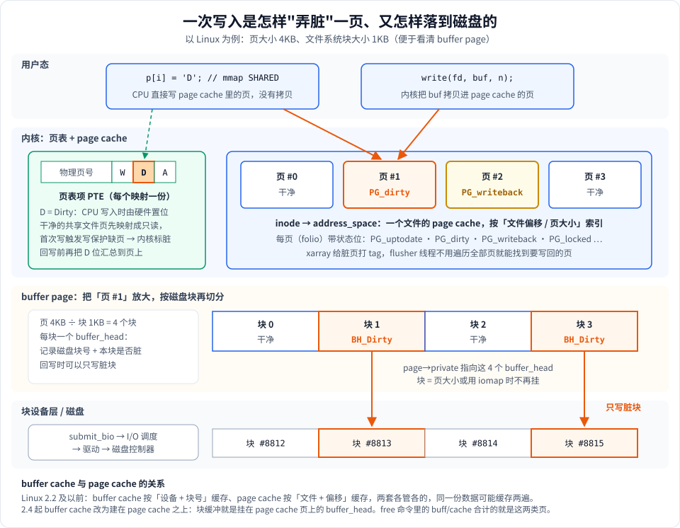
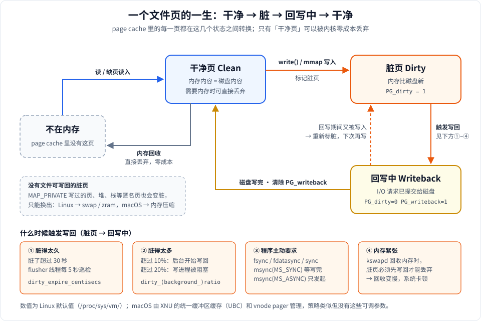

# 什么是脏页：从操作系统角度看 page cache、buffer cache 与 buffer page

用 mmap 写文件时，`p[i] = 'D'` 这一行执行完，数据**并没有**到磁盘，它只是让内存里的某一页变"脏"了。什么时候真正落盘、断电会丢多少、为什么 `msync` 有时很慢、为什么内存紧张时系统会卡，都要从"脏页"说起。

---

## 1. 脏页是什么

> **脏页（dirty page）**：内存中内容已被修改、但还没有写回后备存储（磁盘文件或 swap）的页。

几个关键点：

- **以页为单位**。内核不跟踪"哪几个字节改了"，只跟踪"哪一页改了"。在你的 Mac 上一页是 16KB（`sysctl hw.pagesize`），所以**写 1 个字节，就会让整整 16KB 变脏**，回写时也要写整页（下面第 7 节的实验每页只写了 1 字节，结果 4096 页全脏）。
- **相对后备存储而言**。"脏"的意思是"和磁盘上的版本不一致"。刚从磁盘读进来、没改过的页是**干净页**。
- **脏页的代价在"释放"时才体现**。干净页在内存紧张时可以直接扔掉（以后需要再从磁盘读回来）；脏页必须**先写回**才能扔，写回要做磁盘 I/O，所以慢。

### 两类脏页

| | 文件页（file-backed） | 匿名页（anonymous） |
|---|---|---|
| 来源 | `write()` 写文件、`MAP_SHARED` 映射文件后写入 | 堆、栈、`MAP_ANONYMOUS`、`MAP_PRIVATE` 写过之后的私有副本 |
| 后备存储 | 原文件 | 没有文件，只能用 swap 分区 / zram / macOS 内存压缩器 |
| 变干净的方式 | 写回文件 | 换出到 swap（或压缩），换出后物理页被释放 |
| 本文重点 | ✓ | 简单提及 |

> `MAP_PRIVATE` 映射的文件页一旦被写，就会经过写时复制（COW）变成一份**匿名**副本，它的脏和原文件无关，永远不会写回文件。这就是 [stage1 `demo_shared_vs_private`](../src/stage1/stage1_basic.cpp) 里 PRIVATE 改了内存、文件却不变的原因。

---

## 2. 内核在哪里记录"脏"

一次写入要经过好几层，"脏"在其中两层被记录：**页表项里的 D 位**、**page cache 页上的 PG_dirty 标志**。如果文件系统块比页小，还会细到**每个磁盘块的 BH_Dirty**。



### ① 页表项（PTE）的 D 位：硬件记录

每个页表项除了物理页号，还有几个状态位：

- **W**（Writable）：能不能写
- **A**（Accessed）：最近有没有被访问过，内核用它判断页的冷热
- **D**（Dirty）：有没有被写过

CPU 通过某个映射**写入**一页时，由硬件（MMU）自动把这个 PTE 的 D 位置 1，不需要内核参与，所以几乎没有开销。

D 位是**每个映射各一份**的：同一个文件页被 3 个进程映射，就有 3 个 PTE，各有各的 D 位。

> ARM64 上较新的 CPU 支持硬件更新 D 位（DBM 特性）；不支持时，内核用"先映射成只读、写时缺页"的办法在软件里模拟，效果相同。

### ② page cache 页上的 PG_dirty：内核记录

page cache 里的每一页（新内核里叫 folio）由一个 `struct page` / `struct folio` 描述，里面有一组标志位：

| 标志 | 含义 |
|---|---|
| `PG_uptodate` | 页里的数据是有效的（已从磁盘读完） |
| `PG_dirty` | **脏页**，需要写回 |
| `PG_writeback` | 正在写回中，I/O 已提交还没完成 |
| `PG_locked` | 页被锁住（正在读入、截断等） |

PG_dirty 才是内核做决策（写回谁、回收谁）时看的依据。PTE 的 D 位会在合适的时机（回写扫描、解除映射、回收前）被**汇总**到 PG_dirty 上。

同时，一个文件的所有 page cache 页挂在该文件 inode 的 `address_space` 上（用 xarray 按"文件偏移 / 页大小"索引）。页被标脏时，xarray 里对应位置也会打上 **DIRTY tag**，回写线程据此快速找出所有脏页，而不用遍历整个文件的页。

### ③ buffer_head 的 BH_Dirty：更细的粒度

见第 6 节。

---

## 3. 脏页从哪来：两条写入路径

### 路径 A：`write()` 系统调用

```
write(fd, buf, n)
  → 找到（或读入）对应的 page cache 页
  → 把 buf 拷贝进页（copy_from_user）
  → 给页标 PG_dirty，xarray 打 DIRTY tag
  → 返回（此时数据只在内存里）
```

这条路径不经过页表，脏是内核在拷贝时**主动**标的。

### 路径 B：mmap（`MAP_SHARED`）后直接写内存

内核想知道"哪些页被写过"，但 CPU 写内存不会通知内核。办法是：**干净的共享文件页先以只读方式映射**。

```
p[i] = 'D'（这一页第一次被写）
  → PTE 是只读的，CPU 触发「写保护缺页」
  → 内核缺页处理：调用文件系统的 page_mkwrite（可在此预留磁盘空间）
  → 给页标 PG_dirty，把 PTE 改成可写，硬件置 D 位
  → 返回用户态，重新执行写指令，这次成功
p[i+1] = 'E'（同一页再写）
  → PTE 已可写，不再缺页，开销为零
```

所以 mmap 写入的成本是：**每页第一次写时一次缺页**，之后就是纯内存写。

页被写回、重新变干净之后，内核会调用 `page_mkclean` 把所有映射它的 PTE **再次改成只读**并清 D 位，这样下一次写入又能被捕获。

---

## 4. 脏页到哪去：写回（writeback）



### 写回什么时候发生

Linux 里负责写回的是每个块设备一组的 **flusher 线程**（在 `ps` 里能看到 `kworker/u*:*+flush-*`）。触发条件有四类：

| 触发 | 说明 | 相关参数（`/proc/sys/vm/`） | 默认值 |
|---|---|---|---|
| ① 脏得太久 | 页脏了超过一定时间，flusher 定期醒来检查 | `dirty_expire_centisecs`<br>`dirty_writeback_centisecs` | 3000（30 秒）<br>500（每 5 秒醒一次） |
| ② 脏得太多 | 脏页占可用内存比例超过阈值，后台开始写回；再高则**正在写的进程被强制睡眠**（`balance_dirty_pages`） | `dirty_background_ratio`<br>`dirty_ratio` | 10%<br>20% |
| ③ 程序要求 | `fsync`、`fdatasync`、`sync`、`msync(MS_SYNC)` 立即写回并等待；`msync(MS_ASYNC)` 只发起 | — | — |
| ④ 内存紧张 | `kswapd` 或直接回收时遇到脏文件页，要先写回才能释放 | — | — |

第 ② 条值得注意：如果一个程序疯狂写文件（比如拷贝大文件），脏页涨到 20% 时，**这个程序的 `write()` 会被卡住**，直到写回追上来。这是内核在保护自己：不限制的话，脏页会把内存塞满，回收时到处都要等磁盘。

### 写回的过程

```
PG_dirty=1
  → flusher 选中这页，调用文件系统的 writepages
  → 设置 PG_writeback=1，清除 PG_dirty
  → 构造 bio（块 I/O 请求），提交给块设备层
  → 块层调度、合并相邻请求，交给驱动 → 磁盘
  → I/O 完成中断：清除 PG_writeback，唤醒等待者（如 fsync）
  → 页回到「干净」状态
```

如果页在**写回期间又被写了**，它会被重新标脏，下一轮再写一次。（有些设备要求写回期间页内容不能变，即"稳定页"，这时写入者会等写回完成再继续。）

### 断电会丢什么

只要数据还是脏页，就**只在内存里**。断电、内核崩溃时，最多会丢失最近 `dirty_expire_centisecs`（默认 30 秒）内写入的数据。需要更强保证的程序必须自己调 `fsync` / `msync(MS_SYNC)`，数据库就是这么做的。

---

## 5. buffer cache 与 page cache

这两个名字经常一起出现，它们缓存的东西不同：

| | page cache | buffer cache |
|---|---|---|
| 缓存的是 | **文件内容** | **磁盘块** |
| 索引方式 | （哪个文件，文件内偏移） | （哪个块设备，第几个块） |
| 典型内容 | 你 `read` / `write` / `mmap` 的文件数据 | 文件系统元数据（超级块、inode 表、目录块）、直接读写块设备 `/dev/sda` 的数据 |

### 历史：从两套到一套

- **早期 Unix 和 Linux 2.2 及以前**：两套缓存各自独立。文件数据写入时先进 page cache，落盘时又要经过 buffer cache，**同一份数据在内存里存两遍**，还要保持两份一致，既浪费内存又复杂。
- **Linux 2.4 起**：buffer cache 被改造成**建在 page cache 之上**。块设备本身也被当作一个"文件"，有自己的 `address_space`；所谓的块缓冲，就是挂在 page cache 页上的 `buffer_head`（见下一节）。从此只有一份数据。
- **macOS（XNU）**：同样采用统一的缓冲区缓存（UBC，Unified Buffer Cache），文件数据只在内存中存一份，`read`/`write` 和 mmap 看到的是同一批页。

### 今天在 `free` 里看到的 buff/cache

```
$ free -h
               total        used        free      shared  buff/cache   available
Mem:            15Gi       4.1Gi       6.2Gi       312Mi       5.1Gi        10Gi
```

`/proc/meminfo` 里把它拆成两项：

- `Buffers`：块设备自身的 page cache（主要是文件系统元数据）
- `Cached`：普通文件的 page cache

它们都是**可回收**的：干净的部分随时能释放，所以 `available` 远大于 `free`。其中脏的部分由 `/proc/meminfo` 的 `Dirty:` 和 `Writeback:` 两行单独显示。

---

## 6. buffer page 与 buffer_head

**buffer page** 指的是：一个 page cache 页，上面挂了 `buffer_head` 结构，把这一页**按磁盘块大小切成几段**分别管理。

### 为什么需要

页大小和文件系统块大小不一定相等。例如页 4KB、块 1KB 时，一页文件数据对应 4 个磁盘块，而这 4 个块在磁盘上**不一定连续**（文件系统可能把它们分配在不同位置）。内核需要知道：

- 页里每 1KB 对应磁盘上的哪个块号；
- 每个块是否已读入、是否脏。

### buffer_head 记录了什么

| 字段 / 标志 | 含义 |
|---|---|
| `b_blocknr` | 这一段对应的磁盘块号 |
| `b_page` / `b_folio` | 属于哪一页 |
| `b_data` | 在页内的起始地址 |
| `BH_Uptodate` | 这一块的数据有效 |
| `BH_Dirty` | **这一块是脏的** |
| `BH_Mapped` | 已经知道它对应哪个磁盘块 |

页的 `private` 字段指向这组 `buffer_head`（环形链表）。回写时，文件系统可以**只写 BH_Dirty 的块**，而不是整页都写，见上面分层图的最下面两层。

### 现状

`buffer_head` 是 Linux 很老的机制，元数据开销大（每块一个结构体）。现代文件系统（XFS、新版本 ext4 的部分路径、btrfs）越来越多地改用 **iomap**，配合 **folio**（可以是多页组成的大页）直接描述"文件区间 ↔ 磁盘区间"的映射，数据页上不再挂 buffer_head。但在块设备 page cache、ext4 元数据等地方，它仍然在用。

---

## 7. 实测：在你的 Mac 上看着页变脏、变干净

macOS 的 `mincore` 能返回每一页是否被修改过（`MINCORE_MODIFIED`），正好用来观察脏页。下面的程序映射一个 64MB 文件，分步操作并统计：

```cpp
// dirty_demo.cpp —— 编译：c++ -std=c++17 -O1 -o dirty_demo dirty_demo.cpp
#include <cstdio>
#include <fcntl.h>
#include <sys/mman.h>
#include <unistd.h>
#include <vector>

// 用 mincore 统计：多少页在内存里、多少页被修改过（脏）
static void show(const char *tag, char *p, size_t size, long page) {
    std::vector<char> vec(size / page);
    mincore(p, size, vec.data());
    size_t incore = 0, dirty = 0;
    for (char v : vec) {
        if (v & MINCORE_INCORE) ++incore;
        if (v & (MINCORE_MODIFIED | MINCORE_MODIFIED_OTHER)) ++dirty;
    }
    printf("%-26s 在内存: %4zu 页   脏页: %4zu 页\n", tag, incore, dirty);
}

int main() {
    long page = sysconf(_SC_PAGESIZE);
    const size_t size = 64UL << 20;  // 64MB
    const char *path = "/tmp/dirty_demo.bin";
    int fd = open(path, O_CREAT | O_RDWR | O_TRUNC, 0644);
    ftruncate(fd, size);
    char *p = static_cast<char *>(mmap(nullptr, size, PROT_READ | PROT_WRITE, MAP_SHARED, fd, 0));
    printf("页大小 %ld 字节，共 %zu 页\n", page, size / page);

    show("1. mmap 之后", p, size, page);
    volatile char sink = 0;
    for (size_t i = 0; i < size; i += page) sink += p[i];
    show("2. 只读一遍", p, size, page);
    for (size_t i = 0; i < size; i += page) p[i] = 'D';
    show("3. 每页写 1 字节", p, size, page);
    msync(p, size, MS_SYNC);
    show("4. msync(MS_SYNC) 之后", p, size, page);
    for (size_t i = 0; i < size / 2; i += page) p[i] = 'E';
    show("5. 再写前一半", p, size, page);
    msync(p, size, MS_ASYNC);
    show("6. msync(MS_ASYNC) 之后", p, size, page);
    sleep(1);
    show("7. 再等 1 秒", p, size, page);

    munmap(p, size);
    close(fd);
    unlink(path);
    return 0;
}
```

本机（Apple Silicon，macOS 15）实际输出：

```
页大小 16384 字节，共 4096 页
1. mmap 之后             在内存:    0 页   脏页:    0 页
2. 只读一遍            在内存: 4096 页   脏页:    0 页
3. 每页写 1 字节      在内存: 4096 页   脏页: 4096 页
4. msync(MS_SYNC) 之后   在内存: 4096 页   脏页:    0 页
5. 再写前一半         在内存: 4096 页   脏页: 2048 页
6. msync(MS_ASYNC) 之后  在内存: 4096 页   脏页:  128 页
7. 再等 1 秒            在内存: 4096 页   脏页:    0 页
```

逐行解读：

1. **mmap 之后 0 页在内存**：mmap 只建立了映射关系（VMA），一页都没读。
2. **只读一遍：全部进内存，0 页脏**：每页第一次访问触发缺页，从文件读入 page cache。这些都是干净页。
3. **每页写 1 字节：4096 页全脏**：64MB 文件只改了 4096 个字节，但脏的是 64MB——脏页以页为单位，这就是**写放大**。
4. **MS_SYNC 之后 0 页脏**：`msync(MS_SYNC)` 阻塞到全部写回完成才返回，页都变回干净，但**仍留在内存里**（在内存还是 4096 页）——写回不等于释放。
5. **再写前一半：2048 页脏**：干净页被再次写入，又经历一次"写保护缺页 → 标脏"。
6. **MS_ASYNC 之后还剩 128 页脏**：`MS_ASYNC` 只是发起写回就返回，返回时还有一部分 I/O 没完成。
7. **等 1 秒后 0 页脏**：后台的写回完成了。

> Linux 的 `mincore` 只返回"是否在内存"，没有"是否修改"这一位。在 Linux 上可以看 `/proc/meminfo` 的 `Dirty:`，或进程的 `/proc/<pid>/smaps` 里的 `Shared_Dirty` / `Private_Dirty`。

---

## 8. 脏页对系统的影响

| 影响 | 原因 | 典型表现 |
|---|---|---|
| **内存回收变慢** | 干净页直接丢；脏页要先等磁盘 | 内存紧张时整机卡顿，`kswapd` CPU 占用高 |
| **写进程被节流** | 脏页超过 `dirty_ratio` | 拷大文件时 `write()` 偶尔卡住几百毫秒 |
| **数据丢失窗口** | 脏页只在内存里 | 断电丢失最近约 30 秒的写入 |
| **写放大** | 以页为单位标脏和写回 | 每页改 1 字节，回写整页（Mac 上是 16KB） |
| **fsync 抖动** | `fsync` 要等该文件**所有**脏页写完 | 平时积累的脏页越多，偶尔一次 `fsync` 越慢 |
| **移动端内存压力** | 没有 swap 或只有 zram，脏页释放不掉 | Android `dumpsys meminfo` 里 **Private Dirty** 才是进程真正"占着不放"的内存 |

最后一条对 Android 开发尤其重要：`dumpsys meminfo` 把内存分成 Clean 和 Dirty。**Clean 的部分系统可以随时回收**（比如 mmap 进来的只读 dex、so、资源文件），**Dirty 的部分只能压缩或杀进程才能回收**。所以"用 mmap 只读加载大文件"比"read 进堆内存"更友好：前者是干净的文件页，后者是脏的匿名页。

---

## 9. 怎么观察脏页

| 想看什么 | Linux | macOS |
|---|---|---|
| 全系统脏页 / 回写中 | `grep -E 'Dirty\|Writeback' /proc/meminfo` | `vm_stat`（无直接的脏页计数） |
| 某进程每个映射的脏页 | `/proc/<pid>/smaps`：`Shared_Dirty`、`Private_Dirty` | `vmmap <pid>`：`DIRTY` 列（只统计私有脏页） |
| 某段映射逐页的状态 | `/proc/<pid>/pagemap`（需要 root） | `mincore` 的 `MINCORE_MODIFIED`（见第 7 节） |
| 写回参数 | `sysctl vm.dirty_ratio` 等 | 不可调 |
| 手动全部写回 | `sync` | `sync` |
| 丢弃干净的 page cache（测试用） | `echo 1 > /proc/sys/vm/drop_caches` | `sudo purge` |

---

## 10. 和本项目代码的对应

| 代码 | 和脏页的关系 |
|---|---|
| [stage1 `demo_write_shared`](../src/stage1/stage1_basic.cpp#L53) | `MAP_SHARED` 写入 → 页变脏 → `msync(MS_SYNC)` 写回 → 用 `read()` 读到新内容 |
| [stage1 `demo_shared_vs_private`](../src/stage1/stage1_basic.cpp) | PRIVATE 写入产生的是**匿名**脏页，永远不会写回文件 |
| [stage2 `demo_msync`](../src/stage2/stage2_syscalls.cpp#L92) | 演示 `MS_SYNC` 主动触发写回（第 4 节的触发条件 ③） |
| [stage9 `SimpleKVStore::put`](../src/stage9/stage9_projects.cpp#L122) | 先写记录、`msync` 记录所在页，再更新文件头、`msync` 头页——利用写回顺序保证崩溃后数据一致 |
| [stage9 `SimpleKVStore::sync_range`](../src/stage9/stage9_projects.cpp#L193) | 只 `msync` 本次写入涉及的页（起始地址按页向下取整），避免把整个文件的脏页都等一遍 |

---

## 11. 思考题

1. 程序每页写 1 字节和每页写满 16KB，产生的脏页数量一样吗？回写的数据量一样吗？
2. 为什么内核要把**干净**的共享文件页映射成只读？如果一开始就映射成可写，会丢失什么信息？
3. `munmap` 之后，之前写入的数据会丢吗？什么情况下会丢？（提示：区分进程崩溃和机器断电。）
4. 一个服务每秒写 100MB 日志，从不调 `fsync`。机器内存 16GB，按默认参数，大约脏到多少时写日志的线程会开始被卡住？
5. Android 上用 mmap 只读加载一个 50MB 的模型文件，和用 `read()` 读进一个 50MB 的 `std::vector`，在 `dumpsys meminfo` 里分别会算到哪一类？哪种更不容易被系统杀掉？

<details>
<summary>提示</summary>

1. 脏页数量一样（都是整页标脏），回写数据量也一样（都写整页）。
2. 硬件 D 位会记录，但内核需要在"第一次变脏"的那一刻介入：记账（统计脏页总量以便节流）、调用文件系统的 `page_mkwrite` 预留磁盘空间。只读映射 + 写保护缺页就是这个介入点。
3. 进程崩溃不会丢：脏页属于 page cache，不属于进程，内核照样会写回。机器断电或内核崩溃才会丢。
4. 约 20% × 可用内存，大约 3GB 左右（可用内存小于总内存，具体取决于当时的空闲和可回收内存）。
5. mmap 只读：文件页、Clean，可被系统随时回收；`read()` 进 vector：匿名页、Private Dirty，只能压缩或杀进程才能回收。前者更不容易被杀。

</details>

---

相关文档：[1-用到的系统调用.md](1-用到的系统调用.md)（msync 的用法）、[stage1 学习笔记](../src/stage1/stage1_basic.md)（SHARED 写回与 PRIVATE COW 的图）。
