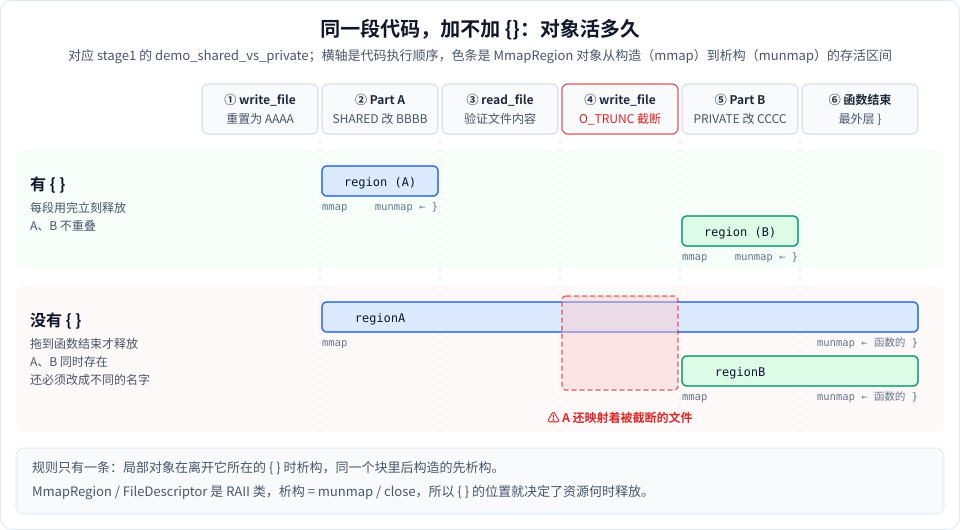

# 讲讲 {}：块作用域

> **一句话**：`{}` 圈出一个块作用域，块里定义的局部对象在执行到 `}` 时析构；配合 RAII 类，析构就等于释放资源，所以 `{}` 的位置决定了资源什么时候释放。

这篇从 stage1 里一段让人困惑的代码讲起：

```cpp
write_file(original);
{
    FileDescriptor fd(path, O_RDWR);
    MmapRegion region = MmapBuilder()...build();
    ...
    region.sync(MS_SYNC);
}
```

`write_file(original);` 后面紧跟一个 `{`，它们是什么关系？这个 `{}` 起什么作用？

---

## 1. 先分清：C++ 里的 `{}` 有好几种身份

困惑往往来自把不同身份的 `{}` 混在一起。同样是一对花括号，出现的位置不同，意思完全不同：

| 写法 | `{}` 的身份 | 举例 |
|---|---|---|
| 函数名 + 参数 + `{}`，**没有分号** | 函数体 | `void foo(int x) { ... }` |
| lambda 的 `[...](...)` 后面 | lambda 的函数体 | `auto f = [&](int x) { ... };` |
| `if` / `for` / `while` 后面 | 控制语句的语句体 | `if (ok) { ... }` |
| `class` / `struct` 后面 | 类定义 | `struct Point { int x; };` |
| 变量名或类型后面，里面是值 | 初始化列表 | `int a{5};`、`std::vector<int> v{1, 2, 3};` |
| **单独出现，前面什么都不挂** | **独立的块（块作用域）** | `{ int tmp = 1; }` |

回到开头的代码：

```cpp
write_file(original);   // 函数调用。分号 ; 表示这条语句到此结束
{                       // 前面什么都没挂 → 独立的块，是一条新语句
    ...
}
```

`write_file(original);` 有分号，是一次**调用**，已经结束了。下一行的 `{` 不属于它，两者只是恰好挨在一起，**没有任何关系**。中间空一行、插一行注释，意思完全一样。

`write_file` 的函数体在别处，就是文件前面定义 lambda 的那个 `{}`：

```cpp
auto write_file = [&](const char *content) {   // ← 这个 {} 才是 write_file 的函数体
    FileDescriptor fd(path, O_CREAT | O_RDWR | O_TRUNC);
    ...
};
```

---

## 2. 块作用域的两条规则

### 规则 ①：名字只在块内可见（作用域）

```cpp
{
    int x = 1;
    printf("%d\n", x);   // ✓
}
printf("%d\n", x);       // ✗ error: use of undeclared identifier 'x'
```

块外看不见块里定义的名字。反过来，**不同的块可以使用相同的名字**，互不冲突。

### 规则 ②：对象在离开块时析构（生命周期）

普通局部变量（专业说法叫"自动存储期"对象）在执行到它所在块的 `}` 时自动析构。同一个块里有多个对象时，**后构造的先析构**，和构造顺序相反：

```cpp
{
    FileDescriptor fd(path, O_RDWR);   // 第 1 个构造
    MmapRegion region = ...;           // 第 2 个构造
}   // 先析构 region（munmap），再析构 fd（close）
```

这个顺序是有意义的：`region` 依赖 `fd` 打开的文件，所以先解除映射、再关文件，和"先打开、再映射"正好倒过来。

> 函数体本身也是一个块。如果没有单独加 `{}`，局部对象所在的块就是整个函数体，要等函数结束才析构。

---

## 3. 亲眼看：加不加 `{}`，析构时机差在哪

下面这个小程序用一个会打印日志的类模拟 `MmapRegion`：

```cpp
#include <cstdio>

// 模拟 MmapRegion：构造时 "mmap"，析构时 "munmap"
struct Region {
    const char *name;
    Region(const char *n) : name(n) { printf("    [%s] mmap\n", name); }
    ~Region() { printf("    [%s] munmap\n", name); }
};

void with_braces() {
    printf("== 有 {} ==\n");
    printf("write_file\n");
    {
        Region region("A");
        printf("    修改映射\n");
    }                               // ← region 在这里销毁
    printf("read_file 验证\n");
    printf("write_file\n");
    {
        Region region("B");         // 同名变量，没问题
        printf("    修改映射\n");
    }
    printf("函数结束\n");
}

void without_braces() {
    printf("\n== 没有 {} ==\n");
    printf("write_file\n");
    Region regionA("A");
    printf("    修改映射\n");
    printf("read_file 验证\n");
    printf("write_file\n");
    Region regionB("B");            // 只能换个名字，否则编译报错
    printf("    修改映射\n");
    printf("函数结束\n");
}                                   // ← A 和 B 都拖到这里才销毁

int main() {
    with_braces();
    without_braces();
}
```

本机运行输出：

```
== 有 {} ==
write_file
    [A] mmap
    修改映射
    [A] munmap          ← 到 } 立刻释放
read_file 验证
write_file
    [B] mmap
    修改映射
    [B] munmap
函数结束

== 没有 {} ==
write_file
    [A] mmap
    修改映射
read_file 验证           ← A 还在
write_file              ← A 还在，文件正被截断
    [B] mmap            ← A、B 同时存在
    修改映射
函数结束
    [B] munmap          ← 函数结束才释放，B 先于 A（后构造先析构）
    [A] munmap
```

如果不加 `{}`、又想沿用同一个名字 `region`，编译器直接报错：

```
error: redefinition of 'region'
```

把这段过程画成时间线：



---

## 4. 为什么 stage1 要这样写

对照 [stage1_basic.cpp 的 demo_shared_vs_private](../src/stage1/stage1_basic.cpp#L109)，整个函数可以读成一串独立的步骤：

| 行号 | 代码 | 作用 |
|---|---|---|
| [144](../src/stage1/stage1_basic.cpp#L144) | `write_file(original);` | 把文件重置为 `AAAA` |
| [146–164](../src/stage1/stage1_basic.cpp#L146-L164) | `{ fd; region; 改成 BBBB; msync }` | Part A：SHARED 映射并修改，到 `}` 时 munmap + close |
| [166–170](../src/stage1/stage1_basic.cpp#L166-L170) | `{ buf; read_file(...) }` | 用 `read()` 验证文件变成了 `BBBB` |
| [174](../src/stage1/stage1_basic.cpp#L174) | `write_file(original);` | 再次重置为 `AAAA`（会 `O_TRUNC` 截断文件） |
| [175–192](../src/stage1/stage1_basic.cpp#L175-L192) | `{ fd; region; 改成 CCCC }` | Part B：PRIVATE 映射并修改 |

这里用 `{}` 有三个具体好处：

**① 资源用完立刻释放。** Part A 的映射和文件描述符在验证之前就已经释放，不会一直占到函数结束。

**② 避免两段操作互相干扰。** 第 174 行的 `write_file` 会用 `O_TRUNC` 把文件截断成 0 字节。如果 Part A 的映射此时还在，它就映射着一段"已经不存在"的文件内容——再访问就会触发 **SIGBUS**（见 [1-用到的系统调用.md](1-用到的系统调用.md) 的 ftruncate 一节）。代码之后虽然没有再访问 A，但这种状态是个隐患；用 `{}` 保证 A 先释放，B 再开始，从根本上消除了重叠。

**③ 两段代码可以写成一样的结构。** 不同的块里可以重复使用 `fd`、`region` 这些名字，Part A 和 Part B 一眼就能对照着看。

---

## 5. `{}` 不是万能的：只有"有析构函数"的对象才会自动释放

块结束时，**只是调用块内对象的析构函数**。资源能不能被释放，取决于这个对象的析构函数有没有写释放代码：

```cpp
{
    MmapRegion region = ...;          // ✓ 析构函数里调用 munmap
    FileDescriptor fd(path, O_RDWR);  // ✓ 析构函数里调用 close
    std::vector<char> buf(1 << 20);   // ✓ 析构函数释放堆内存

    int raw_fd = ::open(path, O_RDONLY);         // ✗ int 没有析构函数，fd 泄漏
    void *p = ::mmap(nullptr, n, ...);           // ✗ 裸指针没有析构函数，映射泄漏
    char *heap = new char[1024];                 // ✗ 内存泄漏
}
```

所以准确的说法是：**块作用域 + RAII 类 = 块一结束资源就释放**。这也是项目要把 `open`/`mmap` 包装成 `FileDescriptor`/`MmapRegion` 的原因——包装之后，`{}` 才能替你管理资源。

---

## 6. 常见的坑

### 坑 ①：把块内对象的指针带出块外（悬空指针）

```cpp
char *p = nullptr;
{
    MmapRegion region = MmapBuilder().length(4096).readWrite().priv().anonymous().build();
    p = region.as<char>();
    p[0] = 'A';               // ✓ 块内，映射还在
}                             // region 析构 → munmap
printf("%c\n", p[0]);         // ✗ 映射已经没了，p 是悬空指针
```

本机实测：块内正常打印 `A`，块外访问时进程被 SIGSEGV 杀掉（退出码 139 = 128 + 11）。

`region.as<char>()`、`region.data()` 拿到的只是**地址**，不拥有映射。对象析构后，这些地址立刻失效。stage9 的 `MiniGrep::search_file` 返回的 `string_view` 也有同样的限制。

### 坑 ②：`switch` 的 `case` 里定义带初始化的变量

```cpp
switch (x) {
case 1:
    std::string s = "one";    // ✗
    return (int)s.size();
case 2:
    return 2;
}
```

编译报错：

```
error: cannot jump from switch statement to this case label
note: jump bypasses variable initialization
```

整个 `switch` 是一个块。跳到 `case 2` 时，`s` 仍在作用域内却没有被初始化，C++ 不允许这种情况。解决办法正是加 `{}`，把 `s` 关进 `case 1` 自己的块里：

```cpp
case 1: {
    std::string s = "one";
    return (int)s.size();
}
```

### 坑 ③：`static` 局部变量不受 `}` 影响

```cpp
{
    static MmapRegion cache = ...;   // 程序结束时才析构，不是在 } 时
}
```

`static` 局部变量只构造一次，活到程序结束。`{}` 只管普通局部变量。

### 坑 ④：块里的对象被移动到块外，就不会在 `}` 释放资源

```cpp
MmapRegion outer;
{
    MmapRegion region = ...;
    outer = std::move(region);   // 映射的所有权转移给 outer
}   // region 析构，但它已经是空的，什么都不释放
// 映射仍然有效，由 outer 负责
```

这不算错误，而是有意为之：`MmapRegion` 的移动操作把资源转交出去，块结束时被析构的只是一个空壳。

---

## 7. 同样的思路在其他地方

块作用域 + RAII 是 C++ 管理"一段时间内持有某种东西"的通用写法：

```cpp
// 加锁：只在临界区内持有锁
{
    std::lock_guard<std::mutex> lock(mtx);   // 构造时加锁
    shared_counter++;
}                                            // 析构时解锁

// 计时：只统计块内代码的耗时
{
    ScopedTimer t("parse");                  // 构造时记录开始时间
    parse(data);
}                                            // 析构时打印耗时

// 尽早释放大对象
{
    std::vector<char> big(512 << 20);        // 512MB 临时缓冲区
    process(big);
}                                            // 立刻释放，不等函数结束
do_other_things();
```

### 另一种选择：拆成小函数

函数体本身就是一个块，所以把一段代码提取成函数，效果和加 `{}` 一样，而且还能起个名字：

```cpp
static void modify_with_shared(const char *path, size_t len) {
    FileDescriptor fd(path, O_RDWR);
    MmapRegion region = ...;
    ...
}   // 函数返回时释放

modify_with_shared(path, len);
```

块里的代码比较长、或者会被复用时，拆成函数通常更清楚；只是在函数中间临时限定几行代码的生命周期时，直接加 `{}` 更方便。

### C++17：`if` 里也能限定作用域

```cpp
if (MmapRegion region = MmapBuilder()...build(); region.valid()) {
    use(region);
}   // region 在整个 if/else 结束时析构
```

`if (初始化; 条件)` 定义的变量只在这个 `if`（包括 `else`）里有效，相当于自带一个块。

---

## 8. 小结

| 问题 | 答案 |
|---|---|
| `write_file(original);` 和下一行的 `{` 有关系吗？ | 没有。分号结束了调用，`{` 开始一个新的独立块 |
| `{}` 做了什么？ | 规定块内名字的可见范围，并让块内对象在 `}` 时析构 |
| 资源一定会释放吗？ | 只有 RAII 对象（析构函数里会释放资源）才会；裸 `int fd`、裸指针不会 |
| 析构顺序？ | 后构造的先析构 |
| 在 stage1 里的好处？ | 资源尽早释放；Part A 和 Part B 不重叠，避免映射着被截断的文件；可以复用变量名 |
| 要小心什么？ | 不要把块内对象的指针/引用带出块外；`switch` 的 case 里定义变量要加 `{}` |

---

相关文档：[1-用到的系统调用.md](1-用到的系统调用.md)（ftruncate 与 SIGBUS）、[stage1 学习笔记](../src/stage1/stage1_basic.md)。
