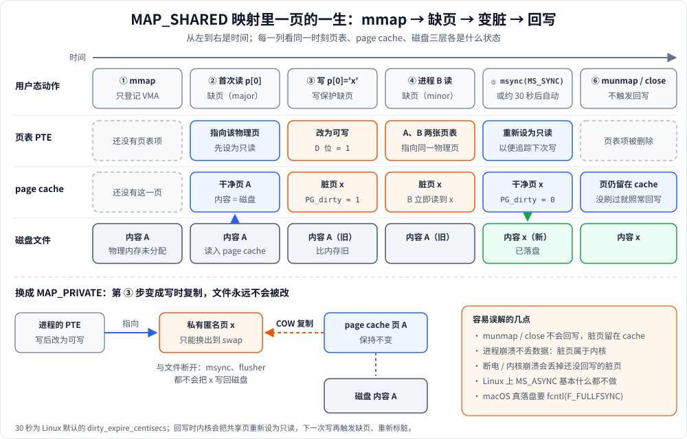

# 共享映射、写时复制与缺页：MAP_SHARED / MAP_PRIVATE、COW、page fault、msync 与脏页回写

`mmap` 调用本身几乎不做事：它只在进程地址空间里登记一段**虚拟内存区域（VMA）**，既不分配物理内存，也不读文件。真正的工作都发生在**之后访问内存的时候**。这篇文档按访问的时间顺序讲 4 件事：

| 主题                       | 回答的问题                                    |
|----------------------------|-----------------------------------------------|
| MAP_SHARED / MAP_PRIVATE   | 我写的内容别人看不看得到、会不会写回文件      |
| 写时复制（COW）            | MAP_PRIVATE 和 `fork()` 怎么做到"不复制也能改" |
| 缺页中断（page fault）     | 第一次访问某页时内核做了什么                  |
| msync 与脏页回写           | 改过的数据什么时候真正落到磁盘                |

脏页本身（PTE 的 D 位、`PG_dirty`、两条写入路径）在 [3-什么是脏页.md](3-什么是脏页.md) 里讲得更细，本文只讲和 mmap 相关的部分。

---

## 1. MAP_SHARED 和 MAP_PRIVATE 的区别

| | MAP_SHARED | MAP_PRIVATE |
|---|---|---|
| 写操作落在哪 | 直接写进内核的 **page cache**（和文件共用同一批物理页） | 写的时候先**复制一份私有页**，再写到副本上（写时复制） |
| 别的进程能不能看到 | 能。映射同一文件的进程，以及用 `read()` 读这个文件的进程，都能立即看到 | 看不到，副本只属于本进程 |
| 会不会写回文件 | 会，由内核回写，或者调用 `msync` 主动刷 | **永远不会** |
| 典型用途 | 进程间通信、持久化数据结构、修改大文件 | 加载可执行文件和 `.so`（代码段、数据段）、只读或"读完随便改"的场景 |

一个容易忽略的细节：MAP_PRIVATE 映射里**还没被自己写过的页**，仍然指向 page cache 里的那一份。如果别的进程通过 MAP_SHARED 或 `write()` 改了文件，你**可能**会看到变化（Linux 上会看到，POSIX 规定这种情况结果未定义）。一旦你写了这一页，它就和文件彻底断开了。

```cpp
// 同一个文件，两种映射
char* shared  = (char*)mmap(nullptr, len, PROT_READ | PROT_WRITE, MAP_SHARED,  fd, 0);
char* priv    = (char*)mmap(nullptr, len, PROT_READ | PROT_WRITE, MAP_PRIVATE, fd, 0);

shared[0] = 'S';   // 文件内容变了，priv[0] 此时也能读到 'S'（priv 这页还没写过）
priv[1]   = 'P';   // 触发 COW：priv 所在页变成私有副本，文件第 1 字节不变
shared[0] = 'T';   // priv[0] 不再跟着变——那一页已经是副本了
```

---

## 2. 写时复制（COW, Copy-On-Write）

### 原理

1. 建立映射（或者 `fork()`）时**不复制数据**，多个虚拟页指向同一个物理页，并且把页表项（PTE）标成**只读**。
2. 某一方写这个页时，MMU 发现页是只读的，触发**写保护缺页**（protection fault）。
3. 内核判断这一页属于 COW 页，于是：
   - 分配一个新物理页，把原页内容复制过去；
   - 把当前进程的 PTE 改成指向新页，并设为**可写**；
   - 原物理页的引用计数减 1。如果只剩一个使用者，内核直接把它改成可写，不再复制。
4. 返回用户态，**重新执行**刚才那条写指令，这次就成功了。

```
写之前                         写之后（进程 A 写了这一页）
进程 A ─┐                       进程 A ──→ [新物理页 副本，可写]
        ├─→ [物理页，只读]
进程 B ─┘                       进程 B ──→ [原物理页]
```

### 要点

- 复制以**页（通常 4KB，Apple Silicon 上是 16KB）为单位**，改 1 个字节也要复制整页。
- 用到 COW 的地方主要有两个：
  - `fork()`：父子进程共享全部页，谁写谁复制；
  - `MAP_PRIVATE` 映射：和 page cache 共享，写的时候复制。
- 好处是省掉大量没必要的复制。比如 `fork()` 之后马上 `exec()`，几乎一页都不用复制。
- 代价是第一次写每一页都要多一次缺页加一次 `memcpy`，写密集的场景下比 MAP_SHARED 慢。

---

## 3. 缺页中断（Page Fault）

`mmap()` 只登记 VMA。第一次访问某一页时，页表里没有对应的项，MMU 就会触发缺页异常，进入内核处理：

```
访问地址 addr
  └─ 找不到对应的 VMA，或者权限不符（比如写只读映射） → SIGSEGV
  └─ 找到了 VMA：
       ├─ 文件页已经在 page cache 里 → 只需建立 PTE        （minor fault，很快）
       ├─ 不在 page cache → 从磁盘读入，再建立 PTE          （major fault，有磁盘 IO，慢）
       ├─ 匿名映射 → 分配一个清零页（第一次读时映射共享的零页）
       ├─ 写一个 COW 页 → 按第 2 节的流程复制
       └─ 地址在 VMA 范围内，但超出了文件末尾所在的那一页 → SIGBUS
```

最后一种就是 [1-用到的系统调用.md](1-用到的系统调用.md) 里说的"映射前要先 `ftruncate` 留出空间"的原因：映射长度比文件大时，访问文件末尾之后的整页会收到 `SIGBUS`，而不是 `SIGSEGV`。

### minor fault 和 major fault

| | minor fault | major fault |
|---|---|---|
| 页在哪 | 已经在内存里（page cache 或零页） | 不在内存里，需要读磁盘或 swap |
| 代价 | 微秒级，只改页表 | 毫秒级（机械盘）或几十微秒（SSD） |
| 常见场景 | 文件刚被别人读过；COW 复制；匿名页首次访问 | 冷启动第一次读大文件 |

可以用 `getrusage()` 的 `ru_minflt` / `ru_majflt` 统计，或者在 Linux 上用 `/usr/bin/time -v ./prog` 查看。

### 相关的优化手段

- 内核会做 **fault-around / 预读**：一次缺页顺带把相邻几页也映射上，减少缺页次数。
- `MAP_POPULATE`（Linux 专有）：在 `mmap` 时就把所有页提前载入，把缺页集中到一开始。
- `madvise(MADV_SEQUENTIAL / MADV_WILLNEED / MADV_RANDOM)`：告诉内核你的访问模式，让它调整预读策略。
- `mlock()`：把页锁在内存里，之后不会再因为被换出而产生 major fault。

---

## 4. msync 与脏页：数据什么时候写回磁盘？

### 页是怎么变脏的

写入 MAP_SHARED 映射时，CPU 会在 PTE 上置 **dirty 位**。为了可靠地追踪脏页，内核一般先把共享文件页映射成只读，第一次写时触发一次写保护缺页，在这次缺页里把页标记为 `PG_dirty` 并改成可写。之后这一页就在 page cache 里等待回写。

### 回写时机（以 Linux 为例）

| 触发条件 | 说明 |
|---|---|
| **`msync(addr, len, MS_SYNC)`** | 同步回写指定范围内的脏页，**等磁盘 IO 完成才返回**。这是 mmap 场景下确保"数据已落盘"的方式（前提是硬盘本身会执行 flush） |
| `msync(..., MS_ASYNC)` | 只"安排"回写，立即返回。Linux 2.6.19 之后内核本身已经在追踪脏页，所以它**基本相当于什么都不做** |
| `fsync(fd)` / `fdatasync(fd)` | 对同一个文件同样有效，因为 mmap 写入的和 `write()` 写入的是同一份 page cache |
| **flusher 内核线程定时回写** | 每隔 `dirty_writeback_centisecs`（默认 5 秒）醒来一次，把脏了超过 `dirty_expire_centisecs`（默认 30 秒）的页写回 |
| 脏页比例超过阈值 | 超过 `dirty_background_ratio`（默认 10%）时，后台开始回写；超过 `dirty_ratio`（默认 20%）时，**正在写入的进程会被阻塞**，帮着一起回写 |
| 内存紧张、需要回收页 | 脏页必须先写回磁盘才能释放 |

这些参数在 `/proc/sys/vm/` 下，可以用 `sysctl vm.dirty_expire_centisecs` 等命令查看。

### 容易误解的几点

- **`munmap()` 和 `close()` 都不会触发回写**，它们只解除映射或关闭描述符，脏页仍然留在 page cache 里，之后照常回写。
- **进程崩溃或退出不会丢数据**：脏页属于内核，进程没了它们依然会被写回。
- **断电或内核崩溃会丢失**还没回写的脏页。需要持久化保证的场景（数据库、日志），必须在关键点调用 `msync(MS_SYNC)`。
- 对 MAP_PRIVATE 调用 `msync` 没有意义，它的修改根本不会回到文件。
- `msync` 的 `addr` 必须按页对齐。

### macOS 的差异

macOS 使用统一缓冲区缓存（UBC），整体行为和上面类似，但有两点要注意：

- 没有 `/proc/sys/vm/` 那套可调参数，回写节奏由内核自行决定。
- `fsync` 在 macOS 上只保证数据交给了硬盘，**不保证硬盘缓存已经刷到介质上**。真要落盘需要 `fcntl(fd, F_FULLFSYNC)`。

---

## 5. 一张图串起来



- **上半部分**按时间从左到右排了 ① 到 ⑥ 六步，每一列同时画出这一时刻页表、page cache、磁盘三层的状态。蓝色表示干净页，橙色表示脏页，绿色表示磁盘内容已经更新。
- **下半部分**是 MAP_PRIVATE 的分支：第 ③ 步写入时会复制出一份私有匿名页，page cache 和磁盘都保持原样。

同样的过程用文字表示：

```
mmap(MAP_SHARED)    → 只建 VMA，不分配物理页
首次读 p[0]         → 缺页 → 读文件进 page cache → 建立 PTE（只读）
首次写 p[0] = 'x'   → 写保护缺页 → 页标记为 dirty → PTE 改为可写
……                  → 修改留在 page cache 中，其他进程立即可见
msync(MS_SYNC)      → 脏页写回磁盘 → 清除 dirty 标记      ← 主动回写
或者约 30 秒后       → flusher 线程自动回写                 ← 被动回写
munmap / close      → 不回写，脏页继续留在 page cache
```

如果换成 `MAP_PRIVATE`，第三步变成"写保护缺页 → COW 复制出私有页"，之后的 `msync` 和自动回写都与它无关。
