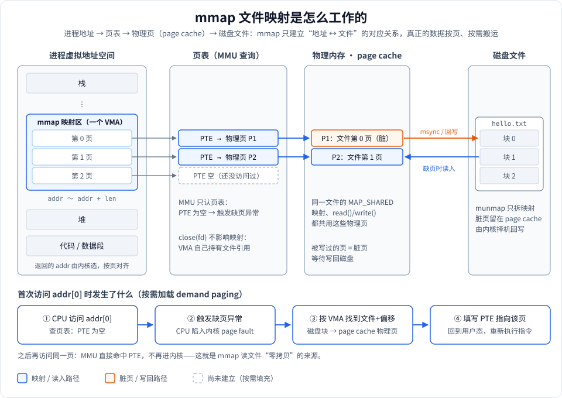
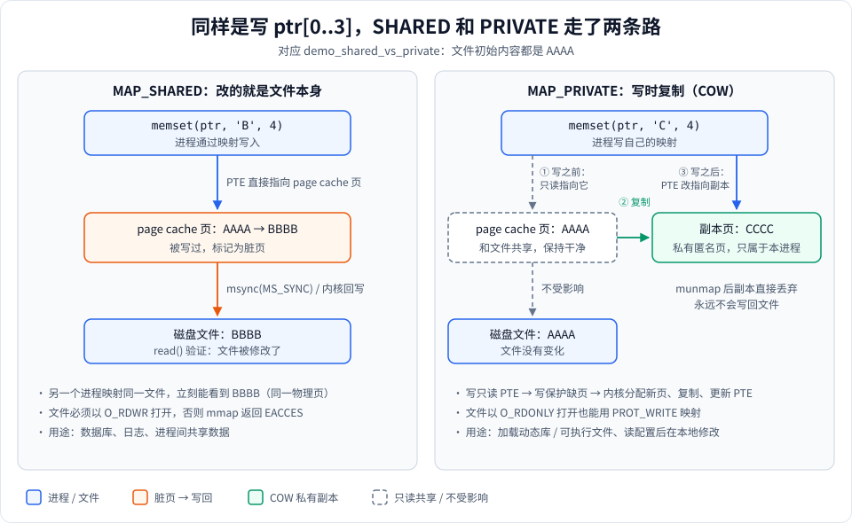

# Stage 1：mmap 基本用法

## 这一阶段学什么

用 3 个 demo 弄清 mmap 最核心的三件事：

1. **怎么把文件映射成内存**：`open` → `fstat` 拿大小 → `mmap` → 像数组一样访问 → `munmap` / `close`。
2. **怎么通过映射改文件**：`MAP_SHARED` + `PROT_WRITE`，写内存就是写文件，`msync` 保证落盘。
3. **SHARED 和 PRIVATE 的区别**：同样写一个字节，一个改了文件，一个只改了自己的副本（写时复制，COW）。

后面所有阶段（共享内存、KV 存储、benchmark）都建立在这三点之上，所以这一阶段要把“映射背后发生了什么”想清楚，而不只是会调 API。

**运行：**

```bash
cmake -S . -B build && cmake --build build
./build/mmap_learn 1
```

代码：[stage1_basic.h](stage1_basic.h)（声明 + 注释）、[stage1_basic.cpp](stage1_basic.cpp)（实现）。封装类 `FileDescriptor` / `MmapRegion` / `MmapBuilder` 在 [../mmap_wrapper.hpp](../mmap_wrapper.hpp)。

---

## 全景图：mmap 背后发生了什么



读图要点：

- **mmap 本身几乎不做事**。它只在进程地址空间里登记一段区域（内核叫它 VMA），记下“这段地址对应哪个文件的哪个偏移、什么权限”。此时页表是空的，一个字节都没读。
- **数据是第一次访问时才搬进来的**（图下半部分的 ①→④）：CPU 查页表发现没有 → 缺页异常 → 内核按 VMA 找到文件位置，读进 page cache → 填页表 → 回到用户态重新执行那条指令。这叫**按需加载（demand paging）**。
- **映射的页就是 page cache 的页**。`read()` 要把 page cache 的数据再拷贝一份到你的 buffer，而 mmap 让你的地址直接指向 page cache，所以少一次拷贝。
- **写回是另一条路**（橙色）：写过的页变成脏页，由内核定期回写，或者你调 `msync` 强制立即写回。

---

## 知识点逐个讲

### 1. 读文件：只读 + 私有映射

代码：[demo_read_file](stage1_basic.cpp#L12)

```cpp
FileDescriptor fd(path, O_RDONLY);
off_t file_size = fd.size();                 // fstat 拿文件大小
MmapRegion region = MmapBuilder()
        .length(file_size).readOnly().priv()  // PROT_READ + MAP_PRIVATE
        .file(fd.get()).build();
printf("%.*s", (int)region.size(), region.as<const char>());
```

- **length 用文件大小**：映射长度不能是 0（空文件不能 mmap，会 `EINVAL`）。内核会把长度向上取整到整页，但你只该访问文件实际大小范围内的数据。
- **只读场景用 `MAP_PRIVATE` 还是 `MAP_SHARED` 都可以**：不写的话两者没有区别。这里用 PRIVATE 是习惯：万一误写也不会改到文件。
- **打印用 `%.*s`**：映射区没有 `'\0'` 结尾，必须指定长度，不能当 C 字符串用。
- **RAII 析构顺序**：`region` 后声明，先析构（munmap），然后 `fd` 析构（close）。其实反过来也没问题——见下一条。

> **close(fd) 之后映射还能用吗？** 能。VMA 自己持有对文件的引用，`fd` 只是建立映射时用的“入口”。很多代码 mmap 完就立刻 close。

### 2. 写文件：共享 + 读写映射

代码：[demo_write_shared](stage1_basic.cpp#L53)

- **先准备好文件**：[第 62 行](stage1_basic.cpp#L62) 用 `O_CREAT | O_RDWR | O_TRUNC` 打开并 `truncate` 到目标长度。要写的范围必须在文件大小之内，否则访问超出文件末尾的整页会触发 SIGBUS（详见 [stage2](../stage2/stage2_syscalls.md)）。
- **映射前重新以 `O_RDWR` 打开**：`MAP_SHARED + PROT_WRITE` 要求文件可写，用 `O_RDONLY` 打开会让 mmap 返回 `EACCES`。
- **写入就是普通的指针操作**：`ptr[0] = 'X'` 修改的是 page cache 里的那一页。
- **[msync](stage1_basic.cpp#L91)**：`MS_SYNC` 阻塞到数据真正写到磁盘。注意：即使不调 msync，用 `read()` 也能立刻读到新内容（同一个 page cache 页），msync 解决的是**断电不丢**，不是**别人看不看得到**。

### 3. SHARED vs PRIVATE：写时复制

代码：[demo_shared_vs_private](stage1_basic.cpp#L109)，其中 [write_file / read_file 两个 lambda](stage1_basic.cpp#L116) 负责重置文件和验证文件内容。



- **SHARED（左）**：页表直接指向 page cache 的页，写入让这一页变脏，msync / 内核回写后文件变成 `BBBB`。
- **PRIVATE（右）**：
  1. 刚映射时，页表**也指向 page cache 的那一页**，但被标记为只读（所以只读的私有映射不占额外内存）。
  2. 第一次写入触发“写保护缺页”，内核分配一个新的物理页，把原内容复制过去。
  3. 页表改指向这个副本，写入落在副本上。文件和 page cache 都保持 `AAAA`。
- **为什么 PRIVATE 映射可以用 `O_RDONLY` 打开的文件 + `PROT_WRITE`？** 因为写入永远不会到文件，内核不需要文件可写。看 [第 175 行](stage1_basic.cpp#L175) 的写法。
- COW 是按**页**复制的：只写 1 个字节，也会复制整整一页（Linux x86 是 4 KB，Apple Silicon 是 16 KB）。

---

## 运行输出解读

```
[Stage1] demo_read_file: Read a file via mmap
  mmap addr  : 0x1009c0000
  mmap size  : 17
  content    : Hello mmap world!
  RAII cleanup done (munmap + close)
```

- `mmap addr` 末尾是 `000`（实际末 14 位都是 0）：返回地址一定按页对齐，这台 Apple Silicon 机器的页大小是 16 KB（0x4000）。
- `mmap size : 17`：这是传给 mmap 的长度；内核实际占用的是一整页，但多出来的部分不该访问。

```
[Stage1] demo_write_shared: Write via MAP_SHARED
  before modify: ABCDEFGH
  after modify : XYZWEFGH
  msync done
  read() verify: XYZWEFGH
```

- 用普通的 `read()` 读到了 `XYZW`：说明通过映射写入的内容就在文件里。

```
  --- MAP_SHARED ---
  mmap content before: AAAA
  mmap content after : BBBB
  file on disk       : BBBB  (file changed!)
  --- MAP_PRIVATE (COW) ---
  mmap content before: AAAA
  mmap content after : CCCC
  file on disk       : AAAA  (file unchanged - COW!)
```

- 两种映射里，自己看到的内容都变了（`after` 一行）；区别只在文件：SHARED 改了，PRIVATE 没改。这正是 COW 的效果——进程以为自己在改文件，实际上改的是私有副本。

---

## 实际应用

| 场景 | 用法 | 为什么用 mmap |
|---|---|---|
| 加载大模型 / 大资源文件（llama.cpp、游戏资源包） | 只读映射 | 不用一次读进内存，用到哪页加载哪页；多个进程共享同一份物理页 |
| 动态库、可执行文件加载 | 代码段 PRIVATE 只读、数据段 PRIVATE 可写 | 数据段靠 COW：每个进程改自己的全局变量，互不影响 |
| SQLite、LMDB | SHARED 读写 | 数据库文件当内存用，随机访问没有 `lseek + read` 的开销 |
| MMKV、xlog（微信） | SHARED 读写 | 写内存就是写文件，进程崩溃时数据仍在 page cache，由内核写回 |

---

## 常见坑

- **失败返回的是 `MAP_FAILED`，不是 `NULL`**。`MmapRegion` 构造函数里已经帮你判断了。
- **offset 必须按页对齐**，length 不需要（内核会向上取整）。
- **空文件不能映射**：长度 0 会 `EINVAL`。要写新文件，先 `ftruncate` 再映射。
- **SHARED 写入需要 `O_RDWR`**：`O_WRONLY` 也不行，因为映射总是需要读权限。
- **映射区不是字符串**：没有结尾的 `'\0'`，打印或比较时一定要带长度。
- **文件被别人截断**：映射时文件 1 MB，之后别的进程把它截成 0，再访问原来的页就是 SIGBUS。

## macOS vs Linux

| | macOS（Apple Silicon） | Linux（x86_64） |
|---|---|---|
| 页大小 | 16 KB | 4 KB |
| 匿名映射标志 | `MAP_ANON`（`MAP_ANONYMOUS` 也可用） | 两者都可用 |
| 观察映射 | `vmmap <pid>` | `cat /proc/<pid>/maps` |
| 未写回脏页的回写周期 | 由 XNU 决定 | 默认约 30 秒（`dirty_expire_centisecs`） |

本阶段的 3 个 demo 在两个平台上行为一致。

---

## 动手练习

1. **关掉 fd 再访问**：在 `demo_read_file` 里 `build()` 之后立刻让 `fd` 析构（例如放进一个更小的作用域），再打印内容。能读到吗？为什么？
   *提示：看全景图里 VMA 对文件的引用。*
2. **不调 msync**：把 `demo_write_shared` 里的 `region.sync(MS_SYNC)` 注释掉，`read()` 验证还能读到新内容吗？那 msync 到底保证了什么？
3. **两个映射看同一文件**：对同一个文件建两个 `MAP_SHARED` 映射 `a`、`b`，写 `a[0]`，立刻读 `b[0]`。再把 `b` 改成 `MAP_PRIVATE` 试一次——**写之前**和**写之后**分别读 `b[0]`，结果有什么不同？
   *提示：PRIVATE 在自己写之前，看到的是 page cache 里的共享页。*
4. **验证按页复制**：在 PRIVATE 映射上只写 1 个字节，用 `vmmap`（macOS）或 `/proc/self/smaps` 的 `Private_Dirty` 字段（Linux）观察多出了多少私有内存。
5. **故意出错**：用 `O_RDONLY` 打开文件，再用 `MAP_SHARED + PROT_WRITE` 映射，看 `MmapRegion` 抛出的异常信息是什么。

延伸阅读：[mmap 配套系统调用](../../doc/1-用到的系统调用.md)、[Stage 2](../stage2/stage2_syscalls.md)。
