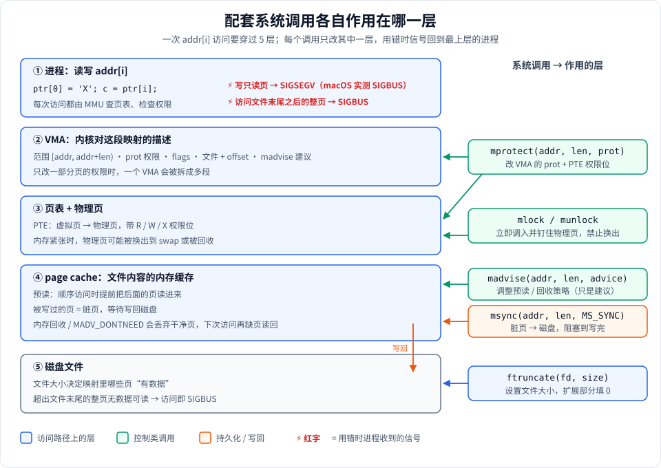

# Stage 2：mmap 的配套系统调用

## 这一阶段学什么

Stage 1 只用了 `mmap` / `munmap`。真实项目里，映射建好之后还要回答这些问题：

| 问题 | 系统调用 |
|---|---|
| 数据什么时候真正写到磁盘？ | `msync` |
| 能不能运行时把一段内存改成只读、可执行？ | `mprotect` |
| 能不能告诉内核“我要顺序读”、“这段马上要用”？ | `madvise` |
| 能不能保证这段内存不被换出到 swap？ | `mlock` / `munlock` |
| 映射前文件要多大？映射超出文件会怎样？ | `ftruncate` + SIGBUS |

本阶段每个调用一个 demo，外加一个工程技巧：**用 `sigsetjmp` / `siglongjmp` 捕获 SIGSEGV / SIGBUS，让程序演示完错误后继续运行**。

**运行：**

```bash
./build/mmap_learn 2
```

代码：[stage2_syscalls.h](stage2_syscalls.h)（声明 + 注释）、[stage2_syscalls.cpp](stage2_syscalls.cpp)（实现）。每个调用的参数、标志、实际应用，已在 [doc/1-用到的系统调用.md](../../doc/1-用到的系统调用.md) 里详细写过，这里侧重**它们作用在哪里、demo 怎么验证**。

---

## 全景图：每个调用作用在哪一层



一次 `addr[i]` 的访问，从上往下要经过：进程 → VMA → 页表/物理页 → page cache → 磁盘文件。读图要点：

- **每个调用只改一层**：`mprotect` 改权限（VMA + 页表权限位），`mlock` 管物理页驻留，`madvise` 影响 page cache 的预读和回收，`msync` 把 page cache 的脏页推到磁盘，`ftruncate` 改的是最底层的文件大小。
- **出错时信号都回到最上层的进程**：权限不对 → SIGSEGV（macOS 上实测是 SIGBUS）；访问的页在文件末尾之后 → SIGBUS。
- **SIGSEGV 和 SIGBUS 的本质区别**：SIGSEGV 是“这个地址你不该访问”（没映射、没权限）；SIGBUS 是“地址合法，但背后没有数据可以给你”（文件不够长、硬件错误）。

---

## 知识点逐个讲

### 0. 公共工具：临时文件与信号捕获

- **[TempFile](stage2_syscalls.h#L97)**（RAII）：构造时 `mkstemp` 创建临时文件，析构时 `close` + `unlink`。即使中途 `MmapRegion` 构造抛异常，fd 也会被关闭、文件也会被删除。
  - 注意声明顺序：`TempFile tmp` 在 `MmapRegion region` **之前**声明，所以函数结束时先 munmap，再 close + unlink。
- **[sigsegv_handler](stage2_syscalls.cpp#L17)** + **[install_signal_handler](stage2_syscalls.cpp#L22)**：把 SIGSEGV / SIGBUS 的处理函数换成自己的，演示结束后再恢复原来的。

### 1. msync：把修改写回磁盘

代码：[demo_msync](stage2_syscalls.cpp#L92)

流程：创建临时文件 → [ftruncate 到一页](stage2_syscalls.cpp#L105) → SHARED + RW 映射 → `memcpy` 写字符串 → [msync(MS_SYNC)](stage2_syscalls.cpp#L119) → 用 `read()` 验证。

- 关键理解：`read()` 能读到新内容**不需要** msync（同一个 page cache 页）。msync 的作用是让数据**此刻**就落到磁盘，而不是等内核回写。
- 这个 demo 能证明“写进去了”，但证明不了“落盘了”——要验证落盘只能断电，这正是 msync 容易被忽视的原因。

### 2. mprotect：运行时改权限

代码：[demo_mprotect](stage2_syscalls.cpp#L140)

流程：匿名 RW 映射 → 写入 → [mprotect(PROT_READ)](stage2_syscalls.cpp#L155) → [sigsetjmp](stage2_syscalls.cpp#L172) 设好恢复点 → 再写 → 被信号打断 → 跳回。

- mprotect 改的是 VMA 的权限，同时更新页表项的写权限位。之后的写入由 **MMU 硬件**直接拦截，没有任何软件检查开销。
- 演示结束**不需要**把权限改回可写：munmap 和页权限无关，只读映射也能直接解除。

### 3. madvise：给内核访问提示

代码：[demo_madvise](stage2_syscalls.cpp#L191)，策略分发在 [apply_madvise_strategy](stage2_syscalls.cpp#L55)，策略枚举是 [MadviseStrategy](stage2_syscalls.h#L40)。

- 先对 1 MB 文件用 `MADV_SEQUENTIAL` 然后顺序扫描，再用 `MADV_WILLNEED` 让内核提前读入。
- madvise 是**建议**，内核可以忽略；效果要在冷缓存、大文件下才看得出来（Stage 8 的 benchmark 会涉及）。
- `MADV_DONTNEED` 在 Linux 上会**真的丢弃**页内容（私有映射的修改会丢），在 macOS 上只是提示——这是少数会改变程序结果的 advice。

### 4. mlock / munlock：钉住物理页

代码：[demo_mlock](stage2_syscalls.cpp#L237)

- [mlock](stage2_syscalls.cpp#L247) 立刻把页调入物理内存，并保证不被换出；[munlock](stage2_syscalls.cpp#L260) 解除。
- 受 `RLIMIT_MEMLOCK` 限制（`ulimit -l`），普通用户锁太多会失败。demo 只锁一页，所以能成功。
- 典型用途：密钥、密码不能被写进 swap；实时系统不能接受缺页带来的延迟抖动。

### 5. ftruncate 与 SIGBUS

代码：[demo_ftruncate_sigbus](stage2_syscalls.cpp#L270)


- **上半图**：文件 16 字节（[第 279 行](stage2_syscalls.cpp#L279) 的 ftruncate），却映射了 2 页。
  - 第 0 页：开头 16 字节是文件数据，剩下的部分可以访问，读到 0，但写入不会进文件。
  - 第 1 页：整页都在文件末尾之后，没有任何文件数据可以映射，一访问就 SIGBUS。
  - 记住规则：**SIGBUS 的判断单位是页**，不是字节。访问第 0 页里第 20 个字节不会出错。
- **下半图**：[sigsetjmp](stage2_syscalls.cpp#L313) 第一次返回 0，执行越界访问；内核投递 SIGBUS；handler 调用 `siglongjmp` 跳回 sigsetjmp 的位置，这次它“第二次返回” 1，走 else 分支打印并继续。
- 为什么 handler 不能直接 return：返回后 CPU 会重新执行出错的那条指令，再次触发 SIGBUS，死循环。
- `sigjmp_buf` 的完整用法（savemask 为什么必须是 1、volatile、C++ 析构函数、异步信号安全等规则）见 [doc/2-sigjmp_buf的用法.md](../../doc/2-sigjmp_buf的用法.md)。

---

## 运行输出解读

```
=== Demo: msync ===
  mmap'd 16384 bytes (SHARED | RW)
  msync(MS_SYNC) succeeded - data flushed to disk
  Verified via read(): "Hello from mmap + msync!"
```
- `16384`：demo 用 `sysconf(_SC_PAGESIZE)` 取页大小，Apple Silicon 是 16 KB。在 Linux x86 上这里会是 4096。

```
=== Demo: mprotect ===
  mprotect(PROT_READ) succeeded - region is now read-only
  Attempting write to read-only region...
  Caught SIGBUS/SIGSEGV: write to read-only mmap region (signal=10)
```
- `signal=10` 在 macOS 上是 **SIGBUS**，不是 SIGSEGV（SIGSEGV 是 11）。macOS 对“写只读页”报 SIGBUS；同样的代码在 Linux 上会是 `signal=11`。这就是 demo 同时捕获两个信号的原因。

```
=== Demo: madvise ===
  Created 1MB temp file
  [MADV_SEQUENTIAL] ... Sequential scan complete (checksum byte: 0)
```
- 校验值是 0：文件是 `ftruncate` 扩出来的，内容全是 0。madvise 只影响性能，不影响读到的内容。

```
=== Demo: mlock / munlock ===
  mlock succeeded - page is pinned in physical RAM (no swapping)
```
- 一页（16 KB）远小于默认的 `RLIMIT_MEMLOCK`，所以成功。

```
=== Demo: ftruncate + SIGBUS trap ===
  Created tiny file (16 bytes)
  mmap'd 32768 bytes (2 pages) backed by 16-byte file
  Write at offset 0: OK
  Attempting access at offset 16384 (beyond file, second page)...
  Caught SIGBUS/SIGSEGV: access beyond end of file in mmap region (signal=10)
```
- offset 0 在第 0 页（文件覆盖到了），成功；offset 16384 正好是第 1 页的起点，整页在文件之外 → SIGBUS。

---

## 实际应用

| 调用 | 典型项目 |
|---|---|
| msync | LMDB 提交事务、MMKV 切后台时刷盘 |
| mprotect | V8 / JVM 的 JIT（先写机器码再改成可执行，W^X）；线程栈底部的保护页 |
| madvise | ripgrep 对大文件用 `MADV_SEQUENTIAL`；jemalloc 用 `MADV_DONTNEED` / `MADV_FREE` 归还内存 |
| mlock | OpenSSL、libsodium 存放私钥；高频交易、音频处理消除缺页抖动 |
| ftruncate | MMKV / LMDB 扩容；`shm_open` 后设置共享内存大小（Stage 4） |

---

## 常见坑

- **以为 munmap / close 会落盘**：都不会。需要持久化就显式 msync。
- **信号处理函数里做复杂操作**：handler 里只能调用异步信号安全的函数。demo 只设标志 + `siglongjmp`，`printf` 都放在跳回之后。
- **只捕获 SIGSEGV**：macOS 上写只读页是 SIGBUS，只装 SIGSEGV 的 handler 程序会直接崩。
- **mprotect 超过文件打开权限**：`O_RDONLY` 打开的文件做 SHARED 映射后，`mprotect(PROT_WRITE)` 返回 `EACCES`。
- **madvise / mprotect / mlock 的地址必须页对齐**：直接传 `ptr + 100` 会 `EINVAL`。

## macOS vs Linux

| | macOS（Apple Silicon） | Linux |
|---|---|---|
| 页大小 | 16 KB | 4 KB（x86_64） |
| 写只读页的信号 | SIGBUS（10） | SIGSEGV（11） |
| `MADV_DONTNEED` | 只是提示，内容可能还在 | 立即丢弃，匿名页再读是 0 |
| `mremap` | 没有 | 有，可原地扩大映射 |
| SIGBUS 编号 | 10 | 7 |

---

## 动手练习

1. **SIGBUS 的边界**：在 `demo_ftruncate_sigbus` 里分别访问 offset 15、16、`page_size - 1`、`page_size`。哪些会出错？和你的预期一致吗？
   *提示：SIGBUS 按页判断。*
2. **修好 SIGBUS**：把 ftruncate 的大小改成 `2 * page_size`，再访问 offset `page_size`，还会出错吗？这就是“写文件前先 ftruncate”的原因。
3. **只保护一部分**：对 3 页的映射只 `mprotect` 中间一页为 `PROT_NONE`，分别访问三页。在 Linux 上用 `cat /proc/self/maps` 看 VMA 被拆成了几段（macOS 用 `vmmap`）。
4. **mlock 的上限**：用 `ulimit -l` 查看限制，再尝试 mlock 一个比它大的匿名映射，看返回的 errno 是什么。
5. **思考题**：为什么 handler 里调用 `printf` 是危险的，而 demo 把打印放在 `siglongjmp` 跳回之后就安全了？

延伸阅读：[Stage 1：基本用法](../stage1/stage1_basic.md)、[mmap 系统调用全景图](../../doc/1-用到的系统调用.md)。
