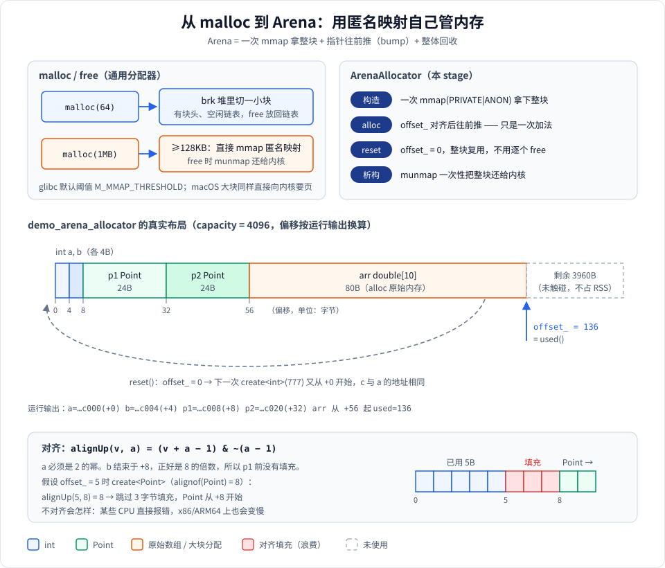

# Stage 3：匿名映射与 Arena 内存池

## 这个 stage 学什么

前两个 stage 都是“把**文件**映射进内存”。这个 stage 换一个角度：**不关联任何文件**，只是向内核要一块内存，这就是**匿名映射**（`MAP_ANONYMOUS`）。

学完后你应该能回答：

- `malloc` 拿到的内存是从哪里来的？为什么申请 1GB 时进程的“内存占用”并不会立刻涨 1GB？
- 什么是按需分页、零页、写时复制，它们和 RSS（实际占用的物理内存）有什么关系？
- 为什么游戏引擎、编译器、protobuf 都喜欢用 Arena（内存池），它和 mmap 是什么关系？
- 怎么查看一个进程到底建立了哪些映射？

**为什么要学**：匿名映射是所有内存分配器的地基。`malloc`、`new`、线程栈、JVM/V8 的堆，最终都是向内核要匿名映射。理解它，才能看懂“内存占用”这类指标，也才能自己写高性能的内存池。

**运行方式**：

```bash
./mmap_learn 3        # 在构建目录里直接运行 stage 3
```

**代码**：[stage3_anonymous.h](stage3_anonymous.h)（声明 + 注释）、[stage3_anonymous.cpp](stage3_anonymous.cpp)（实现）。系统调用本身的用法见 [../../doc/1-用到的系统调用.md](../../doc/1-用到的系统调用.md)。

---

## 全景图

### 图 1：一段匿名映射的一生


从左往右看每一行：你的代码做了什么 → 内核里描述这段地址的 VMA 怎么变 → 页表项怎么变 → 物理内存怎么变。从上往下是时间顺序。重点看两件事：

1. **`mmap` 那一行，物理内存一栏是空的**：mmap 只是“登记”了一段地址，没有分配任何物理页。
2. **物理页是在“第一次写”时才分配的**，RSS（Resident Set Size，常驻物理内存）也是在这一刻才增长。

### 图 2：从 malloc 到 Arena



上半部分对比通用分配器 `malloc` 和本 stage 的 `ArenaAllocator`；下半部分是 `demo_arena_allocator` **真实运行时**每个对象落在 Arena 里的位置（偏移是从运行输出的地址换算出来的），以及对齐是怎么算的。

---

## 知识点逐个讲

### 1. 匿名映射：不关联文件的 mmap

```cpp
MmapRegion region = MmapBuilder()
                        .length(4096)
                        .readWrite()
                        .priv()        // MAP_PRIVATE
                        .anonymous()   // MAP_ANON，fd = -1
                        .build();
```

对应代码：[Stage3Anonymous::demo_anonymous_map](stage3_anonymous.cpp#L74)，Builder 的 [anonymous()](../mmap_wrapper.hpp#L428)。

和文件映射的区别只有两点：

| | 文件映射 | 匿名映射 |
|---|---|---|
| `flags` | `MAP_SHARED` / `MAP_PRIVATE` | 再加上 `MAP_ANON`（= `MAP_ANONYMOUS`） |
| `fd` | 打开的文件 | `-1` |
| 初始内容 | 文件内容 | **保证全是 0** |
| 数据去哪 | 可以写回文件 | 进程退出就没了（可能被换出到 swap） |

“保证全是 0”很重要：内核绝不会把别的进程用过的内存原样交给你，否则就是信息泄漏。demo 里逐字节检查后输出 `zero-initialized: YES`，验证的就是这一点。

`MAP_PRIVATE` 还是 `MAP_SHARED`，对匿名映射来说只在 `fork` 之后才有区别：`PRIVATE` 的父子进程各自写时复制，`SHARED` 的父子进程看到同一块内存。后者就是 [Stage 4](../stage4/stage4_shared_mem.md) 的主题。

### 2. 按需分页：虚拟内存 ≠ 物理内存

这是本 stage **最核心**的概念，对应图 1。

- **mmap 时**：内核只创建一个 VMA（`vm_area_struct`，记录“这段地址属于谁、什么权限”），**页表是空的，物理内存一页都没分配**。
- **第一次读**：CPU 查页表发现没有映射 → 触发**缺页异常**（page fault）。Linux 发现这是匿名页且只是读，会把这一页映射到一个全系统共享、内容全 0 的**零页**（只读），不分配新内存。
- **第一次写**：写一个只读的零页又触发一次缺页 → 内核这才**真正分配一个物理页**、清零、让页表指向它（这一步本质上就是写时复制）。RSS 此时增加 4KB（Apple Silicon 上是 16KB）。
- **munmap**：清掉页表、归还物理页。

所以有两个指标要分清：

| 指标 | 含义 | mmap 1GB 后不写 | 写满 1GB 后 |
|---|---|---|---|
| VSZ / 虚拟大小 | 已登记的地址空间 | +1GB | +1GB |
| RSS / 常驻内存 | 真正占用的物理内存 | ≈ +0 | +1GB |

这就是为什么 `top` 里有些进程 VIRT 动辄几十 GB，实际却没占多少内存。

> macOS 没有 Linux 那种“共享零页”的说法，但效果一样：匿名页是按需分配、保证清零的。

### 3. malloc 与 mmap 的关系

`malloc` 并不是每次都调用 mmap。以 glibc 为例：

- **小块（默认 < 128KB）**：从“堆”里切。堆是用 `brk`/`sbrk` 扩展的一段连续区域，分配器在里面维护空闲链表，每块前面有块头。`free` 只是把块放回链表，通常不还给内核。
- **大块（≥ `M_MMAP_THRESHOLD`，默认 128KB）**：直接 `mmap` 一段匿名映射，`free` 时直接 `munmap` 还给内核。

这样设计的原因：小块走 mmap 太浪费（至少占一整页，还要一次系统调用）；大块走堆则容易产生碎片，而且 free 后很难还给系统。

macOS 的 libmalloc 结构不同，但同样是“小块在自己的区域里切，大块直接向内核要页”。

### 4. ArenaAllocator：用一次 mmap 管理一大堆小对象

对应代码：类声明 [ArenaAllocator](stage3_anonymous.h#L62)，实现在 [stage3_anonymous.cpp](stage3_anonymous.cpp#L17)。

**思路**（对照图 2 上半部分右边）：

1. **构造**（[构造函数](stage3_anonymous.cpp#L17)）：一次 `mmap(MAP_PRIVATE | MAP_ANON)` 拿下一整块（默认 1MB，demo 里是 4096 字节）。
2. **分配**（[alloc](stage3_anonymous.cpp#L45)）：维护一个偏移 `offset_`，每次分配先按对齐要求把 `offset_` 往上取整，再往前推 `n` 字节。**整个分配只是一次加法**，没有加锁、没有找空闲块。
3. **构造对象**（[create&lt;T&gt;](stage3_anonymous.h#L128)）：先 `alloc(sizeof(T), alignof(T))`，再用 placement new 在这块内存上构造对象。
4. **回收**（[reset](stage3_anonymous.cpp#L62)）：只把 `offset_` 置 0，整块复用。不能单独释放某一个对象。
5. **析构**：`MmapRegion` 析构时 `munmap`，一次性还给内核。

**对齐**（[alignUp](stage3_anonymous.cpp#L15)）：

```cpp
(value + align - 1) & ~(align - 1)   // align 必须是 2 的幂
```

例：`alignUp(5, 8)`：`5 + 7 = 12`（二进制 `1100`），`~7` 把低 3 位清零，得到 `8`。为什么要对齐？`double`、指针等类型在很多 CPU 上要求地址是 8 的倍数，不对齐要么直接崩溃，要么访问变慢。

**溢出保护**：判断“空间够不够”时写成 `n > capacity_ - aligned`，而不是 `aligned + n > capacity_`。后者在 `n` 很大时会整数溢出回绕成一个小数，误判为空间足够。

**移动语义**（[移动构造](stage3_anonymous.cpp#L27) / [移动赋值](stage3_anonymous.cpp#L34)）：Arena 只能移动不能拷贝。移动后源对象的 `capacity_`、`offset_` 清零，再对它 `alloc` 会打印提示并返回 `nullptr`，不会算出非法地址。

**Arena 的取舍**：

| 优点 | 代价 |
|---|---|
| 分配极快（一次加法） | 不能单独释放某个对象 |
| 整体释放是 O(1) | `reset()` 不会调用析构函数，只适合平凡类型或自己管理析构 |
| 对象紧挨着放，缓存友好 | 容量固定，用完就返回 `nullptr`（真实实现会再申请新块） |
| 没有碎片 | 生命周期必须“一起生、一起死” |

### 5. 查看进程的内存映射

对应代码：[Stage3Anonymous::demo_process_maps](stage3_anonymous.cpp#L156)。

- **Linux**：读 `/proc/self/maps`，每行就是一个 VMA：

  ```
  7f3a1c000000-7f3a1c010000 rw-p 00000000 00:00 0
  起始地址-结束地址          权限 文件偏移 设备 inode 路径（匿名映射为空）
  ```

  权限里的 `p` 表示 `MAP_PRIVATE`，`s` 表示 `MAP_SHARED`。想看每段实际占了多少物理内存，读 `/proc/self/smaps` 里的 `Rss` 字段。

- **macOS**：没有 `/proc`，用 `vmmap <pid>`。demo 会在映射**还活着的时候**调用 vmmap，只打印这段 probe 映射所在的那一行。

---

## 运行输出解读

下面是在 macOS（Apple Silicon）上 `./mmap_learn 3` 的实际输出：

```
========== Stage3: Anonymous Mapping ==========
[anonymous] mapped 4096 bytes at 0x100d1c000
[anonymous] zero-initialized: YES
[anonymous] wrote:  "Hello from anonymous mmap!"
[anonymous] integers at offset 256: 100 200 300 400 500
[anonymous] region will be munmap'd on scope exit (RAII)
```

- `0x100d1c000`：末尾是 `000`，因为 mmap 返回的地址一定**按页对齐**。
- `zero-initialized: YES`：匿名映射保证初始全 0（图 1 第 ② 行）。
- 写入字符串后才真正分配物理页（图 1 第 ③ 行）；偏移 256 处写的 int 也在这同一页里，不会再分配。

```
========== Stage3: Arena Allocator ==========
[arena] capacity: 4096, used: 0, remaining: 4096
[arena] int *a = 42 (at 0x100d1c000)
[arena] int *b = 99 (at 0x100d1c004)
[arena] Point p1 = (1.0, 2.0, 3.0) at 0x100d1c008
[arena] Point p2 = (4.0, 5.0, 6.0) at 0x100d1c020
[arena] double array[0..4]: 0.0 1.1 2.2 3.3 4.4
[arena] after allocations => used: 136, remaining: 3960
[arena] after reset()     => used: 0, remaining: 4096
[arena] after reset, new int *c = 777 (at 0x100d1c000)
```

- Arena 的地址和上一个 demo 一模一样（`0x100d1c000`）：上一个映射已经 munmap 了，内核把这段空出来的地址又分给了新的映射。
- `a` 在 +0、`b` 在 +4：`int` 是 4 字节、4 字节对齐，紧挨着放。
- `p1` 在 +8（`0x...008`）：`Point` 是 3 个 double，大小 24、对齐 8。`b` 结束于 +8，正好是 8 的倍数，所以**没有填充**。
- `p2` 在 +32（`0x...020`）= 8 + 24。
- 数组从 +56 开始，10 个 double 共 80 字节，结束于 136，所以 `used: 136`。这就是图 2 下半部分那根条。
- `reset()` 后 `c` 的地址和 `a` 相同：内存被原地复用，没有任何系统调用。

```
========== Stage3: Process Memory Maps ==========
[maps] macOS detected. /proc/self/maps is not available.
[maps] created a 64KB anonymous mapping at 0x100d1c000 for inspection
[maps] vmmap lines containing the probe region:
  VM_ALLOCATE (reserved)  100d1c000-100d2c000  [ 64K  0K  0K  0K] rw-/rwx SM=NUL  reserved VM address space (unallocated)
```

这一行是本 stage 最好的“证据”：

- `100d1c000-100d2c000`：正好 64KB 的虚拟地址区间。
- `[ 64K 0K 0K 0K]` 依次是**虚拟大小、常驻内存、脏页、换出**。常驻是 **0K**：映射了 64KB，但一个字节都没写，所以一页物理内存都没占。
- `rw-/rwx`：当前权限 / 最大权限。
- `SM=NUL`、`unallocated`：还没有任何物理页（共享模式为空）。

在 Linux 上，这一节会打印 `/proc/self/maps` 的前 30 行，可以在里面找到 `rw-p` 且路径为空的匿名映射。

---

## 实际应用

- **malloc 的大块分配**：glibc 超过 128KB 的分配直接走匿名 mmap，所以大数组 `free` 之后 RSS 会立刻下降。
- **Arena / 内存池**：protobuf 的 `Arena`、LLVM 的 `BumpPtrAllocator`、游戏引擎的“每帧一个 Arena”（这一帧的临时对象帧结束时一次 `reset`）、Web 服务器的“每个请求一个 Arena”。
- **线程栈**：`pthread_create` 用匿名映射给每个线程分配栈，并在栈底放一个 `PROT_NONE` 的保护页，栈溢出时立即崩溃。
- **预留大块地址空间**：V8、JVM、Go runtime 启动时先用 `PROT_NONE` 的匿名映射占住一大段地址，真正要用时再 `mprotect` 打开权限。地址只占“号”，不占物理内存。

---

## 常见坑

- **以为 mmap 了就占内存**：只有写过的页才占 RSS。反过来，测试“分配 1GB 会不会 OOM”时，不写入是测不出来的。
- **Arena 的 `reset()` 不调用析构函数**：里面放了 `std::string`、`std::vector` 这类自己管理堆内存的对象，`reset()` 会造成泄漏。
- **对齐算错**：`alignUp` 要求对齐值是 2 的幂；`alloc` 默认按 8 字节对齐，需要 16/64 字节对齐（SIMD、缓存行）时要显式传入。
- **Arena 被移动后继续用**：源对象已经是空的，`alloc` 会返回 `nullptr`，使用前要检查。
- **页大小不是 4KB**：Apple Silicon 是 16KB，用 `sysconf(_SC_PAGESIZE)` 获取，不要写死。

---

## macOS 与 Linux 的差异

| | Linux | macOS |
|---|---|---|
| 匿名标志 | `MAP_ANONYMOUS`（`MAP_ANON` 是别名） | `MAP_ANON`（也定义了 `MAP_ANONYMOUS`） |
| 查看映射 | `/proc/self/maps`、`/proc/self/smaps` | `vmmap <pid>`、`vmmap --summary <pid>` |
| 只读的第一次访问 | 映射到共享零页 | 按需分配清零的页 |
| 页大小 | 一般 4KB | Intel 4KB，Apple Silicon 16KB |
| malloc 大块 | glibc：≥128KB 走 mmap | libmalloc：大块直接向内核要页 |

---

## 动手练习

1. **亲眼看 RSS 增长**：mmap 一段 100MB 的匿名映射，先 `sleep` 让你在另一个终端用 `vmmap <pid>`（Linux 用 `grep Rss /proc/<pid>/smaps`）看一次；然后只写前 10MB，再看一次。
   *提示：每隔一页写一个字节就够了，不需要写满。*
2. **测一下按需分页的开销**：分别计时“mmap 后第一次写满 100MB”和“第二次写满同一块”，两次差多少？差的就是缺页 + 清零的成本。可以再试试加上 `MAP_POPULATE`（仅 Linux），它会在 mmap 时就把页分配好。
3. **验证 malloc 阈值**：在 Linux 上用 `strace -e trace=mmap,brk ./a.out` 观察 `malloc(64)` 和 `malloc(1 << 20)` 分别调用了哪个系统调用。
4. **给 Arena 加上“自动扩容”**：当前容量用完就返回 `nullptr`。改成用完时再 mmap 一块新的（链表串起来），`reset()` 时只保留第一块。
5. **思考题**：为什么 `ArenaAllocator::alloc` 判断空间时写成 `n > capacity_ - aligned`？举一个 `aligned + n > capacity_` 会给出错误答案的具体数值。
