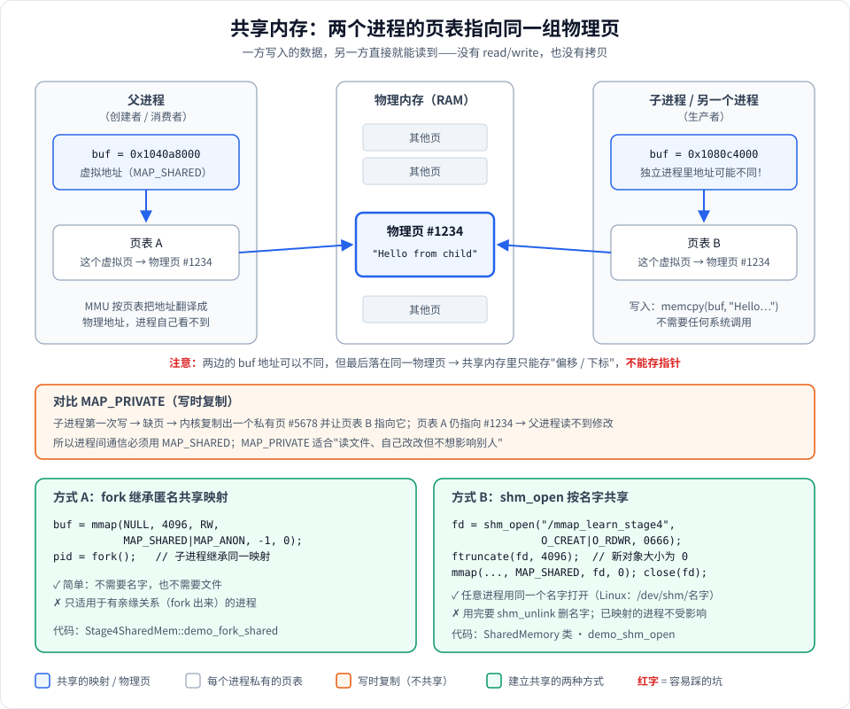
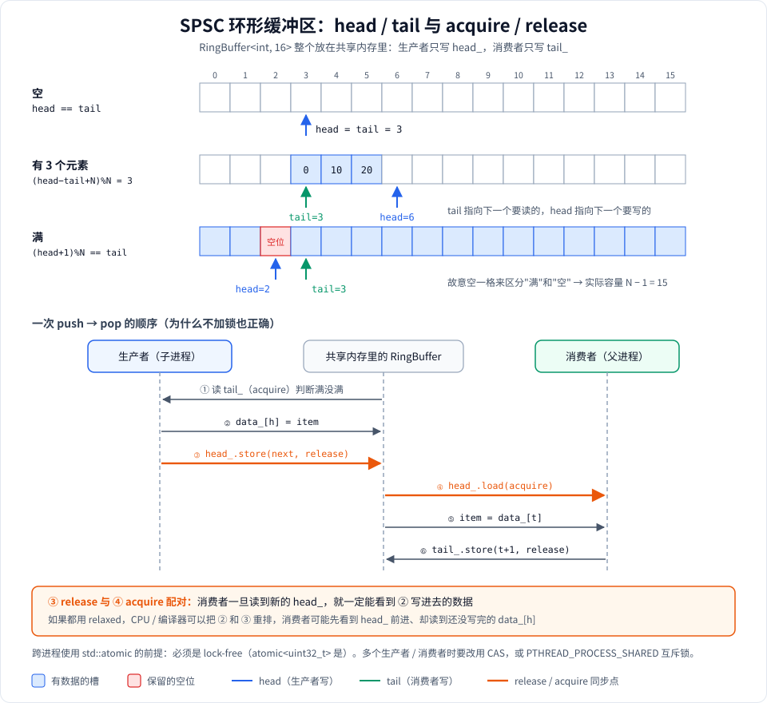

# Stage 4：进程间共享内存

## 这个 stage 学什么

进程之间默认是隔离的：A 进程的指针拿到 B 进程里毫无意义。想交换数据，常见办法是管道、socket，它们都要“A 拷贝到内核 → 内核拷贝到 B”。

**共享内存**是最快的进程间通信（IPC）方式：让两个进程的页表指向**同一组物理页**，一方写入，另一方直接就能读到，中间没有系统调用、没有拷贝。这个 stage 学三件事：

1. **原理**：为什么 `MAP_SHARED` 能让两个进程看到同一块内存，`MAP_PRIVATE` 为什么不行。
2. **建立方式**：父子进程靠 `fork` 继承；无关进程靠 `shm_open` 按名字找到同一块内存。
3. **同步**：共享内存本身不提供任何同步。用一个单生产者单消费者（SPSC）的无锁环形队列，演示怎么用原子变量安全地传数据。

**为什么要学**：Chrome 的多进程架构、Android 的 Binder/ashmem、PostgreSQL 的 shared_buffers、高频交易的行情分发、音视频的帧传递，底层都是共享内存。

**运行方式**：

```bash
./mmap_learn 4
```

**代码**：[stage4_shared_mem.h](stage4_shared_mem.h)（声明 + 注释，`RingBuffer` 模板也在这里）、[stage4_shared_mem.cpp](stage4_shared_mem.cpp)（实现）。`shm_open` / `ftruncate` 的细节见 [../../doc/1-用到的系统调用.md](../../doc/1-用到的系统调用.md)。

---

## 全景图

### 图 1：共享内存的原理和两种建立方式



- 上半部分：两个进程**各有自己的虚拟地址和页表**，但页表项都指向物理页 #1234。子进程写进去的 `"Hello from child"`，父进程用自己的地址读到的是同一份数据。
- 中间：如果换成 `MAP_PRIVATE`，子进程第一次写会触发写时复制，得到自己的私有副本，父进程就看不到了。
- 下半部分：让两个进程映射到同一组物理页的两种办法。

### 图 2：SPSC 环形缓冲区



- 上半部分：`head` / `tail` 在空、有数据、满三种状态下的位置，以及为什么要故意空一格。
- 下半部分：一次 push → pop 的时序，橙色的两步是 release / acquire 配对，正是它保证了不加锁也能正确传递数据。

---

## 知识点逐个讲

### 1. 为什么 MAP_SHARED 能共享

回忆 [Stage 3](../stage3/stage3_anonymous.md)：进程访问的是虚拟地址，MMU 按**每个进程自己的页表**翻译成物理地址。

- `MAP_SHARED`：内核让所有映射了这个对象的进程，页表都指向**同一组物理页**。任何一方写入，其他方立刻可见（硬件层面就是同一块 RAM）。
- `MAP_PRIVATE`：一开始也指向同一页，但页被标记为只读；谁先写，内核就给谁复制一份私有页（写时复制），之后互不影响。

所以**进程间通信必须用 `MAP_SHARED`**。

> 可见性 ≠ 持久化。共享内存的修改对其他进程是立即可见的，不需要 `msync`；`msync` 解决的是“写回磁盘文件”，和这里无关。

### 2. 方式 A：fork 继承匿名共享映射

对应代码：[Stage4SharedMem::demo_fork_shared](stage4_shared_mem.cpp#L93)。

```cpp
MmapRegion region(nullptr, 4096, PROT_READ | PROT_WRITE, MAP_SHARED | MAP_ANON, -1, 0);
pid_t pid = fork();     // 子进程继承这段映射
```

- `fork` 时子进程复制父进程的地址空间，`MAP_SHARED` 的映射会**继续共享**，而普通内存是写时复制。
- 子进程里这段映射的**地址和父进程完全相同**（地址空间是复制来的）。
- 优点：不需要名字、不需要文件，最简单。
- 局限：只能在有亲缘关系的进程之间用。

**子进程为什么用 `_exit(0)` 而不是 `return` / `exit`**：子进程拥有父进程所有对象的副本。如果正常返回，`MmapRegion`、`SharedMemory` 的析构函数会在子进程里再执行一遍（比如提前 `shm_unlink`），`exit` 还会把从父进程继承来的 stdio 缓冲区再输出一次。`_exit` 直接结束进程，这些都不会发生。

### 3. 方式 B：shm_open 按名字共享

对应代码：RAII 类 [SharedMemory](stage4_shared_mem.h#L57)，[构造函数](stage4_shared_mem.cpp#L20)，[析构函数](stage4_shared_mem.cpp#L50)，演示 [demo_shm_open](stage4_shared_mem.cpp#L123)。

创建方的完整步骤：

```cpp
int fd = shm_open("/mmap_learn_stage4", O_CREAT | O_RDWR, 0666);  // ① 按名字创建
ftruncate(fd, 4096);                                              // ② 新对象大小是 0，必须先设大小
void *p = mmap(nullptr, 4096, PROT_READ | PROT_WRITE, MAP_SHARED, fd, 0);  // ③ 映射
close(fd);                                                        // ④ fd 可以马上关，映射仍有效
// ... 使用 ...
munmap(p, 4096);
shm_unlink("/mmap_learn_stage4");                                 // ⑤ 删除名字
```

使用方只需要 `shm_open(name, O_RDWR)` + `mmap`，不用 `O_CREAT`，也不用 `ftruncate`。

几个要点：

- **名字以 `/` 开头**，像一个文件路径，但不在普通文件系统里。Linux 上它就是 `/dev/shm/` 下的一个 tmpfs 文件，可以直接 `ls /dev/shm` 看到。
- **跳过 ② 就访问会 SIGBUS**：新建的共享内存对象大小为 0，所有页都在“文件末尾之后”。
- **`shm_unlink` 只删名字**：已经映射的进程不受影响，等所有进程都 munmap 之后内存才真正释放，和删除一个正在被打开的文件是一个道理。
- `SharedMemory` 用 `owner_` 区分创建者和使用者，只有创建者在析构时 `shm_unlink`。创建过程中任何一步失败，都会先清理已经创建的名字再抛异常。

### 4. 共享内存里不能存指针

见图 1 下方的红字。同一块共享内存，在两个**独立**进程里的映射地址通常不同（方式 B），A 进程存进去的指针，到 B 进程里指向的是另一个地方，甚至是非法地址。

正确做法：存**偏移**或**下标**。`RingBuffer` 里用的就是 `head_` / `tail_` 两个下标，而不是指针。`RingBuffer` 还用 `static_assert(std::is_trivially_copyable<T>)` 限制元素类型（[RingBuffer](stage4_shared_mem.h#L154)），因为 `std::string` 这类类型内部藏着指向堆的指针，放进共享内存也是错的。

### 5. 同步：SPSC 无锁环形缓冲区

对应代码：[RingBuffer](stage4_shared_mem.h#L154) 的 [push](stage4_shared_mem.h#L170) / [pop](stage4_shared_mem.h#L189)，演示 [demo_ring_buffer](stage4_shared_mem.cpp#L154)。

共享内存只负责“看得到”，不负责“看到的是不是写完的数据”。两个进程同时读写，需要同步。

**数据结构**：整个 `RingBuffer<int, 16>` 用 placement new 构造在共享内存上：

```cpp
std::atomic<uint32_t> head_;  // 下一个要写的位置，只由生产者修改
std::atomic<uint32_t> tail_;  // 下一个要读的位置，只由消费者修改
T data_[N];
```

**空和满**（图 2 上半部分）：

- 空：`head == tail`
- 满：`(head + 1) % N == tail`
- 如果允许填满全部 N 个槽，满的时候也会是 `head == tail`，和空分不清。所以故意空一格，**实际容量是 N − 1 = 15**。

**为什么不加锁也正确**（图 2 下半部分）：

1. 每个变量只有一个写者：`head_` 只有生产者写，`tail_` 只有消费者写，不存在两个人同时改同一个变量。
2. 生产者**先写数据，再用 `release` 发布 `head_`**；消费者**用 `acquire` 读 `head_`，再读数据**。release/acquire 配对保证：消费者一旦看到新的 `head_`，就一定能看到它之前写入的 `data_[h]`。
3. 如果都用 `relaxed`，编译器或 CPU 可以把“写数据”和“更新 head_”重排，消费者可能看到 head 前进了，读到的却是还没写完的数据。

**跨进程使用原子变量的前提**：`std::atomic` 必须是 lock-free 的（`atomic<uint32_t>` 在主流平台上都是）。如果某个类型的 atomic 内部是用锁实现的，那把锁在进程私有内存里，跨进程就失效了。

**多生产者 / 多消费者**：上面的论证依赖“每个变量只有一个写者”，有多个生产者时就不成立了，需要改用 CAS，或者用设置了 `PTHREAD_PROCESS_SHARED` 属性、放在共享内存里的 `pthread_mutex`。

**父子进程并发**：生产者（子进程）push，消费者（父进程）同时 pop，收齐后才 `waitpid`。如果父进程先 `waitpid` 再 pop，生产者 push 超过 15 个就会等队列空位，而父进程在等子进程退出，两边互相等待，形成死锁。父进程还会用 `waitpid(WNOHANG)` 检查子进程是否已退出，避免子进程异常退出后父进程一直空等。

---

## 运行输出解读

在终端里运行 `./mmap_learn 4`：

```
===== Stage4: demo_fork_shared =====
  [child ] wrote: "Hello from child process!"
  [parent] read : "Hello from child process!"
```

子进程写入，父进程 `waitpid` 等它结束后，用**自己的地址**读到了同样的内容。整个过程中没有任何 read/write/pipe，数据是通过同一个物理页传过去的。

```
===== Stage4: demo_shm_open =====
  [child ] wrote: "Data from child via shm_open!"
  [parent] read : "Data from child via shm_open!"
```

这次子进程不是靠继承，而是用名字 `/mmap_learn_stage4` 重新 `shm_open` + `mmap` 了一次，效果相同。换成两个毫不相干的程序，只要名字一致，也能这样通信。

```
===== Stage4: demo_ring_buffer =====
  [child ] pushed: 0
  ...
  [child ] pushed: 90
  [parent] popped: 0
  ...
  [parent] popped: 90
  [parent] total popped: 10 items
```

- 10 个数全部按顺序到达，没有丢失也没有重复：SPSC 队列工作正常。
- 为什么 10 个 push 全在 pop 前面？只有 10 条，没超过容量 15，生产者一次都不用等，飞快地写完了；消费者每次队列为空时会 `usleep(100)`，醒来时数据已经全部就绪。把条目数改到 40（练习 2），就能看到 push 和 pop 交替出现。

**一个小陷阱**：如果把输出重定向到文件或管道（`./mmap_learn 4 > out.txt`），前两个 demo 里 `[child ]` 那一行会**消失**。原因是重定向后 stdout 变成全缓冲，子进程的 printf 还在缓冲区里，`_exit` 不会刷新缓冲区就直接退出了。`demo_ring_buffer` 里子进程每次 push 后都 `fflush(stdout)`，所以不受影响。

---

## 实际应用

- **Chrome / Electron**：浏览器进程和渲染进程之间传递大块数据（图片、绘制命令）用共享内存。
- **Android**：ashmem / `memfd_create` + Binder 传 fd，实现跨进程传递大数据；图形缓冲区（`AHardwareBuffer`）也是共享内存。
- **数据库**：PostgreSQL 的多个后端进程共享同一个 `shared_buffers`（缓存的数据页）。
- **高频交易 / 行情分发**：一个进程收行情、写入共享内存环形队列，多个策略进程读取，延迟可以低到微秒级以下。
- **音视频**：解码进程和渲染进程之间传递帧数据，避免每帧几 MB 的拷贝。

---

## 常见坑

- **存指针**：共享内存里只能存偏移 / 下标，也不能放 `std::string`、`std::vector` 等内部带指针的对象。
- **忘了同步**：共享内存不提供任何同步。多个写者必须加锁（`PTHREAD_PROCESS_SHARED` 的 mutex、信号量）或使用正确的原子操作。
- **用了 MAP_PRIVATE**：写时复制，另一方永远看不到修改，而且不会报错。
- **忘了 ftruncate**：新建的共享内存对象大小为 0，直接访问会 SIGBUS。
- **忘了 shm_unlink**：名字会一直留着（Linux 上就是 `/dev/shm` 里的文件），直到重启。程序崩溃时尤其容易遗留，可以手动 `rm /dev/shm/名字`。
- **子进程用 exit / return 退出**：会在子进程里重复执行析构（提前 shm_unlink、重复 munmap），还会把继承来的 stdio 缓冲区再输出一遍。fork 出来的子进程用 `_exit`。
- **先 waitpid 再消费**：生产者写满队列后会和父进程互相等待，造成死锁。

---

## macOS 与 Linux 的差异

| | Linux | macOS |
|---|---|---|
| `shm_open` 的对象在哪 | `/dev/shm/名字`，可以 `ls` 看到 | 内核内部对象，文件系统里看不到 |
| 名字长度 | 较长（受 NAME_MAX 限制） | 很短，约 31 个字符（`PSHMNAMLEN`） |
| `ftruncate` 共享内存对象 | 可以多次调整大小 | **只能设置一次**，再次 ftruncate 会失败 |
| 链接 | 旧版 glibc 需要 `-lrt` | 不需要 |
| 查看 | `ls -l /dev/shm`、`ipcs -m`（System V） | `ipcs -m`（仅 System V 共享内存） |

本项目的 [CMakeLists.txt](../../CMakeLists.txt) 已经处理了 `-lrt`：只在非 Apple 平台上链接。

---

## 动手练习

1. **验证 MAP_PRIVATE 不能共享**：把 `demo_fork_shared` 里的 `MAP_SHARED` 改成 `MAP_PRIVATE`，父进程会读到什么？为什么不报错？
2. **看 push / pop 交替**：把 `demo_ring_buffer` 里的 `kCount` 改成 40（超过容量 15）再运行，观察输出顺序。再思考：如果改回“先 waitpid 再 pop”，为什么会卡住？
3. **两个独立程序通信**：写两个小程序，一个用 `SharedMemory(name, size, true)` 创建并每秒写一个计数，另一个用 `SharedMemory(name, size, false)` 打开并读取。分别打印两边的映射地址，看看是否相同。
   *提示：创建方退出时会 shm_unlink，读取方要先启动还是后启动？*
4. **检查 lock-free**：在 `RingBuffer` 里加一行 `static_assert(std::atomic<uint32_t>::is_always_lock_free);`。思考：如果把 `head_` 换成一个 16 字节的结构体的 atomic，会发生什么？
5. **思考题**：环形队列为什么要“空一格”？如果不想浪费这一格，还有什么办法区分满和空？
   *提示：额外维护一个 count，或者让 head/tail 一直递增、只在取下标时再 `% N`。*
