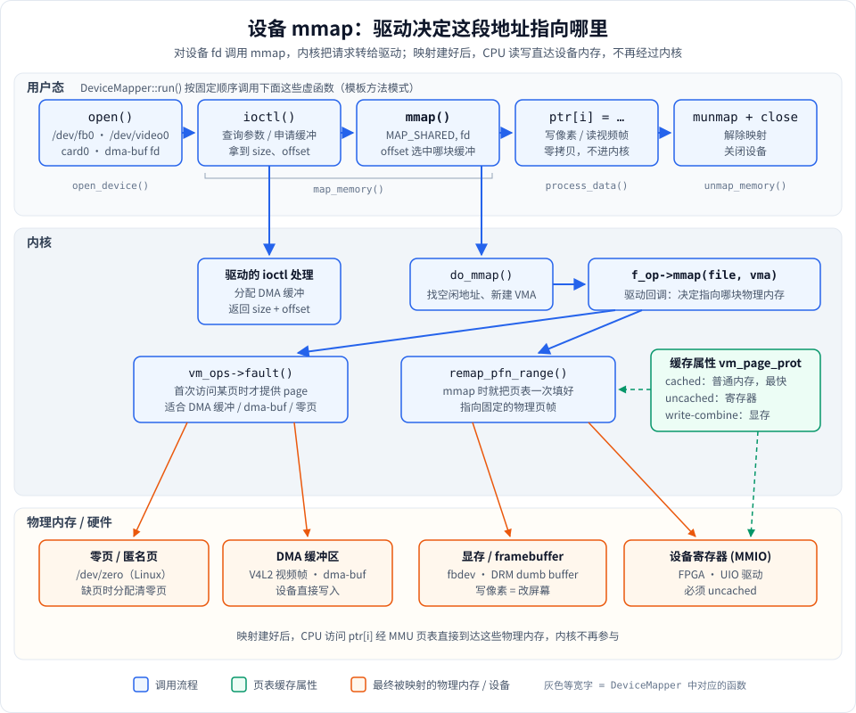

# 阶段 5：设备与驱动层 mmap

前面几个阶段映射的都是**普通文件**或**匿名内存**。这一阶段换成映射**设备文件**：`/dev/zero`、`/dev/fb0`（framebuffer）、`/dev/video0`（摄像头）、`/dev/dri/card0`（GPU），以及 dma-buf fd。

学它的原因是：嵌入式、音视频、图形、驱动开发里的"零拷贝"，几乎全是靠设备 mmap 实现的。弄懂这一层，你就知道摄像头的画面、屏幕上的像素是怎么不经过 `read()`/`write()` 拷贝，直接出现在你程序的指针里的。

**运行方式**

```bash
./mmap_learn 5        # 在构建目录下
```

**macOS 上能跑什么**

| demo | Linux | macOS |
|---|---|---|
| `demo_dev_zero`：映射 `/dev/zero` | ✅ 完整运行 | ❌ `mmap` 返回 `ENODEV`，打印失败后退出 |
| `demo_framebuffer`：映射 `/dev/fb0` | ✅ 需要有 framebuffer 设备和权限 | ⏭ 整段被 `#ifdef __linux__` 跳过 |
| `demo_device_concepts`：V4L2 / DRM / DMA-BUF 原理 | ✅ 只打印文字 | ✅ 只打印文字 |

想完整体验，请在 Linux 虚拟机（或 Docker 里的 Linux）运行。

---

## 一张图看懂：设备 mmap 的完整路径



这张图从上往下分三层：

1. **用户态**：所有设备 mmap 都是同样的五步：`open` → `ioctl` → `mmap` → 读写指针 → `munmap + close`。代码里由 `DeviceMapper::run()` 把这五步固定下来，灰色字就是每一步对应的虚函数。
2. **内核**：`mmap()` 进入内核后，`do_mmap()` 只负责找一段空闲虚拟地址并新建 VMA。**真正决定这段地址指向哪里的，是驱动的 `f_op->mmap` 回调**。驱动有两种实现方式：
   - `remap_pfn_range()`：在 mmap 时就把页表一次性填好，指向一段**固定的物理页帧**。适合显存、寄存器这种物理地址固定的内存。
   - `vm_ops->fault()`：先不填页表，等用户**第一次访问某页**时触发缺页，再由驱动提供那一页。适合 DMA 缓冲、dma-buf、`/dev/zero` 这种按需分配的内存。
3. **物理内存 / 硬件**：映射最终落到四类内存上。一旦页表建好，CPU 访问 `ptr[i]` 就经 MMU 直达这些物理内存，**之后不再进入内核**，这就是零拷贝的来源。

右侧绿色框是**页表缓存属性**：驱动在建页表时还要决定 CPU 能不能缓存这段内存。

---

## 知识点逐个讲

### 1. 对设备 fd 调用 mmap，到底发生了什么

对普通文件 mmap，内核用文件系统通用的实现，把文件的 page cache 页映射进来。对**设备文件** mmap，内核会调用驱动在 `file_operations` 里注册的 `.mmap` 函数，由驱动自己决定映射什么。

所以同样是 `mmap(NULL, len, PROT_READ|PROT_WRITE, MAP_SHARED, fd, offset)`：

- `fd` 指向 `/dev/fb0`，拿到的是**显存**；
- `fd` 指向 `/dev/video0`，拿到的是摄像头的**DMA 缓冲区**；
- `fd` 指向 `/dev/zero`，拿到的是**清零的匿名内存**。

这也解释了为什么 macOS 上 `/dev/zero` 映射会失败：macOS 的 `/dev/zero` 驱动根本没有实现 mmap 回调，内核只能返回 `ENODEV`（"Operation not supported by device"）。

### 2. ioctl + mmap 配合：先问清楚，再映射

设备内存的大小、格式、有几块缓冲，用户程序事先并不知道，所以几乎所有设备 mmap 都是**先 ioctl 查询或申请，再 mmap**：

| 设备 | 第一步 ioctl | 拿到什么 | 再 mmap |
|---|---|---|---|
| framebuffer | `FBIOGET_VSCREENINFO` / `FBIOGET_FSCREENINFO` | 分辨率、每像素位数、显存大小 `smem_len`、每行字节数 `line_length` | `mmap(…, smem_len, …, fd, 0)` |
| V4L2 摄像头 | `VIDIOC_REQBUFS` + `VIDIOC_QUERYBUF` | 每块缓冲的 `length` 和 `m.offset` | `mmap(…, length, …, fd, m.offset)` |
| DRM dumb buffer | `DRM_IOCTL_MODE_CREATE_DUMB` + `DRM_IOCTL_MODE_MAP_DUMB` | 缓冲大小和一个"假 offset" | `mmap(…, size, …, fd, offset)` |

注意第三列的 **offset**：对设备来说，它通常不是"文件里的第几个字节"，而是驱动发给你的一个**编号**，用来告诉驱动"我要映射的是哪一块缓冲"。

代码：[`FramebufferMapper::map_memory()`](stage5_device.cpp#L163) 里先做了两次 ioctl，拿到 `smem_len` 后才 mmap。

### 3. 为什么设备映射几乎都用 MAP_SHARED

`MAP_PRIVATE` 会触发写时复制：你一写，内核就给你复制一份私有页，之后的写入只改这个副本。对设备来说这完全没意义。往 framebuffer 写像素，写的是副本，屏幕不会有任何变化。

所以显存、DMA 缓冲这类映射都必须用 `MAP_SHARED`，让写入直达设备内存。

例外是 `/dev/zero`：它故意用 `MAP_PRIVATE`，因为我们要的正是"一块私有的清零内存"（见 [`DevZeroMapper::map_memory()`](stage5_device.cpp#L77)）。在 Linux 上，私有映射 `/dev/zero` 会被内核直接转成匿名映射，效果和 `MAP_ANONYMOUS` 完全一样。这是 `MAP_ANONYMOUS` 出现之前申请清零内存的老写法。

### 4. remap_pfn_range 与 fault：驱动的两种实现

这是驱动开发里 mmap 回调的两种典型写法：

```c
// 写法一：物理地址固定（显存、寄存器），mmap 时一次填好页表
static int mydev_mmap(struct file *f, struct vm_area_struct *vma) {
    vma->vm_page_prot = pgprot_writecombine(vma->vm_page_prot);  // 设置缓存属性
    return remap_pfn_range(vma, vma->vm_start, phys_addr >> PAGE_SHIFT,
                           vma->vm_end - vma->vm_start, vma->vm_page_prot);
}

// 写法二：按需提供页（DMA 缓冲、dma-buf），第一次访问时才填
static vm_fault_t mydev_fault(struct vm_fault *vmf) {
    struct page *page = find_my_page(vmf->pgoff);
    get_page(page);
    vmf->page = page;
    return 0;
}
static const struct vm_operations_struct mydev_vm_ops = { .fault = mydev_fault };
static int mydev_mmap(struct file *f, struct vm_area_struct *vma) {
    vma->vm_ops = &mydev_vm_ops;
    return 0;
}
```

| | remap_pfn_range | vm_ops->fault |
|---|---|---|
| 何时填页表 | mmap 时一次填完 | 每页第一次访问时 |
| 适合 | 连续、固定的物理地址：显存、MMIO 寄存器 | 不连续、按需分配的内存：DMA 缓冲、dma-buf |
| mmap 速度 | 映射大时较慢 | 很快，代价摊到每次缺页 |

缺页机制本身在 [阶段 7](../stage7/stage7_kernel.md) 会细讲。

### 5. 缓存属性：cached / uncached / write-combine

CPU 访问普通内存时会走缓存。但设备内存不一样：

- **寄存器（MMIO）必须 uncached**：读一个状态寄存器，如果读的是 CPU 缓存里的旧值，你永远看不到硬件的新状态；写一个控制寄存器，如果只写进了缓存，硬件根本收不到。驱动用 `pgprot_noncached()` 设置。
- **显存常用 write-combine**：不读缓存，但允许 CPU 把连续的小写入合并成一次大的总线写，画图时快很多。驱动用 `pgprot_writecombine()` 设置。
- **DMA 缓冲**：如果用了 cached 映射，CPU 写完要先把缓存刷回内存，设备才能看到；设备写完，CPU 要先让缓存失效才能读到新数据。dma-buf 为此提供了 `DMA_BUF_IOCTL_SYNC`。

用户程序看不到这些属性，但它们决定了映射是"正确"还是"偶尔读到旧数据"。

### 6. 模板方法模式：DeviceMapper

不管映射什么设备，流程都一样，只有每一步的细节不同。代码用模板方法模式把流程固定在基类里：

- [`DeviceMapper`](stage5_device.h#L57) 声明了 4 个纯虚步骤：[`open_device()`](stage5_device.h#L67)、[`map_memory()`](stage5_device.h#L73)、[`process_data()`](stage5_device.h#L76)、[`unmap_memory()`](stage5_device.h#L83)。
- [`DeviceMapper::run()`](stage5_device.cpp#L36) 按固定顺序调用它们，并负责出错处理：
  - `open_device()` 失败直接返回；
  - `map_memory()` 失败时调用 [`release_resources()`](stage5_device.cpp#L25) 关掉已打开的 fd；
  - `process_data()` 抛异常时，先 `unmap_memory()` 再把异常继续抛出。
- 析构函数 [`~DeviceMapper()`](stage5_device.cpp#L20) 调用非虚的 `release_resources()` 兜底。这里故意不调用虚函数 `unmap_memory()`：基类析构时子类部分已经销毁，虚调用不会分派到子类。
- 两个子类：
  - [`DevZeroMapper`](stage5_device.h#L135)：打开 `/dev/zero`，用 [`page_size()`](stage5_device.cpp#L72)（`sysconf(_SC_PAGESIZE)`）映射一页，写入字符串和整数再读回。
  - [`FramebufferMapper`](stage5_device.h#L181)（仅 Linux）：[`open_device()`](stage5_device.cpp#L147) 打开 `/dev/fb0`，[`map_memory()`](stage5_device.cpp#L163) 先 ioctl 再 mmap，[`process_data()`](stage5_device.cpp#L196) 只打印像素寻址公式、不真的画，避免弄花屏幕。

### 7. framebuffer 的像素寻址

```
像素 (x, y) 的地址 = base + y * line_length + x * bytes_per_pixel
```

用 `line_length` 而不是 `xres * bytes_per_pixel`，因为每行末尾可能有对齐填充。这是 framebuffer 编程最常见的坑：用错了，画面会一行一行地错位、倾斜。

---

## 运行输出解读（macOS）

```text
[Stage5] demo_dev_zero: Map /dev/zero for zero-initialized memory
  [DevZeroMapper] Opening /dev/zero ...
  [DevZeroMapper] /dev/zero opened, fd = 3
  [DevZeroMapper] Mapping 16384 bytes from /dev/zero ...
  [DevZeroMapper] mmap failed: Operation not supported by device
  [DeviceMapper] map_memory() failed, aborting.
```

- `fd = 3`：0、1、2 被标准输入、输出、错误占用，所以新打开的文件拿到 3。`open` 成功说明 `/dev/zero` 这个设备文件存在、可读写。
- `Mapping 16384 bytes`：这是运行时查到的页大小。Apple Silicon 的页是 **16KB**，不是很多资料里说的 4KB，所以代码用 `sysconf` 而不是写死 4096。
- `mmap failed: Operation not supported by device`：就是 `ENODEV`。macOS 的 `/dev/zero` 驱动没有实现 mmap 回调。**这不是代码 bug**，是平台差异。
- `map_memory() failed, aborting.`：`run()` 发现映射失败，调用 `release_resources()` 关闭 fd 后返回，没有泄漏。

```text
[Stage5] demo_framebuffer: Framebuffer device mmap
  [SKIPPED] Framebuffer mapping is Linux-specific.
```

macOS 的显示由 IOKit / Metal / Core Graphics 管理，没有 `/dev/fb*` 设备文件，整段被条件编译跳过。

`demo_device_concepts` 只打印 V4L2、DRM、DMA-BUF 的使用步骤，两个平台输出一样，对照上面第 2 节的表格阅读即可。

**在 Linux 上**，`demo_dev_zero` 会继续打印：`Memory is zero-initialized: YES`、写入并读回的字符串、偏移 256 处的 8 个整数，最后 `munmap done.` 和 `/dev/zero closed.`。

---

## 实际应用场景

| 场景 | 怎么用到设备 mmap |
|---|---|
| **摄像头采集（V4L2）** | 驱动分配一组 DMA 缓冲，应用 mmap 后循环 `VIDIOC_DQBUF` 取帧、`VIDIOC_QBUF` 还回去。帧数据从传感器经 DMA 直接进入用户态指针，全程不拷贝。 |
| **嵌入式显示（fbdev / DRM）** | 没有窗口系统的设备（工控屏、开机画面）直接往显存写像素。DRM dumb buffer 是 fbdev 的现代替代。 |
| **跨设备共享缓冲（DMA-BUF）** | 摄像头 → GPU 处理 → 编码器 / 显示，同一块缓冲用 fd 在设备间传递，CPU 需要时也能 mmap 进来看一眼。Android 的图形缓冲（AHardwareBuffer）底层就是这个。 |
| **用户态驱动（UIO / FPGA）** | 驱动只负责把寄存器区域 mmap 给用户态，具体的控制逻辑在用户程序里写，开发调试更方便。 |

## 常见坑

1. **用了 MAP_PRIVATE**：写进去的东西只在自己的副本里，硬件看不到。
2. **页大小写死 4096**：ARM64 上可能是 16KB 或 64KB，offset 和 length 对不齐会导致 `EINVAL`。
3. **像素寻址用 xres 而不是 line_length**：画面倾斜错位。
4. **DMA 缓冲忘记同步缓存**：偶尔读到旧数据，非常难排查。
5. **权限不足**：`/dev/fb0`、`/dev/video0` 通常需要 root 或在 `video` 组里。

## macOS 与 Linux 的差异

| | Linux | macOS |
|---|---|---|
| `/dev/zero` mmap | 支持，等价于匿名映射 | 不支持，`ENODEV` |
| framebuffer | `/dev/fb0`、`/dev/dri/card0` | 没有，显示走 IOKit / Metal |
| 摄像头 | V4L2 `/dev/video*` | AVFoundation，没有设备文件可 mmap |
| 页大小 | x86_64 通常 4KB | Apple Silicon 16KB |

更多系统调用细节见 [用到的系统调用](../../doc/1-用到的系统调用.md)。

---

## 动手练习

1. **在 Linux 上跑通 `/dev/zero`**：在 Linux 虚拟机运行 `./mmap_learn 5`，确认输出 `Memory is zero-initialized: YES`。再把 `MAP_PRIVATE` 改成 `MAP_SHARED`，fork 一个子进程写入，父进程能看到吗？
   *提示*：Linux 上共享映射 `/dev/zero` 会变成一块共享匿名内存（shmem），父子进程能互相看到。
2. **对比 `/dev/zero` 和 `MAP_ANONYMOUS`**：两种方式各映射 100MB，用 `/proc/self/maps` 看它们对应的行有什么不同（路径列、设备号、inode）。
3. **读 framebuffer 参数**：有图形界面的 Linux 虚拟机通常有 `/dev/fb0`。用 root 运行，记下分辨率、`bits_per_pixel`、`line_length`，算一算 `line_length` 和 `xres * bytes_per_pixel` 是否相等。
4. **画一个像素**（谨慎）：在 `FramebufferMapper::process_data()` 里，按寻址公式在屏幕中央画一个 10×10 的红色方块，切到文本终端（Ctrl+Alt+F3）观察。
5. **思考题**：显存为什么用 write-combine 而不是 uncached？如果寄存器被映射成 cached，会出现什么现象？
