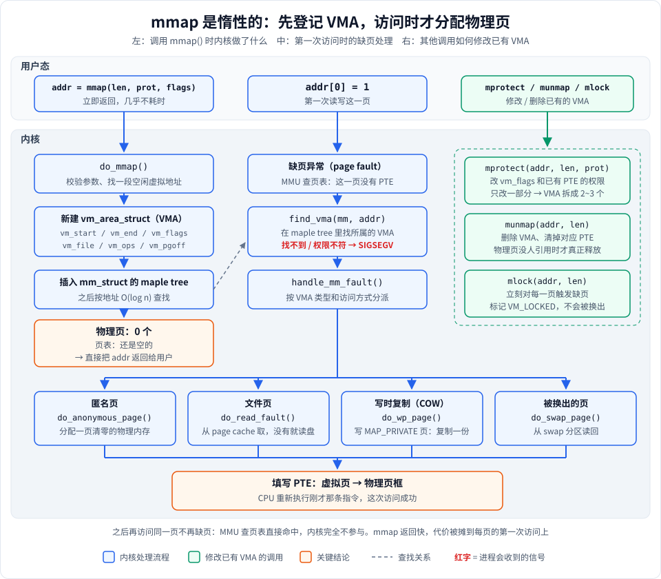
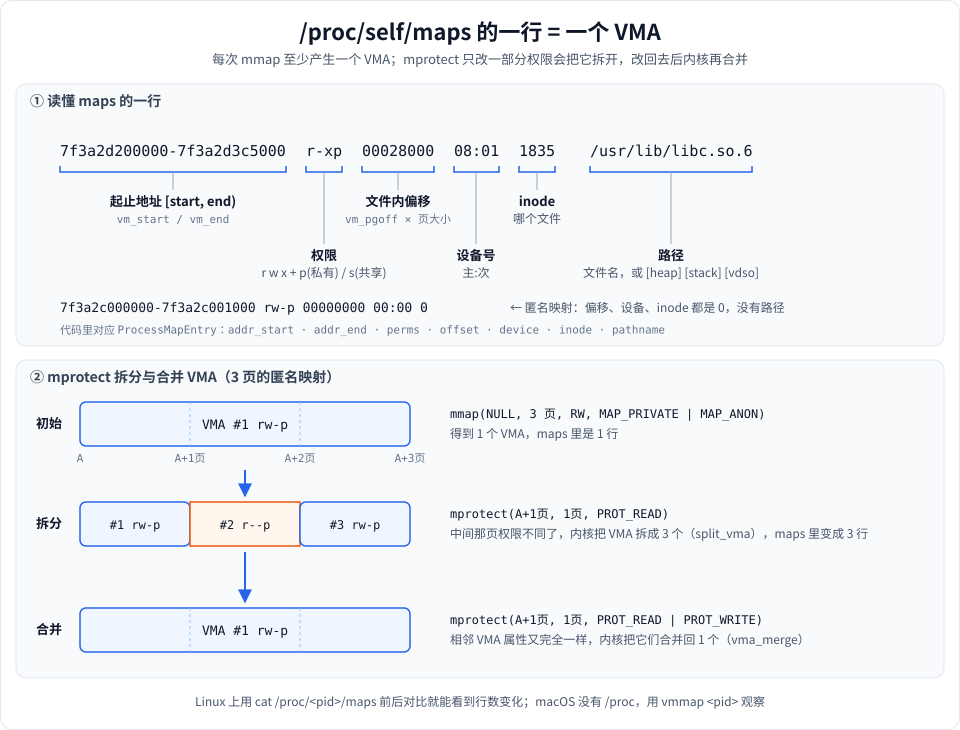
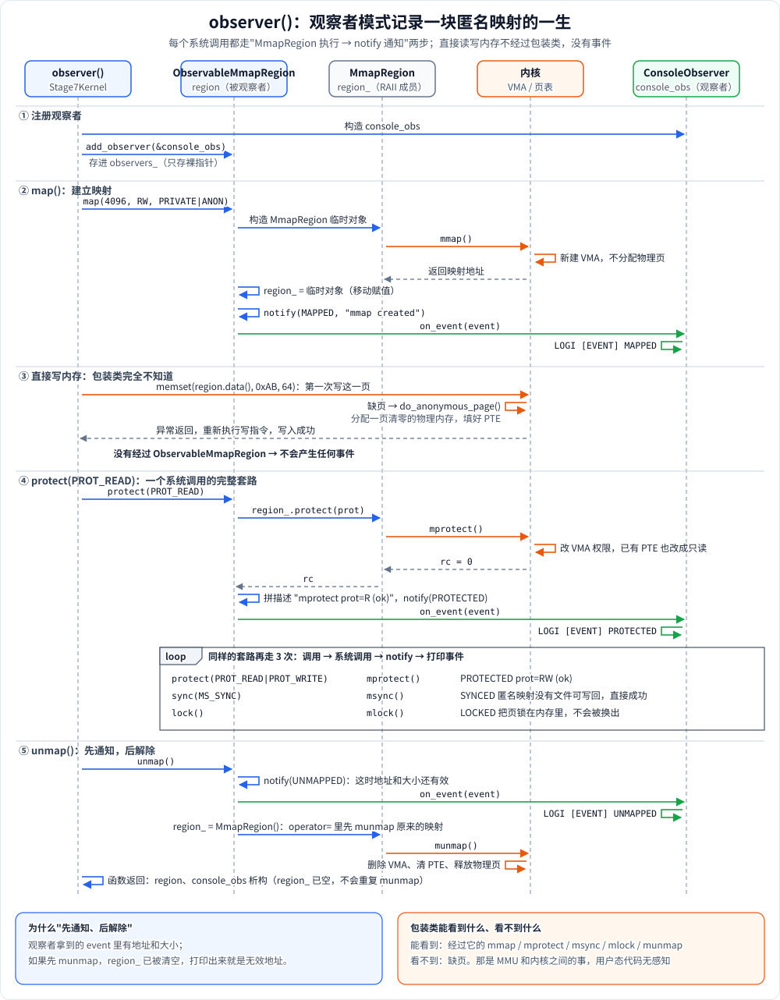
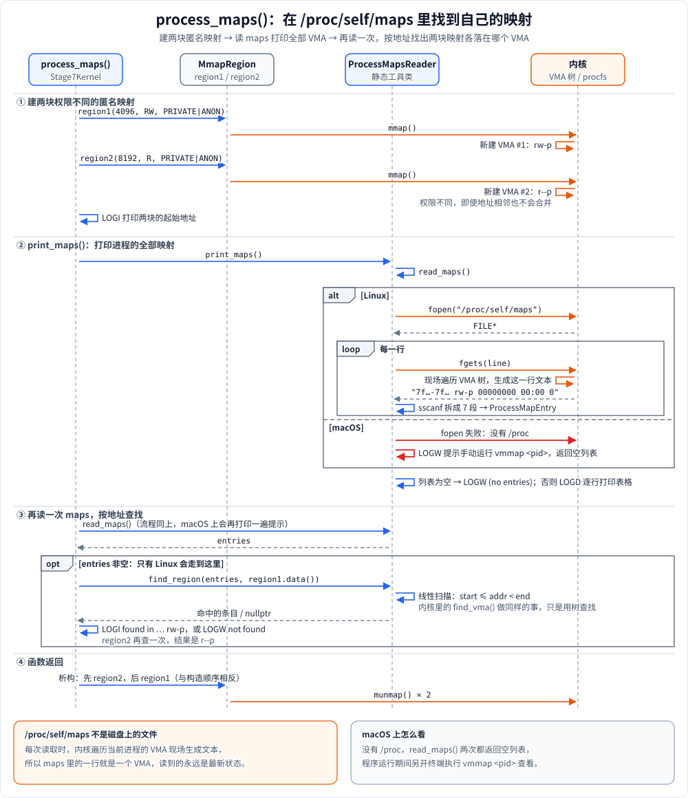
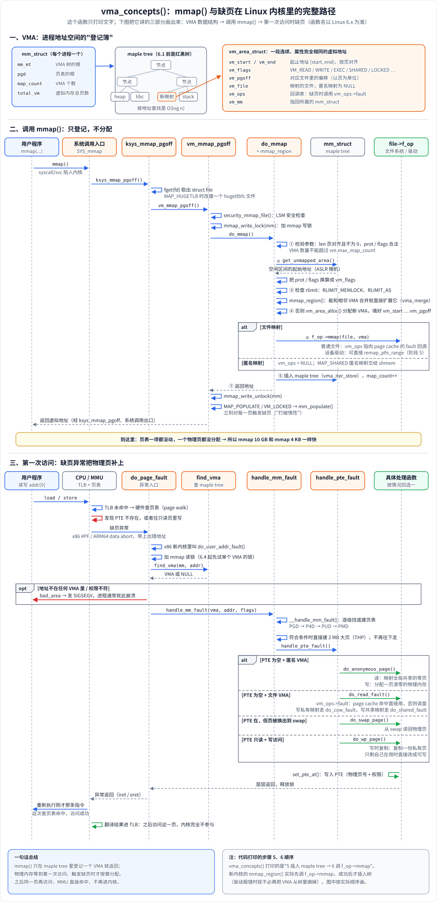

# 阶段 7：内核原理 —— mmap 在内核里做了什么

前面几个阶段都站在用户态看 mmap：调用、读写、解除。这一阶段把视角切到内核，回答几个"为什么"：

- 为什么 `mmap` 一个 10GB 的文件也能**瞬间返回**？
- 为什么程序的 **VSZ（虚拟内存）很大，RSS（实际占用）却很小**？
- 为什么访问一个没映射的地址会 **SIGSEGV**，而映射了但没访问过的地址却不会？
- `mprotect` 改一部分页的权限，内核里发生了什么？

答案都落在两个概念上：**VMA（虚拟内存区域）** 和 **缺页异常（page fault）**。

**运行方式**

```bash
./mmap_learn 7        # 在构建目录下
```

**macOS 上能跑什么**

| demo                                                       | Linux         | macOS                                                   |
|------------------------------------------------------------|---------------|---------------------------------------------------------|
| `observer`：用观察者模式记录映射生命周期              | ✅            | ✅ 完全一样                                             |
| `process_maps`：读 `/proc/self/maps` 并定位自己的映射 | ✅            | ⚠️ 没有 `/proc`，只打印提示，让你手动运行 `vmmap <pid>` |
| `vma_concepts`：打印内核数据结构与调用路径            | ✅ 只打印文字 | ✅ 只打印文字                                           |

文中讲的 `vm_area_struct`、`do_mmap`、缺页函数名都是 **Linux 内核**的。macOS（XNU 内核）的对应概念是 `vm_map_entry` 和 `vm_fault()`，思路相同、名字不同。

---

## 图一：mmap 是惰性的



这张图分三列，按时间顺序看：

**左列：调用 `mmap()` 时**，内核只做"登记"：

1. `do_mmap()` 校验参数，找一段空闲的虚拟地址。
2. 新建一个 `vm_area_struct`（VMA），记下起止地址、权限、对应的文件和偏移。
3. 把 VMA 插进进程的 `mm_struct`（Linux 6.1 起用 maple tree，之前是红黑树），以后可以按地址快速查找。
4. **不分配任何物理页，页表也不动**，直接返回地址。

所以 mmap 10GB 和 mmap 4KB 花的时间几乎一样。

**中列：第一次访问 `addr[0]` 时**，真正的工作才开始：

1. MMU 查页表发现这一页没有 PTE（页表项），触发**缺页异常**，CPU 陷入内核。
2. `find_vma()` 用左列那棵树查这个地址属于哪个 VMA。**找不到，或者权限不符（比如往只读页里写），进程收到 SIGSEGV**。
3. 找到了就交给 `handle_mm_fault()`，**按 VMA 类型分派到四种处理之一**：
   - **匿名页**（`MAP_ANONYMOUS`、堆、栈）：分配一页清零的物理内存。
   - **文件页**         ：从 page cache 拿，没有就从磁盘读进来。
   - **写时复制（COW）**：写 `MAP_PRIVATE` 映射的页，或 fork 之后父子共享的页时，先复制一份再写。
   - **被换出的页**     ：从 swap 分区读回。
4. 填好 PTE，CPU **重新执行**刚才那条指令，这次就成功了。之后再访问这一页，MMU 直接命中，内核完全不参与。

**右列：其他系统调用**都是在修改已有的 VMA：

- `mprotect`：改 VMA 的权限和已有 PTE 的权限；只改一部分时会把 VMA 拆开（见图二）。
- `munmap`  ：删除 VMA、清掉 PTE。物理页只有在没人引用时才真正释放（比如文件页可能还留在 page cache 里）。
- `mlock`   ：立刻对每一页主动触发缺页，把页全部调入内存，并标记 `VM_LOCKED` 防止换出。所以 mlock 是"打破惰性"的方式。

---

## 图二：maps 的一行就是一个 VMA



**上半部分**：Linux 把进程的每个 VMA 以一行文本暴露在 `/proc/<pid>/maps` 里。六个字段从左到右依次是：

| 字段     | 示例                        | 含义                                                                         | 对应 `ProcessMapEntry`   |
|----------|-----------------------------|------------------------------------------------------------------------------|--------------------------|
| 起止地址 | `7f3a2d200000-7f3a2d3c5000` | `[vm_start, vm_end)`，左闭右开                                               | `addr_start`、`addr_end` |
| 权限     | `r-xp`                      | 读/写/执行，最后一位 `p` 是私有（`MAP_PRIVATE`），`s` 是共享（`MAP_SHARED`） | `perms`                  |
| 偏移     | `00028000`                  | 映射从文件的哪个字节开始                                                     | `offset`                 |
| 设备号   | `08:01`                     | 文件所在设备的"主:次"号                                                      | `device`                 |
| inode    | `1835`                      | 文件的 inode 号                                                              | `inode`                  |
| 路径     | `/usr/lib/libc.so.6`        | 文件名，或 `[heap]`、`[stack]`、`[vdso]` 等                                  | `pathname`               |

匿名映射的偏移、设备、inode 都是 0，没有路径。`process_maps` 里的 `region1`、`region2` 就是这种。

**下半部分**：一个 VMA 内所有页的权限必须相同。所以对 3 页映射的中间一页 `mprotect(PROT_READ)`，内核只能把 VMA **拆成 3 个**（`split_vma`），maps 里也从 1 行变成 3 行。把权限改回去后，相邻三个 VMA 的属性又完全一样，内核会把它们**合并回 1 个**（`vma_merge`）。

这也是为什么频繁对零散小区域做 mprotect 的程序（比如某些 JIT、内存调试工具），会让进程的 VMA 数量暴涨，甚至撞上 `vm.max_map_count`（默认 65530）的上限，之后 mmap 直接失败。

---

## 知识点逐个讲（对应代码）

### 1. 观察者模式：记录映射的生命周期



代码用观察者模式给 mmap 相关操作"埋点"，每次系统调用后都发出一个事件：

- 事件类型 [`MemoryEventType`](stage7_kernel.h#L44)：`MAPPED`、`UNMAPPED`、`PROTECTED`、`SYNCED`、`LOCKED`；事件内容 [`MemoryEvent`](stage7_kernel.h#L55)：类型、地址、大小、描述。
- 观察者接口 [`IMemoryObserver`](stage7_kernel.h#L70)，一个实现 [`ConsoleObserver`](stage7_kernel.h#L85) 把事件打印出来（[`on_event()`](stage7_kernel.cpp#L38)）。
- 被观察对象 [`ObservableMmapRegion`](stage7_kernel.h#L114) 内部持有一个 `MmapRegion`，每个操作先执行系统调用，再调用 [`notify()`](stage7_kernel.cpp#L48) 通知所有观察者：
  - [`map()`](stage7_kernel.cpp#L61) → `MAPPED`
  - [`protect()`](stage7_kernel.cpp#L71) → `PROTECTED`，描述里带上新权限和结果
  - [`sync()`](stage7_kernel.cpp#L83) → `SYNCED`
  - [`lock()`](stage7_kernel.cpp#L91) → `LOCKED`
  - [`unmap()`](stage7_kernel.cpp#L66) → `UNMAPPED`。注意它是**先通知、后解除**，所以事件里还能打印出原来的地址。

关键观察：**直接读写 `region.data()` 不产生任何事件**。读写内存不是系统调用，内核只在缺页那一刻介入，用户态的包装类根本感知不到。这正对应图一中列：首次访问由 MMU 和内核处理，跟你的代码无关。

### 2. 读 /proc/self/maps



[`ProcessMapsReader`](stage7_kernel.h#L250) 负责读取和解析：

- [`read_maps()`](stage7_kernel.cpp#L110)：打开 `/proc/self/maps`，用 `unique_ptr<FILE>` 管理文件句柄，保证解析中途出异常也会关闭。macOS 上打不开，就提示 `vmmap <pid>`。
- [`parse_maps_file()`](stage7_kernel.cpp#L161)：每行用 `sscanf` 按 `"%lx-%lx %4s %lx %11s %lu %255[^\n]"` 拆成 7 段，匿名映射没有路径，所以至少要拿到 6 段才算有效。
- [`find_region()`](stage7_kernel.cpp#L151)：给一个地址，在所有条目里找 `start <= addr < end` 的那一个。这就是内核 `find_vma()` 做的事，只不过内核用树查找，这里是线性扫描。

### 3. 内核路径与缺页处理



这张图分三块：

- **一、VMA**：每个进程有一个 `mm_struct`，它用一棵 maple tree 管理所有 VMA；一个 `vm_area_struct` 描述一段连续、属性相同的虚拟地址。
- **二、调用 mmap()**：从系统调用入口一路到 `do_mmap` / `mmap_region`，做的事情是加锁、检查、找地址、建 VMA、插进树里。整个过程**页表一项都没动**。只有 `MAP_POPULATE` 或 `mlock` 会在返回前主动触发缺页。
- **三、第一次访问**：MMU 查不到页表项 → 缺页异常 → `find_vma` 找 VMA（找不到就 SIGSEGV）→ `handle_mm_fault` 逐级建页表 → `handle_pte_fault` 按情况分给 4 个处理函数 → 填好 PTE → 回到用户态重新执行那条指令。

> 代码打印的第 5 步（插入 maple tree）和第 6 步（调 `f_op->mmap`）顺序与新内核相反：`mmap_region()` 先调 `f_op->mmap`，成功后才把 VMA 插进树里。图里按实际顺序画。

[`vma_concepts()`](stage7_kernel.cpp#L260) 把内核里的调用路径打印出来，对照图一阅读即可：

```
mmap()  →  ksys_mmap_pgoff  →  vm_mmap_pgoff  →  do_mmap
             校验参数 → get_unmapped_area 找地址 → 检查 rlimit
             → 分配 VMA → 插入 maple tree → 文件映射时调用 f_op->mmap
缺页    →  do_page_fault  →  find_vma  →  handle_mm_fault  →  handle_pte_fault
             → do_anonymous_page / do_read_fault / do_wp_page / do_swap_page
```

阶段 5 讲的驱动 `f_op->mmap` 回调，就是 `do_mmap` 第 6 步调用的那个函数。

### 4. 透明大页（THP）与 MAP_HUGETLB

默认一页 4KB（Apple Silicon 16KB）。映射 1GB 需要 26 万个 PTE，TLB（页表缓存）根本放不下，频繁未命中会拖慢访问。

- **THP（透明大页）**：内核自动用 2MB 的大页替代 512 个小页，对程序透明。可以用 `madvise(addr, len, MADV_HUGEPAGE)` 提示内核对某段内存使用大页。`/proc/self/smaps` 里的 `AnonHugePages` 字段能看到实际用了多少。
- **`MAP_HUGETLB`**：显式要求用大页，需要管理员事先预留（`/proc/sys/vm/nr_hugepages`），预留不够就直接失败。

数据库（PostgreSQL、Oracle）、JVM 堆、DPDK 网络包缓冲常用大页减少 TLB 未命中。

### 5. 安全：ASLR 与 W^X

- **ASLR**：`mmap(NULL, …)` 每次返回的地址是随机的，攻击者很难预测代码和数据的位置。运行两次本 demo，打印的地址会不同。
- **W^X（写和执行互斥）**：一块内存同一时刻不能既可写又可执行，防止攻击者写入代码后执行。JIT 编译器（V8、JVM）的标准做法是：先 `PROT_READ|PROT_WRITE` 写入机器码，再 `mprotect` 成 `PROT_READ|PROT_EXEC` 执行。macOS 对此更严格，JIT 内存需要 `MAP_JIT` 和专门的 API 切换。

---

## 运行输出解读（macOS）

```text
[Stage7] observer: Observer pattern for mmap operations

  --- Mapping anonymous region (4096 bytes) ---
  [EVENT] MAPPED     | addr: 0x104768000 | size:     4096 | mmap created
  --- Writing data ---
  (wrote 64 bytes of 0xAB, no event -- direct access)
  --- Changing protection to READ-ONLY ---
  [EVENT] PROTECTED  | addr: 0x104768000 | size:     4096 | mprotect prot=R (ok)
  --- Changing protection to READ-WRITE ---
  [EVENT] PROTECTED  | addr: 0x104768000 | size:     4096 | mprotect prot=RW (ok)
  --- Syncing ---
  [EVENT] SYNCED     | addr: 0x104768000 | size:     4096 | msync MS_SYNC (ok)
  --- Locking pages ---
  [EVENT] LOCKED     | addr: 0x104768000 | size:     4096 | mlock (ok)
  --- Unmapping ---
  [EVENT] UNMAPPED   | addr: 0x104768000 | size:     4096 | munmap requested
```

- `MAPPED`：只建了 VMA，此时这 4096 字节一个物理页都没有。
- `wrote 64 bytes … no event`：这次 `memset` 触发了缺页，内核分配了一页清零内存（`do_anonymous_page`）。但这是 MMU 和内核之间的事，**用户态包装类收不到任何通知**。
- `size: 4096`：虽然 Apple Silicon 一页是 16KB，内核实际映射了一整页，但 `MmapRegion` 记录的是你请求的长度，所以打印 4096。
- 两次 `PROTECTED`：权限改成只读再改回读写。整个映射一起改，所以 VMA 不会被拆分。
- `SYNCED (ok)`：对匿名映射调用 msync 直接返回成功，因为没有文件可以写回，这里只是为了演示事件。
- `LOCKED (ok)`：4KB 远小于 `RLIMIT_MEMLOCK` 限制，所以成功。
- `UNMAPPED`：先通知再 munmap，所以还能打印原地址。

```text
[Stage7] process_maps: Process memory layout

  Created region1 at 0x104768000 (4096 bytes, rw)
  Created region2 at 0x10476c000 (8192 bytes, r-)

  --- Current process memory mappings ---
  [ProcessMapsReader] /proc/self/maps not available on macOS.
  [ProcessMapsReader] Run manually:  vmmap 85588
  (no entries available)
```

- `region1` 的地址和上面刚 munmap 掉的地址一样：内核把刚释放的虚拟地址区间直接复用了。
- 两块映射相差 `0x4000` = 16KB：region1 只要 4KB，但占了一整页（16KB），region2 只能从下一页开始。
- macOS 没有 `/proc`，所以读不到 maps。要观察，需要在程序运行期间另开终端执行 `vmmap <pid>`。

**在 Linux 上**，这里会打印完整的 maps 表，并输出 `region1 (…) found in: … rw-p` 和 `region2 (…) found in: … r--p`。两块权限不同，所以即使地址相邻，也是两个独立的 VMA，不会合并。

`vma_concepts` 只打印文字，对照"内核路径与缺页处理"一节的时序图阅读。

---

## 实际应用场景

| 场景                    | 用到本阶段的哪个知识点                                                                                         |
|-------------------------|----------------------------------------------------------------------------------------------------------------|
| **看懂内存占用**        | VSZ 是所有 VMA 的大小之和，RSS 是真正有物理页的部分。mmap 了大文件但只访问一小段，VSZ 大、RSS 小，这是正常的。 |
| **定位段错误**          | 拿 SIGSEGV 的出错地址去 maps 里查：不在任何 VMA 里是野指针；在只读 VMA 里是写了只读数据。                      |
| **JIT 编译器**          | 按 W^X 原则用 mprotect 切换权限；大量零散的权限切换会导致 VMA 拆分、数量暴涨。                                 |
| **数据库 / JVM 大内存** | 用 THP 或 `MAP_HUGETLB` 减少 TLB 未命中。                                                                      |
| **启动性能优化**        | 知道 mmap 是惰性的，就能用 `MAP_POPULATE` 或 `madvise(MADV_WILLNEED)` 把缺页提前到启动阶段，避免运行时卡顿。   |

## 常见坑

1. **以为 mmap 后内存就"分配好了"**：第一次访问每页都会缺页，大映射的第一次遍历可能很慢。对延迟敏感的场景要提前预热。
2. **VMA 数量超过 `vm.max_map_count`**：大量小 mmap 或零散 mprotect 会撞上限，mmap 返回 `ENOMEM`，但其实内存还很充足。
3. **把 munmap 当作"立刻还内存"**：文件页可能还留在 page cache 里，RSS 下降了，但系统的空闲内存不一定马上变多。
4. **在 macOS 上找 `/proc`**：没有。用 `vmmap <pid>`、`vm_stat`，或者 Instruments。

## macOS 与 Linux 的差异

| | Linux | macOS（XNU） |
|---|---|---|
| 区域数据结构 | `vm_area_struct`，存在 maple tree | `vm_map_entry`，存在 `vm_map` |
| 缺页入口 | `handle_mm_fault()` | `vm_fault()` |
| 观察映射 | `/proc/<pid>/maps`、`smaps` | `vmmap <pid>` |
| 页大小 | x86_64 通常 4KB | Apple Silicon 16KB |
| 大页 | THP、`MAP_HUGETLB` | 没有用户可控的等价机制 |
| JIT 内存 | mprotect 切换 RW / RX | 需要 `MAP_JIT` 和 `pthread_jit_write_protect_np` |

系统调用本身的用法见 [用到的系统调用](../../doc/1-用到的系统调用.md)。

---

## 动手练习

1. **亲眼看到 VMA 拆分**（Linux）：映射 3 页匿名内存，打印 `/proc/self/maps` 中对应的行数；对中间一页 `mprotect(PROT_READ)` 后再打印一次；改回读写后再打印一次。验证图二的"1 行 → 3 行 → 1 行"。
   *提示*：可以复用 `ProcessMapsReader::read_maps()` 和 `find_region()`，统计落在你那段地址范围内的条目数。
2. **测量惰性分配**：mmap 1GB 匿名内存，记录 mmap 耗时；然后每隔 4KB 写一个字节，再记录耗时。用 `/proc/self/status` 的 `VmRSS` 对比前后变化。macOS 上可以用 `getrusage` 的 `ru_maxrss` 代替。
3. **数缺页次数**：同上的写入循环前后，用 `getrusage(RUSAGE_SELF)` 读 `ru_minflt`（次缺页次数），差值应该约等于你访问的页数。再试试加上 `MAP_POPULATE`（Linux）后差值变成多少。
4. **观察 COW**：mmap 一个文件为 `MAP_PRIVATE`，读一遍后看 `smaps` 里该区域的 `Private_Dirty`；再写一遍后看它怎么变化，解释原因。
5. **思考题**：`ObservableMmapRegion` 能不能做到"每次缺页都通知观察者"？如果不能，用户态有什么办法感知缺页？
   *提示*：想想 `mprotect(PROT_NONE)` + SIGSEGV 处理函数，以及 Linux 的 `userfaultfd`。
