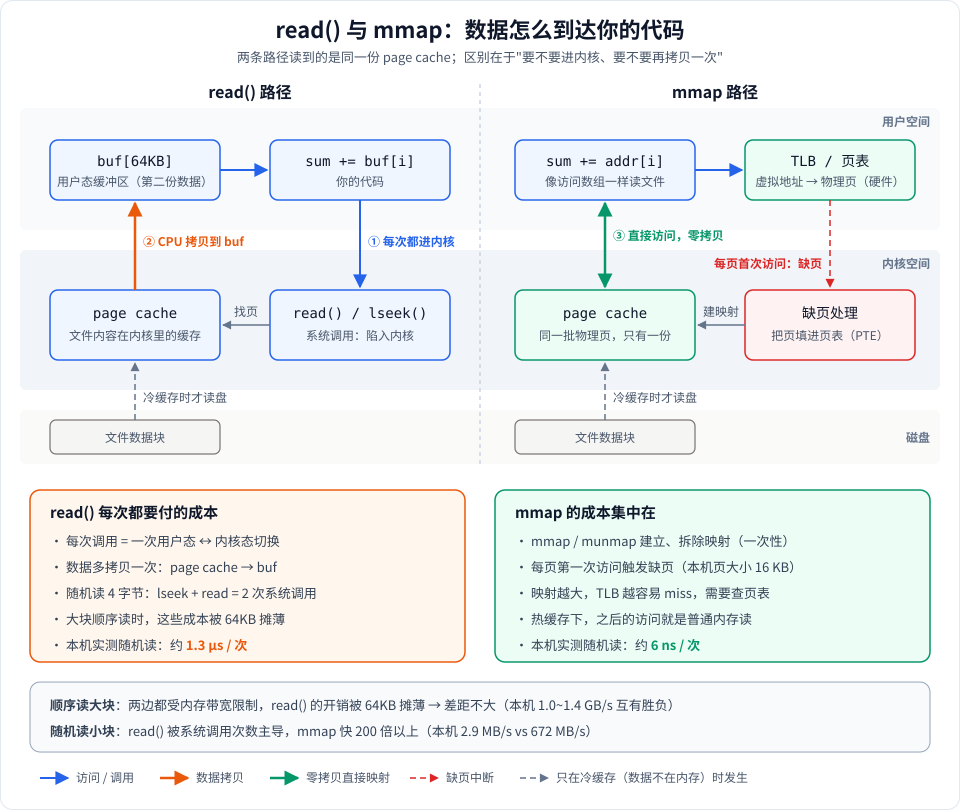
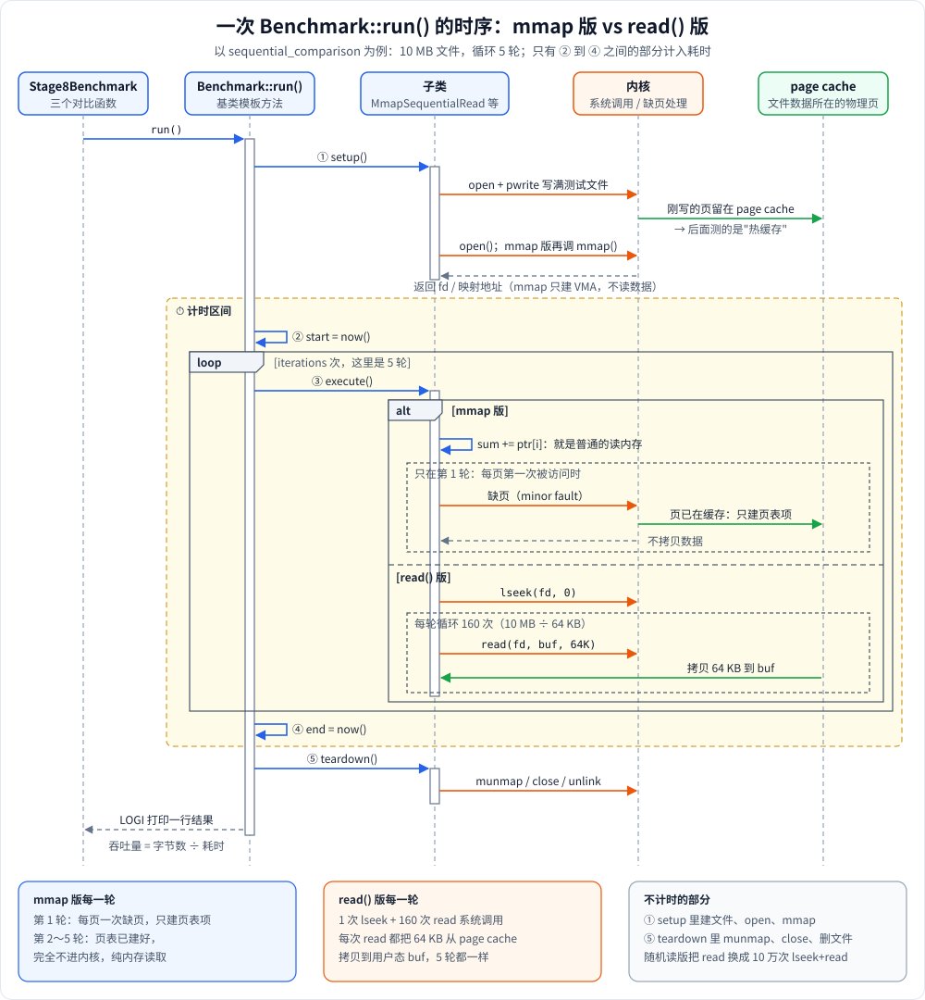
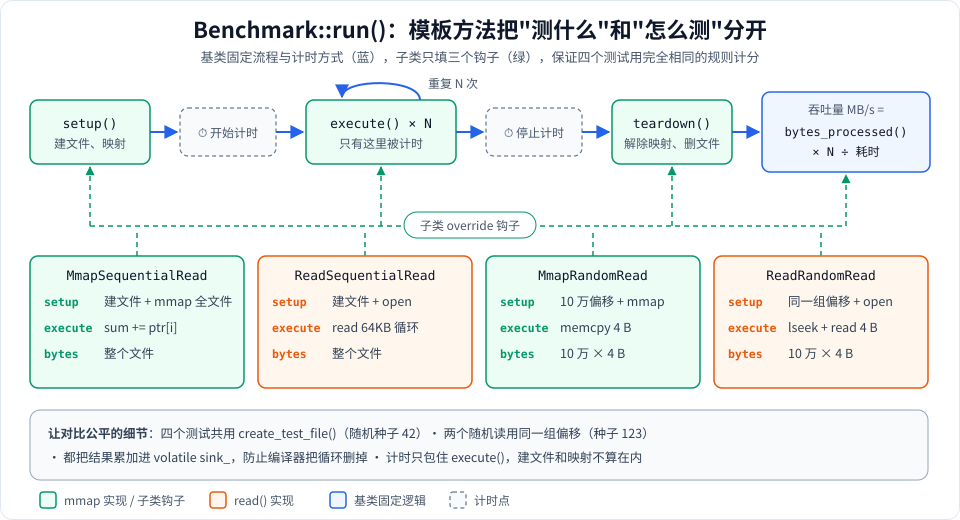

# Stage 8：性能基准测试 —— mmap 一定比 read() 快吗？

## 这个阶段学什么

前面几个阶段一直在说"mmap 省掉了一次拷贝"。这个阶段用实验回答一个更实际的问题：**在什么情况下 mmap 真的更快，什么情况下它反而不占优？**

你会亲手测出四组数据：

| 测试                     | 访问方式                                       | 每轮读多少  |
|--------------------------|------------------------------------------------|-------------|
| `mmap sequential read`   | 映射整个文件，从头到尾逐字节累加               | 整个文件    |
| `read() sequential read` | 每次 `read()` 64KB 到缓冲区，再逐字节累加      | 整个文件    |
| `mmap random read`       | 在映射里随机取 10 万个位置，每次 4 字节        | 10 万 × 4 B |
| `read() random read`     | 同样 10 万个位置，每次 `lseek` + `read` 4 字节 | 10 万 × 4 B |

**为什么要学**：选 mmap 还是 read 是工程里真实存在的决策。ripgrep、SQLite、LMDB、llama.cpp 都在这件事上做过取舍。只记"mmap 零拷贝所以快"会让你在顺序大块读的场景里做出错误判断。

**运行方式**：

```bash
cmake -S . -B build && cmake --build build
./build/mmap_learn 8
```

> 注意：CMakeLists 没有设置 `CMAKE_BUILD_TYPE`，默认构建**不开优化**。想看接近真实的数字，用 `cmake -S . -B build-rel -DCMAKE_BUILD_TYPE=Release` 再跑一次（下文"运行输出解读"里两种都有）。

---

## 全景图：两条数据路径



一句话读懂这张图：**两条路径读的都是内核里同一份 page cache**，区别只在"数据怎么到你的代码手里"。

- **read() 路径**（左）：你的代码 → ① 系统调用陷入内核 → 内核在 page cache 里找到页 → ② CPU 把数据**拷贝**到你的 `buf` → 回到用户态，你再去读 `buf`。
- **mmap 路径**（右）  ：你的代码直接读 `addr[i]` → CPU 通过 TLB / 页表把虚拟地址翻译成 page cache 的物理页 → ③ **直接读到**，没有拷贝。只有某一页**第一次**被访问时，才会触发一次缺页，由内核把这一页填进页表。

所以两者的成本结构完全不同：read() 是"**每次调用都要付**"（系统调用 + 拷贝），mmap 是"**每页第一次付一次**"（缺页）+ 一次性的 mmap/munmap。

---

## 时序图：一次 run() 里发生了什么



上面的全景图讲"数据怎么走"，这张图按时间顺序讲"谁在什么时候调用了谁"，从上往下看：

- **① setup()**：建测试文件、`open`，mmap 版再调一次 `mmap`。刚写进去的数据留在 page cache 里，所以后面测的是热缓存。mmap 这时只建 VMA，不读任何数据。
- **② start → ④ end**（黄色底色）：只有这一段计入耗时。中间的 `loop` 跑 `iterations` 轮 `execute()`，`alt` 框里分成两种情况：
  - **mmap 版**：读 `ptr[i]` 就是普通的读内存。只有第 1 轮里每页第一次被访问时会缺页，内核发现页已经在 page cache 里，只补一个页表项，不拷贝数据。第 2 轮以后完全不进内核。
  - **read() 版**：每一轮都要 `lseek` 回到开头，再调 160 次 `read`，每次内核都把 64 KB 从 page cache 拷贝到 `buf`。5 轮里的每一轮都是这样。
- **⑤ teardown()**：`munmap`、`close`、删文件，这部分不计时。最后 `run()` 用 ② 到 ④ 的时间算出吞吐量，用 `LOGI` 打印一行结果。

---

## 知识点逐个讲

### 1. read() 的成本：系统调用 + 拷贝

每次 `read()` 都是一次用户态 → 内核态 → 用户态的切换，再加上一次 `page cache → buf` 的内存拷贝。

- 顺序读时，代码用 64KB 的缓冲区（[`ReadSequentialRead::execute`](read_sequential_read.cpp#L20)），10MB 文件只需要 160 次系统调用，切换成本被摊得很薄；64KB 的 `buf` 还能留在 CPU 缓存里，拷贝也不算贵。
- 随机读时，每读 4 字节都要 `lseek` + `read` 两次系统调用（[`ReadRandomRead::execute`](read_random_read.cpp#L30)），10 万次读取就是 **20 万次**系统调用，成本完全被切换开销主导。

### 2. mmap 的成本：缺页 + TLB + 映射本身

mmap 不是"没有成本"，只是成本出现在别的地方：

- **mmap / munmap 本身**：建立和拆除映射要修改进程的地址空间（VMA）和页表。本项目把它放在 `setup()` / `teardown()` 里，不计入时间（[`MmapSequentialRead::setup`](mmap_sequential_read.cpp#L12)）。
- **缺页**：映射建立后页表是空的，每一页第一次被访问都要陷入内核处理一次缺页。Apple Silicon 的页大小是 16KB，10MB 文件大约要 640 次缺页。缺页只发生在**第一轮** `execute()`，后面几轮就是纯内存访问。
- **TLB**：TLB 是 CPU 里缓存"虚拟地址 → 物理地址"的小表。映射越大、访问越分散，TLB 越容易 miss，每次 miss 都要去查页表。

详细的系统调用说明见 [../../doc/1-用到的系统调用.md](../../doc/1-用到的系统调用.md)。

### 3. 顺序读 vs 随机读

- **顺序读**：两边最后都受限于"逐字节累加"这个循环和内存带宽。read() 多出来的拷贝被 64KB 摊薄，所以差距不大，甚至 read() 有时更快。
- **随机读**：read() 每 4 字节付一次（两次）系统调用；mmap 在页表建好后就是一次普通的内存读取。差距是**两个数量级**。

结论：**mmap 的优势在"随机访问 + 小块读取"时最明显**，这正是数据库索引、KV 存储、模型权重按需加载的访问模式。

### 4. 热缓存 vs 冷缓存

测试文件是 [`Benchmark::create_test_file`](benchmark.cpp#L22) 刚用 `pwrite` 写出来的，内容还完整地留在 page cache 里。所以这组 benchmark 测的是**热缓存**：完全没有磁盘 I/O，比的只是"page cache 到你的代码"这一段。

如果文件不在内存里（**冷缓存**），两条路径都要先从磁盘读，磁盘 I/O 会成为主要成本，mmap 和 read 的差距会被大幅冲淡。程序开头打印的 `Note: hot-cache benchmark` 就是在提醒这一点（[`Stage8Benchmark::run_all`](stage8_benchmark.cpp#L92)）。

### 5. 模板方法：把"测什么"和"怎么测"分开



[`Benchmark`](benchmark.h#L27) 是一个抽象基类，[`run()`](benchmark.cpp#L49) 把流程固定成：

```
setup() → 开始计时 → execute() × N → 停止计时 → teardown() → 算吞吐量
```

四个子类只需要实现三个钩子 [`setup`](benchmark.h#L41) / [`execute`](benchmark.h#L44) / [`teardown`](benchmark.h#L47)，以及可选的 [`bytes_processed`](benchmark.h#L68)。好处是：

- **计时口径统一**：只有 `execute()` 被计时，建文件、建映射这些准备工作不会混进结果。
- **加新测试很便宜**：想测 `pread`、`MAP_POPULATE`，只要再写一个子类。

这和 Google Benchmark、JMH 等框架的设计思路一致。

### 6. 怎样让 benchmark 可信

性能测试最怕"测的不是你以为的东西"。代码里做了这几件事：

| 措施                                                        | 防的是什么                                 | 代码位置                                                                                                      |
|-------------------------------------------------------------|--------------------------------------------|---------------------------------------------------------------------------------------------------------------|
| 结果累加进 `volatile uint64_t sink_`                        | 编译器发现结果没用，把整个循环删掉         | [`sink_`](benchmark.h#L38)、[`MmapSequentialRead::execute`](mmap_sequential_read.cpp#L26)                  |
| mmap 版和 read 版用完全相同的累加方式                       | 一边能向量化、一边不能，比的变成了循环写法 | [`ReadSequentialRead::execute`](read_sequential_read.cpp#L20)                                                    |
| 测试文件用同一个随机种子（42）                              | 两边读到的数据不同                         | [`create_test_file`](benchmark.cpp#L22)                                                                |
| 两个随机读用同一组偏移（种子 123），且在 `setup()` 里预生成 | 两边访问位置不同；随机数生成的耗时被算进去 | [`MmapRandomRead::setup`](mmap_random_read.cpp#L14)                                                          |
| 吞吐量按**实际读取的字节数**计算                            | 随机读只读了 400KB，却按 10MB 算，数字虚高 | [`bytes_processed`](benchmark.cpp#L45)、[`MmapRandomRead::bytes_processed`](mmap_random_read.cpp#L48) |

---

## 运行输出解读

以下数字来自一台 Apple M4（页大小 16KB）。你的机器上数字会不同，但**相对关系**应该类似。

### 默认构建（不开优化）

```
  mmap sequential read           |  1312.18 MB/s |      7.621 ms/iter |      5 iters
  read() sequential read         |  1440.75 MB/s |      6.941 ms/iter |      5 iters

  (throughput counts bytes actually read: 100000 reads x 4 B per iteration)
  mmap random read               |   672.09 MB/s |      0.568 ms/iter |      3 iters
  read() random read             |     2.91 MB/s |    131.045 ms/iter |      3 iters

  --- File size: 50 MB ---
  mmap sequential read           |  1305.22 MB/s |     38.308 ms/iter |      3 iters
  read() sequential read         |  1024.70 MB/s |     48.795 ms/iter |      3 iters
```

逐行看：

- **顺序读两边都在 1.0~1.4 GB/s，互有胜负**。没开优化时，`sum += ptr[i]` 每个字节都是好几条指令，瓶颈是这个循环本身，而不是内存或系统调用。两边跑的是同一个循环，所以差不多。
- **随机读：mmap 0.568 ms，read() 131 ms，差了约 230 倍**。换算成单次：mmap 约 5.7 ns 一次（就是一次内存读取，多数还命中 CPU 缓存），read() 约 1.3 µs 一次（两次系统调用）。这就是全景图左下角"每次都要付的成本"。
- **随机读的 MB/s 看起来很低**，是因为每次只读 4 字节。这里的 MB/s 是按实际读到的 400KB 算的，比较两行之间的倍数才有意义。

### 开优化（`-O2`）

```
  mmap sequential read           |  7149.20 MB/s |      1.399 ms/iter |      5 iters
  read() sequential read         | 12493.88 MB/s |      0.800 ms/iter |      5 iters
  mmap random read               |  1712.01 MB/s |      0.223 ms/iter |      3 iters
  read() random read             |     7.49 MB/s |     50.925 ms/iter |      3 iters
  --- File size: 50 MB ---
  mmap sequential read           | 14875.42 MB/s |      3.361 ms/iter |      3 iters
  read() sequential read         | 10355.69 MB/s |      4.828 ms/iter |      3 iters
```

- 循环被向量化后，顺序读一下快了 5~10 倍，现在瓶颈才真正落到"数据怎么来"上。
- **第一组 mmap 反而比 read() 慢**：只跑 5 轮，第一轮要处理约 640 次缺页，这部分成本占比很高。到 50MB、计时更长时，mmap 就反超了。这正是"mmap 的成本是每页第一次付"的直接体现。
- 随机读的差距仍然有 200 多倍：优化编译器帮不了系统调用。

---

## 实际应用

- **ripgrep**：搜单个大文件时用 mmap，搜大量小文件时改用 read。原因就是上面的结论：小文件的 mmap/munmap 和缺页成本摊不薄。
- **LMDB / SQLite（mmap 模式）**：B+ 树查找是典型的随机小块访问，用 mmap 直接在映射里跳转，避免每次查找都走系统调用。
- **PostgreSQL / InnoDB**：选择自己管理缓冲池 + `pread`，因为它们需要精确控制哪些页何时写回、何时淘汰，这是 mmap 给不了的。
- **llama.cpp**：用 mmap 加载几 GB 的模型权重，启动几乎瞬间完成，用到哪层权重才缺页读入；多个进程还能共享同一份 page cache。
- **Kafka**：日志段的索引文件用 mmap 做随机查找，数据本身顺序读写则走普通 I/O 加 `sendfile`。

---

## 常见坑

1. **忘了防优化**：结果没人用，循环可能被整个删掉，测出"无限快"。本项目用 `volatile sink_` 解决。
2. **只跑一轮**：mmap 的第一轮包含全部缺页，只看一轮会严重低估它。至少要多跑几轮，或者分开统计第一轮。
3. **把热缓存当真实性能**：刚写完的文件在 page cache 里，生产环境里大文件很可能是冷的。
4. **用错吞吐量口径**：随机读如果按整个文件大小算 MB/s，数字会虚高几十倍。
5. **在 Debug 构建上下结论**：不开优化时，瓶颈可能是你自己的循环，而不是 I/O 路径。

---

## macOS 与 Linux 的差异

| 项目                         | macOS（Apple Silicon）                                    | Linux（x86-64 常见配置）                            |
|------------------------------|-----------------------------------------------------------|-----------------------------------------------------|
| 页大小                       | 16 KB                                                     | 4 KB（同样大小的文件缺页次数是 macOS 的 4 倍）      |
| 预先填好页表                 | 没有 `MAP_POPULATE`，可以用 `madvise(MADV_WILLNEED)` 提示 | `MAP_POPULATE` 在 mmap 时就把所有页填进页表         |
| 缺页时顺带映射邻近页         | 有类似机制，细节不公开                                    | 有 fault-around，一次缺页会顺带映射附近最多 16 页   |
| 清空 page cache 做冷缓存测试 | `sudo purge`                                              | `sync; echo 3 \| sudo tee /proc/sys/vm/drop_caches` |
| 大页                         | 不支持 `MAP_HUGETLB`                                      | 支持 `MAP_HUGETLB` / 透明大页（减少 TLB miss）      |

---

## 动手练习

1. **开优化重跑**：用 `-DCMAKE_BUILD_TYPE=Release` 构建，对比默认构建的数字。哪一组变化最大？为什么随机读的 read() 几乎没变？
2. **把缺页挪出计时**：在 [`MmapSequentialRead::setup`](mmap_sequential_read.cpp#L12) 末尾先把整个映射读一遍（或调用 `region_.advise(MADV_WILLNEED)`），再跑第一组，看 mmap 和 read() 的顺序读差距如何变化。
   *提示：这相当于手动做了 `MAP_POPULATE`。*
3. **省掉一半系统调用**：把 [`ReadRandomRead::execute`](read_random_read.cpp#L30) 里的 `lseek` + `read` 换成一次 `pread`，预测耗时会变成多少，再实际测一下。
4. **改变读取粒度**：把随机读的每次 4 字节改成 4KB，mmap 和 read() 的差距会变大还是变小？
   *提示：系统调用的固定成本被摊薄了，而 mmap 开始碰到更多不同的页。*
5. **测冷缓存**：在 `setup()` 写完文件后清空 page cache（见上表命令），再测一次。两条路径的差距还剩多少？
