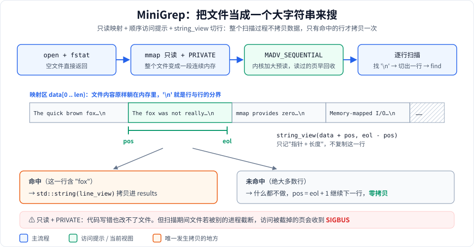

# Stage 9：综合实战 —— 用 mmap 写一个 grep 和一个 KV 存储

## 这个阶段学什么

前面 8 个阶段学的都是零散的知识点。这个阶段把它们组合起来，做两个"小而完整"的项目：

| 项目 | 用到的 mmap 知识 | 对应的真实软件 |
|---|---|---|
| **MiniGrep**：在文件里搜索子串 | 只读映射、`MAP_PRIVATE`、`madvise(MADV_SEQUENTIAL)`、零拷贝扫描 | grep、ripgrep |
| **SimpleKVStore**：能持久化的键值存储 | 读写共享映射、`ftruncate` 扩容、重新映射、`msync` 按页落盘、崩溃一致性 | LMDB、Bitcask、LevelDB 的日志 |

**为什么要学**：单独会用 `msync`、`ftruncate` 不难，难的是把它们按正确的**顺序**组合起来，让程序在扩容、崩溃、重新打开时都不出错。这一阶段就是练这件事。

**运行方式**：

```bash
cmake -S . -B build && cmake --build build
./build/mmap_learn 9
```

---

## 项目一：MiniGrep



整个实现只有一个函数 [`MiniGrep::search_file`](stage9_projects.cpp#L20)，按图中从左到右四步走：

### 1. open + fstat，空文件直接返回

用 `FileDescriptor` 打开文件、取大小。**长度为 0 的文件不能 mmap**（返回 `EINVAL`），所以先判断、直接返回空结果。

### 2. 只读 + MAP_PRIVATE 映射整个文件

```cpp
MmapRegion region = MmapBuilder()
                        .length(file_size).readOnly().priv().file(fd.get()).build();
```

映射之后，整个文件就是内存里一段连续的 `const char*`。好处有两个：

- **不用处理"一行跨两个缓冲区"**：用 `read()` 分块读时，一行可能被切在两块中间，要专门拼接；映射之后根本没有"块"的概念。
- **改不了文件**：`PROT_READ` + `MAP_PRIVATE`，即使代码有 bug 往里写，也只会收到 SIGSEGV（macOS 上可能是 SIGBUS），不会破坏原文件。

### 3. madvise(MADV_SEQUENTIAL)

[这一行](stage9_projects.cpp#L40)告诉内核"我会从头到尾读"。内核会加大预读窗口（提前把后面的页读进来），并且更积极地回收已经扫过的页，避免一次大文件搜索把别的程序的缓存挤掉。

### 4. string_view 切行，命中才拷贝

```cpp
std::string_view line_view(data + pos, eol - pos);   // 只是指针 + 长度
if (line_view.find(pattern_) != std::string_view::npos)
    results.push_back({line_no, std::string(line_view)});   // 唯一的拷贝
```

[`string_view`](stage9_projects.cpp#L58) 只记录"从哪开始、多长"，不复制数据。绝大多数行不匹配，扫描过去不产生任何拷贝。只有命中的行才拷贝成 `std::string` 放进结果。

为什么结果必须拷贝成 `std::string`，而不能直接存 `string_view`？因为函数返回时 `region` 析构、映射被 `munmap`，`string_view` 指向的内存就没了。见 [`Match::line`](stage9_projects.h#L63) 的注释。

---

## 项目二：SimpleKVStore


这张图分三部分，对应下面三节。

### ① 文件格式（VERSION 2）

文件 = 20 字节的文件头 + 一条接一条追加的记录 + 预留空间：

```
[Header 20B][record][record]...[record][ 预留区：全是 0 ... ]
 ^0         ^data_offset                ^data_end             ^容量 = 文件大小
```

文件头 [`Header`](stage9_projects.h#L124) 的五个字段：

| 字段 | 含义 | 作用 |
|---|---|---|
| `magic` | `0x4B56534D`（磁盘上是字节 `MSVK`） | 打开时校验，防止把别的文件当成 KV 文件解析 |
| `version` | 2 | 格式升级时拒绝打开旧格式 |
| `count` | 记录总数（含墓碑） | 统计用 |
| `data_offset` | 第一条记录的位置，当前恒为 20 | 留出将来扩展文件头的余地 |
| `data_end` | 最后一条记录之后的位置 | **最关键**：遍历到这里为止，下次追加也写在这里 |

每条记录是 `key_len(4B) | val_len(4B) | key | value`。三个设计要点：

- **覆盖 = 再追加一条**：`put("name", "Bob")` 不会去改原来的 `Alice`，而是在末尾再写一条。读取时从头扫到尾，**后写的胜出**（[`get`](stage9_projects.cpp#L126)）。
- **删除 = 追加墓碑**：[`remove`](stage9_projects.cpp#L140) 写一条 `val_len = 0xFFFFFFFF`（[`kTombstone`](stage9_projects.h#L120)）且没有 value 字节的记录。用一个"不可能出现的长度"当标记，所以**空字符串 `""` 是合法值**，不会被误当成删除。
- **预留区不会被误读**：文件是按倍数预分配的，尾部有一大段 0。遍历函数 [`iterate_entries`](stage9_projects.h#L263) 只扫描 `[data_offset, data_end)`，不会把这些 0 当成"key 长度为 0 的记录"。

**为什么用追加写？** 只追加不修改，意味着写入时不会破坏已有数据，崩溃恢复非常简单（见下文）。代价是旧版本和墓碑一直占着空间。真实系统（Bitcask、LevelDB）会定期做 **compaction**：把有效数据重写到新文件，丢掉旧版本和墓碑。

### ② put 的执行顺序

[`append_entry`](stage9_projects.cpp#L215) 是 `put` 和 `remove` 共用的核心，严格按六步执行：

1. **算位置**：`new_end = data_end + entry_size`。
2. **确保容量**：[`ensure_capacity`](stage9_projects.cpp#L200)，不够就扩容（见下一节）。
3. **memcpy 写记录**：直接写到映射内存里的 `data_end` 处。写映射内存就是写 page cache，此时**还没落盘**。整数用 `memcpy` 写入，避免未对齐访问。
4. **同步记录所在页**：[`sync_range(start, new_end)`](stage9_projects.cpp#L241)。`msync` 要求起始地址按页对齐，所以 [`sync_range`](stage9_projects.cpp#L193) 先把起点向下取整到页边界，只同步这几页，而不是整个文件。
5. **更新文件头**：`count++`，[`data_end = new_end`](stage9_projects.cpp#L246)。这一步是**提交点**。
6. **同步文件头所在页**：`sync_range(0, 20)`。

#### 为什么必须"先写记录，后改 data_end"？

这就是**崩溃一致性**。设想程序在不同时刻崩溃（断电）：

| 崩溃时机 | 磁盘上的状态 | 重启后 |
|---|---|---|
| 第 4 步完成前 | 记录可能只写了一半，但 `data_end` 还是旧值 | 半截记录在 `data_end` 之后，根本扫描不到 ✓ |
| 第 4 步和第 6 步之间 | 记录完整落盘，但新的 `data_end` 没落盘 | 这次 put 丢了，但文件完全一致 ✓ |
| 如果顺序反过来（先改 `data_end`） | 文件头指向一条还没写完的记录 | 把半截数据当记录解析，读出垃圾 ✗ |

这和数据库的"先写数据、再写提交记录"（write-ahead logging）是同一个思想：**让"提交"这个动作本身是原子的**。这里的 `data_end` 是文件开头一个 4 字节对齐的整数，和文件头其他字段在同一个扇区里，实际中不会出现"只写了一半"的情况。

> 注意区分两种"崩溃"：**进程崩溃**时，已经写进映射的数据在 page cache 里，由内核保管，最终仍会写回磁盘，不会丢；`msync` 防的是**断电或内核崩溃**。

### ③ 扩容：文件变大后必须重新映射

[`ensure_capacity`](stage9_projects.cpp#L200) 的逻辑：

```cpp
if (required <= capacity) return;                         // 够用：什么都不做
new_capacity = max(capacity * 2, required);               // 倍数增长
new_capacity = 向上取整到页大小;
fd_.truncate(new_capacity);                               // 先扩文件，否则写新区域会 SIGBUS
map_file();                                               // 再重新映射
```

- **为什么倍数增长？** 如果每次只扩到刚好够用，每次 put 都要 ftruncate + munmap + mmap。倍数增长后扩容次数是 O(log n)，摊到每次写入上是 O(1)。这和 `std::vector` 的扩容策略一样。
- **为什么必须先 ftruncate？** 映射长度超过文件大小时，访问文件末尾之后的页会触发 SIGBUS（阶段 2 讲过）。
- **为什么必须重新映射？** 已有映射的长度不会跟着文件变大。macOS 没有 `mremap`，只能先 munmap 再 mmap（[`map_file`](stage9_projects.cpp#L168) 里移动赋值会自动 munmap 旧映射）。**新映射的地址可能变了**，所以扩容之前拿到的任何指针都失效了。

代码里正好有一个例子：`append_entry` 在扩容**前**用 `header()->data_end` 读出一个数值（不是指针），扩容**后**再重新调用 `header()` 取文件头指针，而不是复用旧指针。

### 资源管理

[`fd_`](stage9_projects.h#L183) 是 `FileDescriptor`，[`region_`](stage9_projects.h#L184) 是 `MmapRegion`，都是 RAII。构造函数中途任何一步抛异常（比如文件头校验失败），已经打开的 fd 和映射都会自动释放。析构时 [`~SimpleKVStore`](stage9_projects.cpp#L116) 再整体 `msync` 一次兜底。

---

## 运行输出解读

```
=== Stage 9: MiniGrep Demo ===

Pattern: "fox"
Matches: 3
  Line 1: The quick brown fox jumps over the lazy dog
  Line 4: The fox was not really that quick
  Line 7: A second fox appeared near the fence
...
Pattern: "elephant"
Matches: 0 (expected 0)
```

在 8 行测试文本里找 `fox`，命中第 1、4、7 行；找不存在的 `elephant`，结果为空。整个过程只有这 3 行被拷贝出来。

```
=== Stage 9: SimpleKVStore Demo ===

[put] Inserted 4 key-value pairs
[get] name     = Alice
[get] name (after overwrite) = Bob          ← 追加了一条新记录，后写的胜出
[get] level (after remove) = (null)         ← 追加了一条墓碑
[get] note (empty value) = "" (expected "", not null)   ← 空值合法，不是删除
[keys] Active keys (4): name, language, topic, note

[reopen] Verifying persistence after close/reopen...
[get] name     = Bob (expected Bob)
[get] level    = (null) (expected null - was deleted)
[get] note     = "" (expected "" - empty value kept)
[keys] Active keys (4): name, language, topic, note
```

- 第一段在同一个对象里读写，验证覆盖、删除、空值这三种语义。
- `[reopen]` 段关闭文件、重新打开，再读一遍，结果完全一致。这证明数据真的写进了文件，而且重新打开时是靠文件头里的 `data_end` 找到记录末尾的。
- `keys` 的顺序是 key **第一次出现**的顺序。`level` 被删除，所以不在列表里。[`keys()`](stage9_projects.cpp#L144) 用 `unordered_map` 记录每个 key 的下标，整体 O(n)。

demo 写完后文件里共有 7 条记录（4 次 put + 覆盖 name + 删除 level + put note），这就是图中 `count = 7` 的来历。

---

## 实际应用

- **ripgrep**：搜单个大文件时用 mmap，思路和 MiniGrep 一样；搜大量小文件时改用 read，因为小文件的映射成本摊不薄（见 [Stage 8](../stage8/stage8_benchmark.md)）。
- **LMDB**：整个数据库就是一个 mmap 的文件，读取直接返回指向映射内存的指针，零拷贝。它用写时复制的 B+ 树 + 两个交替的 meta 页做提交点，思想和这里的 `data_end` 一致：先把数据写好，最后原子地切换"根"。
- **Bitcask（Riak 的存储引擎）**：几乎就是 SimpleKVStore 的完整版：只追加写日志 + 内存哈希索引（key → 文件偏移）+ 定期 compaction。
- **LevelDB / RocksDB**：写操作先追加到 WAL 日志，再写内存表；墓碑删除、后写覆盖先写的规则和这里一样。
- **Kafka**：消息日志只追加；每个日志段的索引文件用 mmap，靠二分查找快速定位偏移。

---

## 常见坑

1. **映射 0 字节文件**：返回 `EINVAL`。MiniGrep 和 KV 存储都先判断文件大小。
2. **扩容后还在用旧指针**：重新映射后地址可能变化，旧指针指向已经 munmap 的内存，访问会崩溃或读到别的数据。
3. **把 `string_view` 存到映射的生命周期之外**：和上一条本质相同。需要长期保存就拷贝成 `std::string`。
4. **写之前忘了 ftruncate**：访问超出文件末尾的页会收到 SIGBUS。
5. **提交顺序写反**：先改 `data_end` 再写数据，崩溃后文件会损坏。
6. **以为 munmap 就落盘了**：munmap 不保证脏页已写到磁盘，需要持久化保证时要 msync。
7. **文件被外部截断**：别的进程把文件截短后，访问被截掉的部分会 SIGBUS。生产级代码通常会加文件锁，或者捕获 SIGBUS。

---

## macOS 与 Linux 的差异

| 项目 | macOS | Linux |
|---|---|---|
| 扩大映射 | 没有 `mremap`，只能 munmap + mmap，地址可能变 | 可以用 `mremap(MREMAP_MAYMOVE)`，内核尽量原地扩大 |
| 页大小（影响 `sync_range` 的对齐） | Apple Silicon 16 KB | 通常 4 KB |
| 初始容量 4096 字节 | 小于一页；内核按 16 KB 整页映射，超出 4096 的部分能读到 0，但写进去的内容不会进入文件 | 正好一页 |
| `msync(MS_SYNC)` 的保证 | 写到磁盘控制器，不一定穿透磁盘缓存；需要更强保证时用 `fcntl(F_FULLFSYNC)` | 写回磁盘；需要元数据也落盘时再配合 `fsync` |

---

## 动手练习

1. **观察扩容**：在 [`ensure_capacity`](stage9_projects.cpp#L200) 里加一行打印（旧容量、新容量、新映射地址），写一个循环 put 1000 条记录，数一数一共扩容了几次，地址变了几次。
2. **模拟崩溃**：在 `append_entry` 的第 3 步和第 5 步之间直接调用 `_exit(1)`，然后重新打开文件，验证读不到这条半截记录、其他数据完好。再把第 5 步挪到第 3 步前面重复一次，看看会发生什么。
3. **实现 compaction**：给 `SimpleKVStore` 加一个 `compact()`：把所有有效 key 的最新值写进一个新文件，然后用 `rename` 原子替换旧文件。
   *提示：`rename` 在同一个文件系统内是原子的，这是很多存储系统切换文件的标准做法。*
4. **加内存索引**：现在 `get` 每次都从头扫描，是 O(n)。像 Bitcask 那样维护一个 `unordered_map<string, uint32_t>`（key → 记录偏移），打开文件时扫一遍建立索引，put 时更新。
5. **MiniGrep 对比 read 版本**：写一个用 `read()` 分块读的 grep，处理好跨块的行，和 MiniGrep 在一个几百 MB 的文件上比速度。结果符合 Stage 8 的结论吗？
